# Linux Basic
```sh

# Change the server hostname
sudo hostnamectl set-hostname elastic-lab

# Display system uptime and load average
uptime

# Display CPU architecture and processor information
lscpu

# Display the number of available CPU cores
nproc

# Display memory and swap usage
free -h

# Display block devices and disk partitions
lsblk


############################################
# Display configured repositories
dnf repolist

# Refresh repository metadata
sudo dnf makecache

# Search for a package
dnf search nginx

# Display package information
dnf info nginx

# Install a package
sudo dnf install -y nginx

# Display installed packages
dnf list installed

# Check whether a package is installed
rpm -q nginx

# Display files installed by a package
rpm -ql nginx

# Install a local RPM package
sudo dnf install ./elasticsearch-VERSION-x86_64.rpm

# Remove an installed package
sudo dnf remove nginx


# Refresh repository metadata
sudo apt update

# Search for a package
apt search nginx

# Display package information
apt show nginx

# Install a package
sudo apt install -y nginx

# Display installed packages
dpkg -l

# Display files installed by a package
dpkg -L nginx

# Install a local DEB package
sudo apt install ./elasticsearch-VERSION-amd64.deb

# Remove an installed package
sudo apt remove nginx


####################################################

# Display all running services
systemctl list-units --type=service --state=running

# Display installed service unit files
systemctl list-unit-files --type=service

# Display failed services
systemctl --failed

# Display service status
systemctl status nginx

# Start a service
sudo systemctl start nginx

# Stop a service
sudo systemctl stop nginx

# Restart a service
sudo systemctl restart nginx

# Reload the service configuration without a full restart
sudo systemctl reload nginx

# Enable a service at system startup
sudo systemctl enable nginx

# Disable automatic service startup
sudo systemctl disable nginx

# Enable and start a service
sudo systemctl enable --now nginx

# Disable and stop a service
sudo systemctl disable --now nginx

# Check whether a service is running
systemctl is-active nginx

# Check whether a service is enabled
systemctl is-enabled nginx

# Display the systemd unit configuration
systemctl cat nginx

# Reload systemd unit definitions after modifying unit files
sudo systemctl daemon-reload

##################################
# Test connectivity using ICMP
ping -c 4 172.16.30.240

# Display the network path to a destination
traceroute 172.16.30.240

# -w => timeout
# Test TCP connectivity to Elasticsearch
nc -vz -w 3 172.16.30.240 9200

# Test TCP connectivity to Kibana
nc -vz -w 3 172.16.30.241 5601

# Test TCP connectivity to Logstash
nc -vz -w 3 172.16.30.242 5044

# Test TCP connectivity to Fleet Server
nc -vz -w 3 172.16.30.241 8220

# Test TCP connectivity to Redis
nc -vz -w 3 172.16.30.79 6379


# Listen for incoming UDP messages on port 9000
nc -ul 9000

# Connect to the destination server using UDP
nc -u 172.16.30.242 9000


# Display all listening TCP and UDP sockets
sudo ss -lntup

# Display active TCP connections
ss -ntp

# Display established TCP connections
ss -nt state established

# Display configured DNS resolvers
cat /etc/resolv.conf

# Display static hostname mappings
cat /etc/hosts

# Resolve a domain name
nslookup example.com

# Query DNS records
dig example.com

# Display only the DNS answer
dig +short example.com

# Query a specific DNS server
dig @172.16.30.1 example.com

# Query an IPv4 address record
dig example.com A

# Query an IPv6 address record
dig example.com AAAA


# Display available packet capture interfaces
sudo tcpdump -D
 
# Capture ten packets from a specific interface
sudo tcpdump -i ens33 -nn -c 10

# Capture traffic on Elasticsearch port
sudo tcpdump -i any -nn port 9200

# Capture traffic on Fleet Server port
sudo tcpdump -i any -nn port 8220

# Capture traffic related to a specific host
sudo tcpdump -i any -nn host 172.16.30.240

# Capture DNS traffic
sudo tcpdump -i any -nn port 53

# Save captured packets to a PCAP file
sudo tcpdump -i any -w capture.pcap

# Read a PCAP file
sudo tcpdump -nn -r capture.pcap


# Capture UDP packets on port 9000
sudo tcpdump -i any -nn udp port 9000

# Capture NTP traffic
sudo tcpdump -i any -nn udp port 123

# Capture outgoing UDP traffic to a specific destination
sudo tcpdump -i any -nn udp and dst host 172.16.30.242

# Capture incoming UDP traffic from a specific source
sudo tcpdump -i any -nn udp and src host 172.16.30.243


# Simulate Syslog Traffic Using UDP
# Listen for incoming syslog messages on UDP port 514
sudo nc -ul 514


# Send a test syslog message using Netcat
echo "<14>INFO Application started" | nc -u -w 1 172.16.30.242 514

# Send an error message using Netcat
echo "<11>ERROR Database connection failed" | nc -u -w 1 172.16.30.242 514

# Send a syslog message using the logger utility
logger -n 172.16.30.242 -P 514 -d "Test syslog message"


```

## install docker
```sh
dnf install podman podman-compose


```


# ElasticSearch
```sh
# setup repository in rocky linux
# use below repository
---
https://repo.iut.ac.ir/
https://repo.iut.ac.ir/repo/repofiles/iutepel9.repo
https://repo.iut.ac.ir/repo/repofiles/iutrocky9.repo
---

# go to this website and download the elastic package
https://www.elastic.co/downloads/


dnf install lsof bash-completion vim nano tar zip unzip wget curl git net-tools traceroute htop tcpdump rsync jq tree tmux iperf3
 
# install and configure ntp server
dnf install chrony

vim /etc/chrony.conf
----
pool ntp.day.ir iburst

----
systemctl restart chronyd
timedatectl set-timezone Asia/Tehran


# you can use official repository 
vim /etc/yum.repos.d/elasticsearch.repo
----
[elasticsearch]
name=Elasticsearch repository for 9.x packages
baseurl=https://artifacts.elastic.co/packages/9.x/yum
gpgcheck=1
gpgkey=https://artifacts.elastic.co/GPG-KEY-elasticsearch
enabled=0
type=rpm-md

----

dnf repolist
dnf makecache
sudo dnf install --enablerepo=elasticsearch elasticsearch
sudo dnf install elasticsearch-<SPECIFIC.VERSION.NUMBER>


# or you can download the rpm or deb file directly
wget https://artifacts.elastic.co/downloads/elasticsearch/elasticsearch-9.5.5-x86_64.rpm
wget https://artifacts.elastic.co/downloads/elasticsearch/elasticsearch-9.5.5-x86_64.rpm.sha512
shasum -a 512 -c elasticsearch-9.5.5-x86_64.rpm.sha512
sudo rpm --install elasticsearch-9.5.5-x86_64.rpm
# output
--------------
warning: elasticsearch-9.5.5-x86_64.rpm: Header V4 RSA/SHA512 Signature, key ID d88e42b4: NOKEY
Creating elasticsearch group... OK
Creating elasticsearch user... OK
--------------------------- Security autoconfiguration information ------------------------------

Authentication and authorization are enabled.
TLS for the transport and HTTP layers is enabled and configured.

The generated password for the elastic built-in superuser is : cl-L2iyW1H4kdiI7HqxG

If this node should join an existing cluster, you can reconfigure this with
'/usr/share/elasticsearch/bin/elasticsearch-reconfigure-node --enrollment-token <token-here>'
after creating an enrollment token on your existing cluster.

You can complete the following actions at any time:

Reset the password of the elastic built-in superuser with
'/usr/share/elasticsearch/bin/elasticsearch-reset-password -u elastic'.

Generate an enrollment token for Kibana instances with
 '/usr/share/elasticsearch/bin/elasticsearch-create-enrollment-token -s kibana'.

Generate an enrollment token for Elasticsearch nodes with
'/usr/share/elasticsearch/bin/elasticsearch-create-enrollment-token -s node'.

-------------------------------------------------------------------------------------------------
### NOT starting on installation, please execute the following statements to configure elasticsearch service to start automatically using systemd
 sudo systemctl daemon-reload
 sudo systemctl enable elasticsearch.service
### You can start elasticsearch service by executing
 sudo systemctl start elasticsearch.service

-----------------


# Configure Elasticsearch as a Single Node
vim /etc/elasticsearch/elasticsearch.yml
-----

node.name: el-node1-ir

#  Add the following configuration:
discovery.type: single-node
#  Comment the following setting if it exists:
# cluster.initial_master_nodes: ["localhost"]

network.host: 192.168.85.140
http.port: 9200
# Verify the data and log paths:
path.data: /var/lib/elasticsearch
path.logs: /var/log/elasticsearch


-----
systemctl enable --now elasticsearch.service 
systemctl restart elasticsearch.service


# 
cd /usr/share/elasticsearch/bin/
ls
elasticsearch-reset-password -u elastic


# Check Elasticsearch cluster health
curl -k -u elastic https://localhost:9200/_cluster/health?pretty

curl -k -u elastic:cl-L2iyW1H4kdiI7HqxG https://localhost:9200/_cluster/health?pretty

curl  --cacert /etc/elasticsearch/certs/http_ca.crt -u elastic:cl-L2iyW1H4kdiI7HqxG https://localhost:9200/_cluster/health?pretty


# ?v --> verbose
# List all nodes in the cluster
curl -k -u elastic:cl-L2iyW1H4kdiI7HqxG https://localhost:9200/_cat/nodes?v

# List all Elasticsearch indices
curl -k -u elastic https://localhost:9200/_cat/indices?v

# List all indices, including hidden and system indices
curl -k -u elastic:cl-L2iyW1H4kdiI7HqxG "https://localhost:9200/_cat/indices?v&expand_wildcards=all"


# work with index
# Create a new index named students
curl -k -u elastic:cl-L2iyW1H4kdiI7HqxG -X PUT "https://localhost:9200/students"


# Display the students index information
curl -k -u elastic:cl-L2iyW1H4kdiI7HqxG "https://localhost:9200/_cat/indices/students?v"


# Insert a student document with ID 1
curl -k -u elastic:cl-L2iyW1H4kdiI7HqxG -X PUT "https://localhost:9200/students/_doc/1" \
-H "Content-Type: application/json" \
-d '{
  "name": "Ali",
  "age": 25,
  "course": "Elasticsearch"
}'


# Retrieve the student document by ID
curl -k -u elastic:cl-L2iyW1H4kdiI7HqxG "https://localhost:9200/students/_doc/1?pretty"


# Count documents in the students index
curl -k -u elastic:cl-L2iyW1H4kdiI7HqxG "https://localhost:9200/students/_count?pretty"


# Create a new student document with ID 2
curl -k -u elastic:cl-L2iyW1H4kdiI7HqxG -X PUT "https://localhost:9200/students/_create/2" \
-H "Content-Type: application/json" \
-d '{
  "name": "Sara",
  "age": 23,
  "course": "Linux"
}'


curl -k -u elastic:cl-L2iyW1H4kdiI7HqxG -X PUT "https://localhost:9200/students/_create/3" \
-H "Content-Type: application/json" \
-d '{
  "name": "ali",
  "age": 30,
  "course": "devops",
  "city": "shiraz"
}'

curl -k -u elastic:cl-L2iyW1H4kdiI7HqxG -X PUT "https://localhost:9200/students/_create/11" \
-H "Content-Type: application/json" \
-d '{
  "name": "mohammad",
  "age": 18,
  "course": "ccna",
  "city": "darab"
}'


# Retrieve student document with ID 2
curl -k -u elastic:cl-L2iyW1H4kdiI7HqxG "https://localhost:9200/students/_doc/2?pretty"


# Update the age of student with ID 2
curl -k -u elastic:cl-L2iyW1H4kdiI7HqxG -X POST "https://localhost:9200/students/_update/2" \
-H "Content-Type: application/json" \
-d '{
  "doc": {
    "age": 24
  }
}'


# Delete student document with ID 2
curl -k -u elastic:cl-L2iyW1H4kdiI7HqxG -X DELETE "https://localhost:9200/students/_doc/2"


# Count all documents in the students index
curl -k -u elastic:cl-L2iyW1H4kdiI7HqxG "https://localhost:9200/students/_count?pretty"


# Retrieve all documents from the students index
curl -k -u elastic:cl-L2iyW1H4kdiI7HqxG -X GET "https://localhost:9200/students/_search?pretty" \
-H "Content-Type: application/json" \
-d '{
  "query": {
    "match_all": {}
  }
}'


# Search for students named Ali
curl -k -u elastic:cl-L2iyW1H4kdiI7HqxG -X GET "https://localhost:9200/students/_search?pretty" \
-H "Content-Type: application/json" \
-d '{
  "query": {
    "match": {
      "name": "Ali"
    }
  }
}'


# Find students between 20 and 30 years old
curl -k -u elastic:cl-L2iyW1H4kdiI7HqxG -X GET "https://localhost:9200/students/_search?pretty" \
-H "Content-Type: application/json" \
-d '{
  "query": {
    "range": {
      "age": {
        "gte": 10,
        "lte": 20
      }
    }
  }
}'


```


# Setup kibana
```sh
rpm -i kibana-9.5.5-x86_64.rpm


# on elastic server create service token for kibana
curl -k -u elastic -X POST "https://172.16.30.240:9200/_security/service/elastic/kibana/credential/token/kibana-new"
# output is 
# {"created":true,"token":{"name":"kibana-new","value":"AAEAAWVsYXN0aWMva2liYW5hL2tpYmFuYS1uZXc6ZldZM3ExZnZSc09qUTBKbDVRT3dQUQ"}}[root@el-3


vim /etc/kibana/kibana.yml
----
server.port: 5601
server.host: "172.16.30.241"

# =================== System: Kibana Server (Optional) ===================
# Enables SSL and paths to the PEM-format SSL certificate and SSL key files, respectively.
# These settings enable SSL for outgoing requests from the Kibana server to the browser.
#server.ssl.enabled: false
#server.ssl.certificate: /path/to/your/server.crt
#server.ssl.key: /path/to/your/server.key

# =================== System: Elasticsearch ===================
# The URLs of the Elasticsearch instances to use for all your queries.
elasticsearch.hosts: ["https://172.16.30.240:9200"]
elasticsearch.serviceAccountToken: "AAEAAWVsYXN0aWMva2liYW5hL2tpYmFuYS1wcm9kOmktUkxSVkRCVFA2ZTdxcWJjeEhKbHc"
elasticsearch.ssl.verificationMode: none

# on elastic server copy ca certificate 
# ls -lah /etc/elasticsearch/certs/
# elasticsearch.ssl.certificateAuthorities: [ "/etc/kibana/certs/http_ca.crt" ]
# elasticsearch.ssl.verificationMode: full


map.includeElasticMapsService: false

map.tilemap.url: "https://tile.openstreetmap.org/{z}/{x}/{y}.png"

map.tilemap.options.attribution: "© OpenStreetMap contributors"
map.tilemap.options.maxZoom: 19

----

systemctl enable --now kibana.service
ss -nlpt


## setup with enrollment token
/usr/share/elasticsearch/bin/elasticsearch-create-enrollment-token -s kibana

# verification code
/usr/share/kibana/bin/kibana-verification-code

# login with elastic user, 


# Dev-Tools
# now go tho kibana and search from dev tools
# create index with mapping
PUT /students_v2
{
  "settings": {
    "number_of_shards": 3,
    "number_of_replicas": 1
  },
  "mappings": {
    "properties": {
      "name": {
        "type": "text"
      },
      "age": {
        "type": "integer"
      },
      "email": {
        "type": "keyword"
      },
      "created_at": {
        "type": "date"
      }
    }
  }
}

# show index setting
GET /students_v2/_settings?pretty

# show mapping in index
GET /students_v2/_mapping?pretty

# show both of them in one
GET /students_v2?pretty


# create index
PUT /students_v4

# show created index
GET /_cat/indices/students_v4


# insert document
PUT /students_v4/_doc/1
{
  "name": "Ali",
  "age": 25,
  "course": "Elasticsearch"
}

# retrive document
GET students_v4/_doc/1

# Count documents in the students index
GEt /students_v4/_count

# Create a new student document with ID 2
PUT /students_v4/_create/2
{
  "name": "Sara",
  "age": 23,
  "course": "Linux"
}

# Create a new student document with ID 3
PUT /students_v4/_create/3
{
  "name": "mohsen",
  "age": 50,
  "course": "sysadmin"
}

# Create a new student document with ID 11
PUT /students_v4/_create/11
{
  "name": "mohsen",
  "age": 50,
  "course": "sysadmin",
  "city": "shiraz"
}


# retrive document with id 3
GET students_v4/_doc/3


# Update the age of student with ID 2
POST /students_v4/_update/11
{
  "doc": {
    "age": 43,
    "name": "iman"
  }
}

# retrive document with id 11
GET students_v4/_doc/11


# retrive document with id 2
GET students_v4/_doc/2

# Delete student document with ID 2
DELETE /students_v4/_doc/2


# retrive document with id 2
GET students_v4/_doc/2


# Count all documents in the students index
GET students_v4/_count


# Retrieve all documents from the students index
GET /students_v4/_search
{
  "query": {
    "match_all": {}
  }
}

# Search for students named Ali
GET /students_v4/_search
{
  "query": {
    "match": {
      "name": "Ali"
    }
  }
}


# Find students between 20 and 30 years old
GET /students_v4/_search
{
  "query": {
    "range": {
      "age": {
        "gte": 20,
        "lte": 30
      }
    }
  }
}


# setup ssl/tls for kibana web interface
mkdir -p /etc/kibana/cert
cd /etc/kibana/cert
dnf install openssl
openssl req -x509 -nodes -days 365 \
  -newkey rsa:2048 \
  -keyout kibana.key \
  -out kibana.crt \
  -subj "/CN=localhost" \
  -addext "subjectAltName=DNS:localhost,IP:127.0.0.1,IP:192.168.132.2"

# openssl pkey -in kibana.key -pubout -out kibana.pub

chown -R  kibana: /etc/kibana/cert

vim /etc/kibana/kibana.yml
----
server.ssl.enabled: true
server.ssl.certificate: /etc/kibana/cert/kibana.crt
server.ssl.key: /etc/kibana/cert/kibana.key
----

systemctl restart  kibana.service


```

## example using python
```sh
# mapping
{
  "transaction_id": "TX-100012",
  "terminal_id": "98830456",
  "bank": "Tejarat",
  "city": "Tehran",
  "amount": 2500000,
  "status": "Failed",
  "response_code": "91",
  "response_time_ms": 2800,
  "@timestamp": "2026-11-21T10:30:00Z"
}


# Create a Python virtual environment
python3 -m venv .venv

# Activate the virtual environment
source .venv/bin/activate

# Install the HTTP client library
export PIP_INDEX_URL=https://package-mirror.liara.ir/repository/pypi/simple
pip install requests


# create index in elastic
PUT /pos-transactions
{
  "mappings": {
    "properties": {
      "transaction_id": { "type": "keyword" },
      "terminal_id": { "type": "keyword" },
      "bank": { "type": "keyword" },
      "city": { "type": "keyword" },
      "amount": { "type": "long" },
      "status": { "type": "keyword" },
      "response_code": { "type": "keyword" },
      "response_time_ms": { "type": "integer" },
      "@timestamp": { "type": "date" }
    }
  }
}


vim app.py
----------
import requests
import random
from datetime import datetime, timezone

# Elasticsearch server address
url = "https://192.168.132.2:9200/pos-transactions/_doc"

# Sample banks and cities
banks = ["Tejarat", "Mellat", "Melli"]
cities = ["Tehran", "Shiraz", "Mashhad"]

# Generate 100 transactions
for i in range(100):

    # Select random values
    bank = random.choice(banks)
    city = random.choice(cities)
    amount = random.randint(10000, 5000000)
    response_time = random.randint(100, 3000)

    # Generate transaction status
    status = random.choice(["Success", "Success", "Success", "Failed"])

    # Create transaction document
    transaction = {
        "transaction_id": "TX-" + str(i),
        "terminal_id": str(random.randint(10000000, 99999999)),
        "bank": bank,
        "city": city,
        "amount": amount,
        "status": status,
        "response_code": "00" if status == "Success" else "91",
        "response_time_ms": response_time,
        "@timestamp": datetime.now(timezone.utc).isoformat()
    }

    # Send transaction to Elasticsearch
    response = requests.post(
        url,
        json=transaction,
        auth=("elastic", "cl-L2iyW1H4kdiI7HqxG"),
        timeout=10,
        verify=False
)
    # Print result
    print(i, bank, city, status, response.status_code)

---------

python app.py

GET /pos-transactions/_count
GET /pos-transactions/_search
{
  "size": 10,
  "sort": [
    {
      "@timestamp": "desc"
    }
  ]
}

# failed transaction for tejarat bank
GET /pos-transactions/_search
{
  "query": {
    "bool": {
      "filter": [
        { "term": { "bank": "Tejarat" } },
        { "term": { "status": "Failed" } }
      ]
    }
  }
}


# find failed transaction in shiraz for tejarat bank
GET /pos-transactions/_search
{
  "query": {
    "bool": {
      "filter": [
        { "term": { "bank": "Tejarat" } },
        { "term": { "city": "Shiraz" } },
        { "term": { "status": "Failed" } }
      ]
    }
  }
}


# to see your data create dataview and create some dashboard
```

# Beats
## filebeats
```sh
rpm -i filebeat-9.5.5-x86_64.rpm

vim /etc/filebeat/filebeat.yml
----

output.elasticsearch:
  hosts: ["https://172.16.30.240:9200"]
  protocol: "https"

  username: "elastic"
  password: "YOUR_ELASTIC_PASSWORD"
  ssl.verification_mode: none

setup.kibana:
  host: "http://172.16.30.241:5601"
  username: "elastic"
  password: "cl-L2iyW1H4kdiI7HqxG"

----

# Validate Filebeat configuration
filebeat test config -e

# Test the connection to Elasticsearch
filebeat test output


filebeat setup -e
systemctl enable filebeat.service --now


```

### enable nginx module
```sh
filebeat modules list
filebeat modules enable nginx
filebeat modules disable system

vim /etc/filebeat/modules.d/nginx.yml
------
- module: nginx
  # Access logs
  access:
    enabled: true
# error logs
  error:
    enabled: true
-------

systemctl restart filebeat.service
```

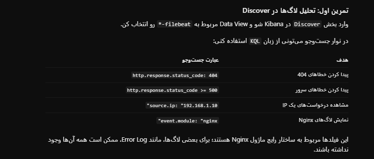

```sh

vim /etc/nginx/conf.d/app.conf
----
server {
    listen 8080;
    server_name web.test.local;

    location / {
        return 500;
    }
}
----
curl web.test.local:8080

```

### enable system module
```sh
filebeat modules enable system
vim /etc/filebeat/modules.d/system.yml
----
  # Syslog
  syslog:
    enabled: true

  # Authorization logs
  auth:
    enabled: true
----

filebeat test config -e


# Test the connection to Elasticsearch
filebeat test output

systemctl restart filebeat.service

```

### enable netflow module
```sh
filebeat modules enable netflow

vim /etc/filebeat/modules.d/netflow.yml
----
- module: netflow
  log:
    enabled: true
    var:
      netflow_host: 0.0.0.0
      netflow_port: 2055
      # internal_networks specifies which networks are considered internal or private
      # you can specify either a CIDR block or any of the special named ranges listed
      # at: https://www.elastic.co/guide/en/beats/filebeat/current/defining-processors.html#condition-network
      internal_networks:
        - private


----

firewall-cmd --add-port=2055/udp --permanent
firewall-cmd --reload

systemctl restart filebeat.service

ss -lunp | grep 2055


conf t

flow record NETFLOW-RECORD
 match ipv4 source address
 match ipv4 destination address
 match ipv4 protocol
 match transport source-port
 match transport destination-port
 match interface input
 collect counter bytes long
 collect counter packets long
 collect timestamp sys-uptime first
 collect timestamp sys-uptime last
 exit

flow exporter NETFLOW-EXPORTER
 destination 192.168.1.100
 source GigabitEthernet0/0
 transport udp 2055
 export-protocol netflow-v9
 exit

flow monitor NETFLOW-MONITOR
 record NETFLOW-RECORD
 exporter NETFLOW-EXPORTER
 cache timeout active 60
 cache timeout inactive 15
 exit

interface GigabitEthernet0/0
 ip flow monitor NETFLOW-MONITOR input
 exit

end

```


### enable cisco module for reading syslog from cisco devices
```sh
filebeat modules enable cisco

vim /etc/filebeat/modules.d/cisco.yml
---------
- module: cisco
  ios:
    enabled: true
    var.syslog_host: 172.16.30.241
    var.syslog_port: 9002
--------

firewall-cmd --add-port=9002/udp --permanent
firewall-cmd --reload
firewall-cmd --list-all


systemctl restart filebeat.service


# config syslog cisco IOS/IOS-XE
conf t
service timestamps log datetime msec show-timezone
logging host 172.16.30.241 transport udp port 9002
logging trap informational
logging origin-id hostname
exit

# create user and enable ssh
username iman privilege 15 secret iman
hostname router.iman.test
crypto key generate rsa modulus 2048
ip ssh version 2
line vty 0 2
transport input ssh
login local
do wr

# generate test log in cisco
send log 3 TEST_ERROR
send log 4 TEST_WARNING
send log 5 TEST_NOTICE
send log 6 TEST_INFORMATIONAL
send log 7 TEST_DEBUG


# filetr in kibana
event.module: "cisco" 
```

[filebeat input type](https://www.elastic.co/docs/reference/beats/filebeat/configuration-filebeat-options)
### read custom log and add property
#### example 1 - send custom data
```sh
sudo mkdir -p /var/log/myapp

echo "User logged in successfully" | sudo tee /var/log/myapp/app.log
echo "Database connection failed" | sudo tee -a /var/log/myapp/app.log

vim /etc/filebeat/filebeat.yml
------
filebeat.inputs:
- type: filestream
  id: myapp-logs
  enabled: true
  paths:
    - /var/log/myapp/app.log
  fields:
    name: lab-log
  fields_under_root: true

# or you can use this pattern
filebeat.inputs:
- type: filestream
  id: myapp-logs
  enabled: true
  paths:
    - /var/log/myapp/app.log

  processors:
  - add_fields:
      target: custom
      fields:
        environment: "lab"
        application: "myapp"
        department: "IT"
        server_role: "application"

------

# kql: custom.department :"IT" 

```


#### example 2 - send custom data(timezone--> Asia/tehran)
```sh
# log type
# 2026-11-04 10:30:00 | ERROR | payment-service | Payment failed

PUT _ingest/pipeline/myapp-pipeline
{
  "description": "My first ingest pipeline",
  "processors": [
    {
      "grok": {
        "field": "message",
        "patterns": [
          "%{TIMESTAMP_ISO8601:custom.log_time} \\| %{LOGLEVEL:log.level} \\| %{DATA:service.name} \\| %{GREEDYDATA:custom.description}"
        ]
      }
    },
    {
      "date": {
        "field": "custom.log_time",
        "formats": ["yyyy-MM-dd HH:mm:ss"],
        "target_field": "@timestamp",
        "timezone": "Asia/Tehran"
      }
    },
    {
      "set": {
        "field": "custom.environment",
        "value": "lab"
      }
    }
  ]
}


# test pipeline
POST _ingest/pipeline/myapp-pipeline/_simulate
{
  "docs": [
    {
      "_source": {
        "message": "2026-11-04 10:30:00 | ERROR | payment-service | Payment failed"
      }
    }
  ]
}


vim /etc/filebeat/filebeat.yml
------
filebeat.inputs:
  - type: filestream
    id: myapp-logs
    enabled: true
    paths:
      - /var/log/myapp/app.log
  pipeline: "myapp-pipeline"
------

echo "2026-11-04 12:40:00 | INFO | auth-service | User logged in" | sudo tee -a /var/log/myapp/app.log
echo "2026-11-04 09:41:00 | ERROR | payment-service | Payment failed" | sudo tee -a /var/log/myapp/app.log
echo "2026-11-04 11:42:00 | WARN | database-service | Connection timeout" | sudo tee -a /var/log/myapp/app.log
echo "2026-11-04 18:43:00 | DEBUG | api-service | Request received" | sudo tee -a /var/log/myapp/app.log
echo "2026-11-04 20:44:00 | INFO | order-service | Order created successfully" | sudo tee -a /var/log/myapp/app.log

vim app.sh
------
#!/bin/bash

LOG_FILE="/var/log/myapp/app.log"

mkdir -p "$(dirname "$LOG_FILE")"

while true; do
    TIMESTAMP=$(TZ=Asia/Tehran date '+%Y-%m-%d %H:%M:%S')

    case $((RANDOM % 4)) in
        0)
            LEVEL="INFO"
            SERVICE="order-service"
            MESSAGE="Order created successfully"
            ;;
        1)
            LEVEL="ERROR"
            SERVICE="payment-service"
            MESSAGE="Payment failed"
            ;;
        2)
            LEVEL="WARN"
            SERVICE="database-service"
            MESSAGE="Connection timeout"
            ;;
        3)
            LEVEL="DEBUG"
            SERVICE="api-service"
            MESSAGE="Request received"
            ;;
    esac

    echo "$TIMESTAMP | $LEVEL | $SERVICE | $MESSAGE" >> "$LOG_FILE"

    sleep $((RANDOM % 4))
done
------

```

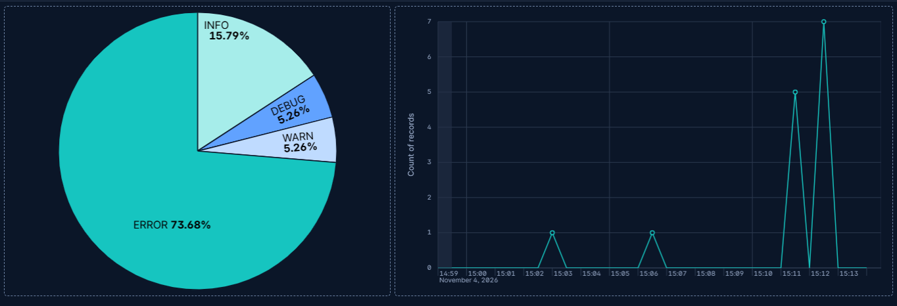


#### example 3 - send custom data(timezone --> UTC)
```sh

# /var/log/shop-api/access.log
vim app.py
------

import argparse
import random
import time
from datetime import datetime, timezone
from pathlib import Path

# Endpoint-specific response time settings
ENDPOINTS = [
    {"method": "GET", "path": "/api/products", "min_ms": 20, "max_ms": 100, "slow_chance": 0.05},
    {"method": "GET", "path": "/api/orders", "min_ms": 200, "max_ms": 700, "slow_chance": 0.30},
    {"method": "POST", "path": "/api/login", "min_ms": 100, "max_ms": 400, "slow_chance": 0.20},
    {"method": "POST", "path": "/api/orders", "min_ms": 800, "max_ms": 1800, "slow_chance": 0.50},
    {"method": "GET", "path": "/api/users", "min_ms": 30, "max_ms": 150, "slow_chance": 0.05},
    {"method": "DELETE", "path": "/api/cart", "min_ms": 100, "max_ms": 350, "slow_chance": 0.10},
    {"method": "PUT", "path": "/api/profile", "min_ms": 400, "max_ms": 900, "slow_chance": 0.25},
    {"method": "GET", "path": "/api/health", "min_ms": 5, "max_ms": 30, "slow_chance": 0.00},
]

# Fixed client IP addresses
CLIENT_IPS = [
    "10.20.30.10",
    "10.20.30.20",
    "10.20.30.30",
    "10.20.30.40",
    "10.20.30.50",
    "192.168.10.10",
    "192.168.10.20",
    "192.168.10.30",
    "172.16.30.10",
    "172.16.30.20",
]

# Relative traffic share for each IP
IP_WEIGHTS = [25, 20, 15, 12, 10, 7, 5, 3, 2, 1]

SLOW_EXTRA_MIN_MS = 500
SLOW_EXTRA_MAX_MS = 1800


def log_line(rng):
    endpoint = rng.choice(ENDPOINTS)

    method = endpoint["method"]
    path = endpoint["path"]

    roll = rng.random()
    status = (
        200 if roll < 0.61 else
        201 if roll < 0.69 else
        400 if roll < 0.77 else
        401 if roll < 0.84 else
        404 if roll < 0.91 else
        500 if roll < 0.97 else
        503
    )

    # Response time based on endpoint configuration
    duration = rng.randint(
        endpoint["min_ms"],
        endpoint["max_ms"]
    )

    # Add occasional latency spikes
    if rng.random() < endpoint["slow_chance"]:
        duration += rng.randint(
            SLOW_EXTRA_MIN_MS,
            SLOW_EXTRA_MAX_MS
        )

    level = (
        "ERROR" if status >= 500 else
        "WARN" if status >= 400 else
        "INFO"
    )

    # Choose from only 10 fixed client IPs
    client_ip = rng.choices(
        CLIENT_IPS,
        weights=IP_WEIGHTS,
        k=1
    )[0]

    timestamp = (
        datetime.now(timezone.utc)
        .isoformat(timespec="milliseconds")
        .replace("+00:00", "Z")
    )

    return (
        f"{timestamp} {level} "
        f"service=shop-api "
        f"client={client_ip} "
        f"method={method} "
        f"path={path} "
        f"status={status} "
        f"duration_ms={duration}\n"
    )


def main():
    parser = argparse.ArgumentParser(
        description="Generate synthetic shop-api logs"
    )

    parser.add_argument(
        "--file",
        default="/var/log/shop-api/access.log",
        help="Output log file"
    )
    parser.add_argument(
        "--interval",
        type=float,
        default=1.0,
        help="Seconds between events"
    )
    parser.add_argument(
        "--count",
        type=int,
        default=0,
        help="Number of events; 0 means continuous"
    )
    parser.add_argument(
        "--seed",
        type=int,
        default=None,
        help="Random seed"
    )

    args = parser.parse_args()

    if args.interval < 0 or args.count < 0:
        parser.error(
            "--interval and --count must be non-negative"
        )

    rng = random.Random(args.seed)

    path = Path(args.file)
    path.parent.mkdir(parents=True, exist_ok=True)

    n = 0

    try:
        with path.open(
            "a",
            encoding="utf-8",
            buffering=1
        ) as logfile:
            while not args.count or n < args.count:
                logfile.write(log_line(rng))
                n += 1

                if args.interval:
                    time.sleep(args.interval)

    except KeyboardInterrupt:
        pass

    print(f"Wrote {n} events to {path}")


if __name__ == "__main__":
    main()

------

# create ingest pipline
PUT _ingest/pipeline/shop-api-parser
{
  "description": "Parse Shop API logs",
  "processors": [
    {
      "grok": {
        "field": "message",
        "patterns": [
          "%{TIMESTAMP_ISO8601:temp_timestamp} %{LOGLEVEL:log.level} service=%{NOTSPACE:service.name} client=%{IP:client.ip} method=%{WORD:http.request.method} path=%{NOTSPACE:url.path} status=%{INT:http.response.status_code:int} duration_ms=%{INT:duration_ms:int}"
        ]
      }
    },
    {
      "date": {
        "field": "temp_timestamp",
        "formats": ["ISO8601"],
        "target_field": "@timestamp",
        "timezone": "UTC"
      }
    },
    {
      "remove": {
        "field": "temp_timestamp"
      }
    }
  ]
}


# test the parser
POST _ingest/pipeline/shop-api-parser/_simulate
{
  "docs": [
    {
      "_source": {
        "message": "2026-11-02T10:52:59.763Z ERROR service=shop-api client=10.20.30.84 method=PUT path=/api/profile status=500 duration_ms=520"
      }
    }
  ]
}

sudo vim /etc/filebeat/filebeat.yml
-----------
- type: filestream
  id: shop-api-lab
  enabled: true
  paths:
    - /var/log/shop-api/access.log
  pipeline: shop-api-parser
  fields:
    application: shop-api
    team: devops
    project: grok-training
  fields_under_root: true
-----------


sudo python3 app3.py   --file /var/log/shop-api/access.log   --interval 0.1   --count 10000

systemctl restart filebeat.service


TZ=Asia/Tehran date -d '2026-11-05T07:34:00.663Z' '+%Y-%m-%d %H:%M:%S.%3N %Z'

```

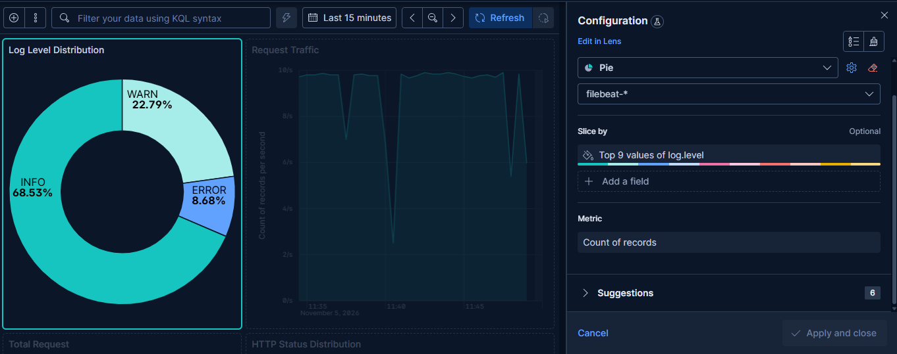
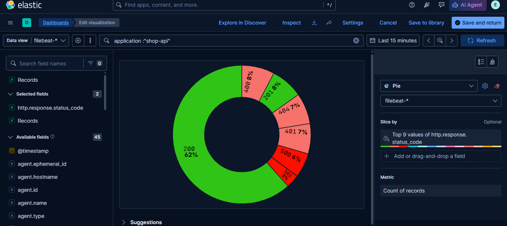

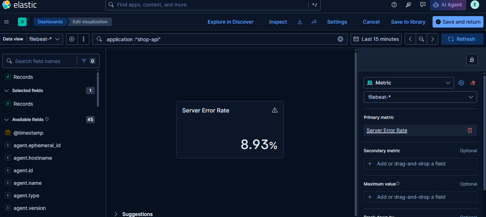


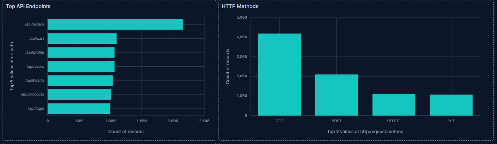


count(kql='http.response.status_code >= 500') / count()

#### example 4 - mqtt

```sh
mkdir mqtt

sudo dnf install -y mosquitto

mkdir config data logs
vim config/mosquitto.conf
-----
listener 1883
allow_anonymous true
persistence true
persistence_location /mosquitto/data/
-----

vim docker-compose.yml
-----
version: "3"
services:
  mosquitto:
    image: eclipse-mosquitto
    container_name: mosquitto
    restart: always
    ports:
      - "1883:1883"
      - "9001:9001"
    volumes:
      - ./config:/mosquitto/config
      - ./data:/mosquitto/data
      - ./log:/mosquitto/log
-----

docker compose up -d


mosquitto_sub -h localhost -t 'datacenter/#' -v


mosquitto_pub -h localhost \
  -t 'datacenter/room-a/sensor-01' \
  -m '{"temperature":28.5,"humidity":45}'


python3 -m venv venv
source venv/bin/activate

export PIP_INDEX_URL=https://package-mirror.liara.ir/repository/pypi/simple
pip install paho-mqtt


vim mqtt_sensors.py
-----

import json
import random
import time
import argparse
from datetime import datetime, timezone

import paho.mqtt.client as mqtt

SENSORS = [
    {"id": "sensor-01", "location": "room-a", "temp": 23, "humidity": 42, "power": 2100},
    {"id": "sensor-02", "location": "room-a", "temp": 29, "humidity": 46, "power": 2900},
    {"id": "sensor-03", "location": "room-b", "temp": 24, "humidity": 62, "power": 2400},
    {"id": "sensor-04", "location": "room-b", "temp": 27, "humidity": 45, "power": 4200},
    {"id": "sensor-05", "location": "room-c", "temp": 22, "humidity": 40, "power": 1800},
]


def generate_event(sensor):
    temperature = sensor["temp"] + random.uniform(-2, 2)
    humidity = sensor["humidity"] + random.uniform(-6, 6)
    power = sensor["power"] + random.uniform(-250, 250)

    # Simulate temperature spikes on sensor-02
    if sensor["id"] == "sensor-02" and random.random() < 0.30:
        temperature += random.uniform(5, 12)

    # Simulate humidity spikes on sensor-03
    if sensor["id"] == "sensor-03" and random.random() < 0.20:
        humidity += random.uniform(8, 18)

    temperature = round(temperature, 2)
    humidity = round(max(0, min(100, humidity)), 2)
    power = round(max(0, power), 2)

    if temperature >= 35 or humidity >= 75:
        status = "critical"
    elif temperature >= 30 or humidity >= 65:
        status = "warning"
    else:
        status = "normal"

    return {
        "timestamp": datetime.now(timezone.utc)
        .isoformat(timespec="milliseconds")
        .replace("+00:00", "Z"),
        "device_id": sensor["id"],
        "location": sensor["location"],
        "temperature": temperature,
        "humidity": humidity,
        "power_watt": power,
        "status": status,
    }


def main():
    parser = argparse.ArgumentParser()
    parser.add_argument("--host", default="localhost")
    parser.add_argument("--port", type=int, default=1883)
    parser.add_argument("--interval", type=float, default=2.0)
    parser.add_argument("--count", type=int, default=0)
    args = parser.parse_args()

    if args.interval < 0 or args.count < 0:
        parser.error("--interval and --count must be non-negative")

    client = mqtt.Client(mqtt.CallbackAPIVersion.VERSION2)
    client.connect(args.host, args.port, keepalive=60)
    client.loop_start()

    sent = 0

    try:
        while args.count == 0 or sent < args.count:
            for sensor in SENSORS:
                if args.count and sent >= args.count:
                    break

                event = generate_event(sensor)
                topic = f"datacenter/{sensor['location']}/{sensor['id']}"
                payload = json.dumps(event)

                result = client.publish(topic, payload, qos=1)
                result.wait_for_publish()

                if result.rc != mqtt.MQTT_ERR_SUCCESS:
                    raise RuntimeError(
                        f"MQTT publish failed: {result.rc}"
                    )

                print(f"{topic} -> {payload}")
                sent += 1

            if args.count == 0 or sent < args.count:
                time.sleep(args.interval)

    except KeyboardInterrupt:
        print("\nStopped by user")

    finally:
        client.disconnect()
        client.loop_stop()

    print(f"Published {sent} MQTT messages")


if __name__ == "__main__":
    main()


-----

python3 mqtt_sensors.py --interval 0.5 --count 1000

PUT _ingest/pipeline/mqtt-iot-pipeline
{
  "description": "Parse MQTT IoT sensor events",
  "processors": [
    {
      "json": {
        "field": "message",
        "target_field": "iot"
      }
    },
    {
      "date": {
        "field": "iot.timestamp",
        "formats": ["ISO8601"],
        "target_field": "@timestamp",
        "timezone": "UTC"
      }
    },
    {
      "set": {
        "field": "event.dataset",
        "value": "mqtt.sensors"
      }
    }
  ]
}

POST _ingest/pipeline/mqtt-iot-pipeline/_simulate
{
  "docs": [
    {
      "_source": {
        "message": "{\"timestamp\":\"2026-11-05T11:30:00.123Z\",\"device_id\":\"sensor-02\",\"location\":\"room-a\",\"temperature\":36.8,\"humidity\":44.5,\"power_watt\":3150,\"status\":\"critical\"}"
      }
    }
  ]
}


vim /etc/filebeat/filebeat.yml
-----
- type: mqtt
  enabled: true
  hosts:
    - tcp://192.168.85.190:1883
  topics:
    - datacenter/#
  qos: 1
  client_id: filebeat-iot-lab
  pipeline: mqtt-iot-pipeline

-----

sudo filebeat test config
sudo filebeat test output

sudo systemctl restart filebeat


GET filebeat-*/_search
{
  "size": 5,
  "query": {
    "term": {
      "event.dataset": "mqtt.sensors"
    }
  },
  "sort": [
    {
      "@timestamp": {
        "order": "desc"
      }
    }
  ]
}


event.dataset:"mqtt.sensors" 


```


## metricbeat
```sh
rpm -i metricbeat-9.5.5-x86_64.rpm


vim /etc/metricbeat/metricbeat.yml
----

output.elasticsearch:
  hosts: ["https://172.16.30.240:9200"]
  protocol: "https"

  username: "elastic"
  password: "YOUR_ELASTIC_PASSWORD"
  ssl.verification_mode: none

setup.kibana:
  host: "http://172.16.30.241:5601"
  username: "elastic"
  password: "cl-L2iyW1H4kdiI7HqxG"

----

metricbeat modules list
metricbeat modules enable system
vim /etc/metricbeat/modules.d/system.yml
------

-------

# Validate Filebeat configuration
metricbeat test config -e

# Test the connection to Elasticsearch
metricbeat test output

metricbeat setup -e

systemctl enable --now  metricbeat.service
```

### enable nginx module
```sh
metricbeat modules list | grep nginx

metricbeat modules enable nginx


vim /etc/nginx/nginx.conf
---
    server {
        listen       80;
        listen       [::]:80;
        server_name  _;
        root         /usr/share/nginx/html;

        # Load configuration files for the default server block.
        include /etc/nginx/default.d/*.conf;

        location /nginx_status {
                stub_status;
                allow 127.0.0.1;
                deny all;
        }
    }

---

curl http://127.0.0.1/nginx_status

vim /etc/metricbeat/modules.d/nginx.yml
---
- module: nginx
  metricsets:
    - stubstatus
  period: 10s

  # Nginx hosts
  hosts: ["http://127.0.0.1"]

  # Path to server status. Default nginx_status
  server_status_path: "nginx_status"

  #username: "user"
  #password: "secret"
---

metricbeat test modules nginx
systemctl restart metricbeat

# test 
vim app.sh
-----

#!/bin/bash

while true
do
    curl -s -o /dev/null http://127.0.0.1/
    sleep 0.01
done
----

bash app.sh

```

### enable postgresql module
[install postgresql](https://www.postgresql.org/download/linux/redhat/)
```sh
# Install the repository RPM:
sudo dnf install -y https://download.postgresql.org/pub/repos/yum/reporpms/EL-10-x86_64/pgdg-redhat-repo-latest.noarch.rpm

dnf makecache -y
# Install PostgreSQL:
sudo dnf install -y postgresql18-server

# Optionally initialize the database and enable automatic start:
sudo /usr/pgsql-18/bin/postgresql-18-setup initdb
sudo systemctl enable postgresql-18
sudo systemctl start postgresql-18

su - postgres
psql
CREATE USER metricbeat WITH PASSWORD 'YOUR_PASSWORD';
GRANT pg_monitor TO metricbeat;

create database zbx;
\l
exit
exit


metricbeat modules enable postgresql

vim /etc/metricbeat/modules.d/postgresql.yml
-----
- module: postgresql
  metricsets:
    - database
    - bgwriter
    - activity
  period: 10s
  hosts: ["postgres://127.0.0.1:5432/postgres?sslmode=disable"]
  username: metricbeat
  password: YOUR_PASSWORD
----

metricbeat test modules postgresql
systemctl restart metricbeat


# create test db
sudo -u postgres createdb shopdb
sudo -u postgres psql -d shopdb

CREATE TABLE orders (
    id SERIAL PRIMARY KEY,
    customer_id INT,
    amount NUMERIC(10,2),
    status VARCHAR(20),
    created_at TIMESTAMP DEFAULT NOW()
);


INSERT INTO orders (customer_id, amount, status)
SELECT
    (random() * 10000)::INT,
    (random() * 1000)::NUMERIC(10,2),
    CASE WHEN random() > 0.5 THEN 'paid' ELSE 'pending' END
FROM generate_series(1, 100000);

\dt

select * from orders limit 10;
exit


vim query.sh
----
#!/bin/bash

while true
do
    sudo -u postgres psql -d shopdb -c \
    "SELECT COUNT(*), AVG(amount) FROM orders;" > /dev/null

    sudo -u postgres psql -d shopdb -c \
    "UPDATE orders SET amount = amount + 1 WHERE id = (random() * 100000)::INT;" > /dev/null

    sudo -u postgres psql -d shopdb -c \
    "INSERT INTO orders (customer_id, amount, status)
     VALUES (100, random()*1000, 'paid');" > /dev/null

    sleep 0.2
done
----


sudo dnf install postgresql18-contrib
vim /var/lib/pgsql/18/data/postgresql.conf
-----
shared_preload_libraries = 'pg_stat_statements'
pg_stat_statements.track = all
----

sudo systemctl restart postgresql

sudo -u postgres psql -d postgres -c "CREATE EXTENSION IF NOT EXISTS pg_stat_statements;"

# enable statement in metricbeat
vim /etc/metricbeat/modules.d/postgresql.yml
-----
- module: postgresql
  metricsets:
    - database
    - bgwriter
    - activity
    - statement
  period: 10s
  hosts: ["postgres://127.0.0.1:5432/postgres?sslmode=disable"]
  username: metricbeat
  password: YOUR_PASSWORD
----

systemctl restart metricbeat

```
### enable docker module
```sh
sudo dnf -y install dnf-plugins-core
sudo dnf config-manager --add-repo https://download.docker.com/linux/rhel/docker-ce.repo

sudo dnf install docker-ce docker-ce-cli containerd.io docker-buildx-plugin docker-compose-plugin

sudo systemctl enable --now docker


metricbeat modules enable docker
vim /etc/metricbeat/modules.d/docker.yml
---
- module: docker
  enabled: true
  metricsets:
    - container
    - cpu
    - memory
    - network
    - diskio
    - info
    - healthcheck
  hosts: ["unix:///var/run/docker.sock"]
  period: 10s
---
docker run -d \
  --name nginx-test \
  -p 8080:80 \
  --restart no \
  nginx:alpine

metricbeat test modules docker
systemctl restart metricbeat


```


## packetbeat

```sh
rpm -i packetbeat-9.5.5-x86_64.rpm

vim /etc/packetbeat/packetbeat.yml
---
packetbeat.interfaces.device: any

output.elasticsearch:
  hosts: ["https://172.16.30.240:9200"]
  protocol: "https"

  username: "elastic"
  password: "YOUR_ELASTIC_PASSWORD"
  ssl.verification_mode: none

setup.kibana:
  host: "http://172.16.30.241:5601"
  username: "elastic"
  password: "cl-L2iyW1H4kdiI7HqxG"

---
packetbeat test config
packetbeat test output
packetbeat setup -e

systemctl enable --now packetbeat


```


## Heartbeat
```sh
rpm -i heartbeat-9.5.5-x86_64.rpm

vim /etc/heartbeat/heartbeat.yml
-----

output.elasticsearch:
  hosts: ["https://172.16.30.240:9200"]
  protocol: "https"

  username: "elastic"
  password: "cl-L2iyW1H4kdiI7HqxG"
  ssl.verification_mode: none

setup.kibana:
  host: "http://172.16.30.241:5601"
  username: "elastic"
  password: "cl-L2iyW1H4kdiI7HqxG"


heartbeat.monitors:
- type: icmp
  id: router
  name: "router"
  hosts: ["172.16.30.1"]
  schedule: '@every 5s'

- type: icmp
  id: elastic
  name: "elastic"
  hosts: ["172.16.30.240"]
  schedule: '@every 5s'

# SSH TCP Port
- type: tcp
  id: ssh-check
  name: SSH Port 22
  hosts: ["192.168.1.10:22"]
  schedule: '@every 10s'

# PostgreSQL TCP
- type: tcp
  id: postgres-check
  name: PostgreSQL 5432
  hosts: ["192.168.1.20:5432"]
  schedule: '@every 10s'

# HTTP
- type: http
  id: nginx-http
  name: Nginx HTTP
  hosts: ["http://192.168.1.10:80"]
  check.response.status: [200]
  schedule: '@every 10s'

-----

heartbeat test config
heartbeat test output
heartbeat setup -e

systemctl enable --now heartbeat-elastic.service


```


## AuditBeat
```sh
rpm -i auditbeat-9.5.5-x86_64.rpm

vim /etc/auditbeat/auditbeat.yml
--------

output.elasticsearch:
  hosts: ["https://172.16.30.240:9200"]
  protocol: "https"

  username: "elastic"
  password: "YOUR_ELASTIC_PASSWORD"
  ssl.verification_mode: none

setup.kibana:
  host: "https://172.16.30.241:5601"
  username: "elastic"
  password: "cl-L2iyW1H4kdiI7HqxG"
  ssl.verification_mode: none
--------

auditbeat test config
auditbeat test output
auditbeat setup -e

systemctl enable --now auditbeat
systemctl restart auditbeat


systemctl enable --now auditbeat
systemctl restart auditbeat


```


# Sending notification 

Kibana Alerting + Index Connector + n8n 


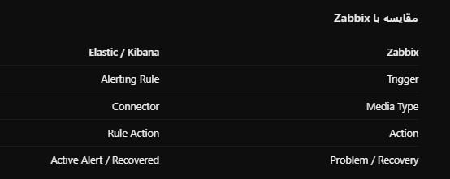
```sh
# on kibana server create encryption key
/usr/share/kibana/bin/kibana-encryption-keys generate
vim /etc/kibana/kibana.yml
----
xpack.encryptedSavedObjects.encryptionKey: "YOUR_GENERATED_KEY"
----
systemctl restart kibana

```


# logstash
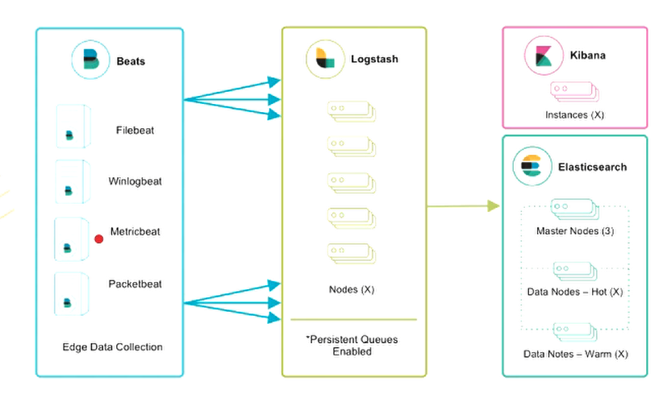
```sh
rpm -i logstash-9.5.5-x86_64.rpm


# on server which filebeat installed

vim /etc/filebeat/filebeat.yml
-----------
#output.elasticsearch:
#  hosts: ["https://localhost:9200"]

output.logstash:
  hosts: ["172.16.30.242:5044"]

--------------

# on logstash server
sudo /usr/share/logstash/bin/logstash-keystore --path.settings /etc/logstash create
sudo /usr/share/logstash/bin/logstash-keystore --path.settings /etc/logstash add ES_PWD


vim /etc/logstash/conf.d/beats.conf
----------
input {
  beats {
    port => 5044
  }
}


output {
  elasticsearch {
    hosts => ["https://172.16.30.242:9200"]
    user => "elastic"
    password => "${ES_PWD}"
    ssl_certificate_authorities => ["/etc/logstash/certs/http_ca.crt"]
    index => "logstash-test-%{+YYYY.MM.dd}"
  }
  stdout { codec => rubydebug }
}

--------------


sudo -u logstash /usr/share/logstash/bin/logstash --path.settings /etc/logstash -t

chown -R logstash: /etc/logstash/

sudo journalctl -u logstash -f


# on filebeat server
sudo systemctl enable --now logstash
sudo systemctl restart filebeat
sudo filebeat test output


# now go to dashboard and see the dashboard is empty
# solution
vim /etc/logstash/conf.d/beats.conf
---------

input {
  beats {
    port => 5044
  }
}


output {
  if [@metadata][pipeline] {
    elasticsearch {
      hosts => ["https://localhost:9200"]
      user => "elastic"
      password => "${ES_PWD}"
      ssl_certificate_authorities => ["/etc/logstash/certs/http_ca.crt"]
      index => "%{[@metadata][beat]}-%{[@metadata][version]}"
      action => "create"
      pipeline => "%{[@metadata][pipeline]}"
    }
  } else {
    elasticsearch {
      hosts => ["https://localhost:9200"]
      user => "elastic"
      password => "${ES_PWD}"
      ssl_certificate_authorities => ["/etc/logstash/certs/http_ca.crt"]
      index => "%{[@metadata][beat]}-%{[@metadata][version]}"
      action => "create"
    }
  }
}
---------


sudo -u logstash /usr/share/logstash/bin/logstash --path.settings /etc/logstash -t
sudo systemctl restart logstash


# now see the dashboards

```


## grok
https://grokdebugger.com/
```sh
#log
192.168.1.10 admin 200

#grok pattern
%{IP:client.ip} %{WORD:user.name} %{NUMBER:http.response.status_code:int}


##########################
# log
client=172.16.30.241 domain=epr.elastic.co status=NOERROR

# grok pattern
client=%{IP:client.ip} domain=%{HOSTNAME:dns.question.name} status=%{WORD:dns.response_code}

##########################

# log
2026-11-02 09:30:15 client=192.168.1.50 domain=mail.google.com type=AAAA status=NOERROR

# grok pattern
^%{TIMESTAMP_ISO8601:timestamp} client=%{IP:client.ip} domain=%{HOSTNAME:dns.question.name} type=%{WORD:dns.question.type} status=%{WORD:dns.response_code}$

############################
#log
user=admin ip=192.168.1.20 status=failed

# grok pattern
user=%{WORD:user.name} ip=%{IP:source.ip} status=%{WORD:event.outcome}


#############################
#log
client=10.10.20.5 domain=google.com type=AAAA

client=%{IP:client.ip} domain=%{HOSTNAME:dns.question.name} type=%{WORD:dns.question.type}


############################
# log
2026-11-02T10:25:30Z 192.168.1.15 GET /login 404

%{TIMESTAMP_ISO8601:timestamp} %{IP:client.ip} %{WORD:http.request.method} %{URIPATH:url.path} %{INT:http.response.status_code:int}

##########################
#log
ERROR user authentication failed for ali reza

%{LOGLEVEL:log.level} %{GREEDYDATA:message}

##########################
#log
src=172.16.1.10 dst=8.8.8.8 port=53 action=ALLOW

src=%{IP:source.ip} dst=%{IP:destination.ip} port=%{INT:destination.port:int} action=%{WORD:event.action}


##########################
# log
02-Nov-2026 10:35:22.456 client=172.16.30.241 port=53122 query=mail.google.com type=AAAA status=NOERROR

%{MONTHDAY:day}-%{MONTH:month}-%{YEAR:year} %{TIME:time} client=%{IP:client.ip} port=%{INT:client.port:int} query=%{HOSTNAME:dns.question.name} type=%{WORD:dns.question.type} status=%{WORD:dns.response_code}


##########################
#log
02-Nov-2026 07:56:09.413 queries: info: client @0x7f2904012b98 172.16.30.241#57808 (epr.elastic.co): query: epr.elastic.co IN AAAA + (172.16.30.241)

#grok

%{MONTHDAY:day}-%{MONTH:month}-%{YEAR:year} %{TIME:time} %{WORD:log.category}: %{LOGLEVEL:log.level}: client %{NOTSPACE:client.id} %{IP:client.ip}#%{INT:client.port:int} \(%{HOSTNAME:client.name}\): query: %{HOSTNAME:dns.question.name} IN %{WORD:dns.question.type} %{NOTSPACE:dns.flags} \(%{IP:server.ip}\)

##########################
#log
2026-11-02T11:15:30Z FW01 src=10.20.30.40:54321 dst=8.8.8.8:53 proto=UDP action=ALLOW

#grok
%{TIMESTAMP_ISO8601:@timestamp} %{HOSTNAME:host.name} src=%{IP:source.ip}:%{INT:source.port:int} dst=%{IP:destination.ip}:%{INT:destination.port:int} proto=%{WORD:network.transport} action=%{WORD:event.action}

##########################
#log
2026-11-02 12:45:33.125 ERROR [auth-service] user=ali.reza ip=192.168.10.15 message=Authentication failed due to invalid password

%{TIMESTAMP_ISO8601:@timestamp} %{LOGLEVEL:log.level} \[%{DATA:service.name}\] user=%{NOTSPACE:user.name} ip=%{IP:source.ip} message=%{GREEDYDATA:message}


```

## example-1  custom data
```sh
sudo mkdir -p /var/log/myapp /opt/myapp
sudo vim /opt/myapp/gen.sh
-------
#!/bin/bash
LEVELS=(INFO INFO INFO WARN ERROR)
SERVICES=(payment auth order)
USERS=(ali sara reza maryam)

while true; do
  L=${LEVELS[$RANDOM % 5]}
  S=${SERVICES[$RANDOM % 3]}
  U=${USERS[$RANDOM % 4]}
  echo "$(date '+%Y-%m-%d %H:%M:%S') $L [$S] {\"user\":\"$U\",\"amount\":$((RANDOM % 500)),\"ip\":\"10.0.0.$((RANDOM % 255))\"}" >> /var/log/myapp/app.log
  sleep 2
  
done
-------

sudo chmod +x /opt/myapp/gen.sh
sudo nohup /opt/myapp/gen.sh > /dev/null 2>&1 &
tail -f /var/log/myapp/app.log

# in filebeat
vim /etc/filebeat/filebeat.yml
------
filebeat.inputs:
- type: filestream
  id: myapp-logs
  enabled: true
  paths:
    - /var/log/myapp/app.log
  fields:
    app: myapp
------


# in logstash server

vim /etc/logstash/conf.d/beats.conf
------
input {
  beats {
    port => 5044
  }
}

filter {
  if [fields][app] == "myapp" {

    grok {
      match => { "message" => "%{TIMESTAMP_ISO8601:log_time} %{LOGLEVEL:level} \[%{WORD:service}\] %{GREEDYDATA:json_part}" }
    }

    json {
      source => "json_part"
      target => "data"
    }

    date {
      match => ["log_time", "yyyy-MM-dd HH:mm:ss"]
      timezone => "Asia/Tehran"
    }

    if [level] == "ERROR" {
      mutate { add_tag => ["alert"] }
    }

    mutate {
      remove_field => ["json_part", "log_time"]
    }
  }
}

output {
  if [fields][app] == "myapp" {
    elasticsearch {
      hosts => ["https://localhost:9200"]
      user => "elastic"
      password => "${ES_PWD}"
      ssl_certificate_authorities => ["/etc/logstash/certs/http_ca.crt"]
      index => "myapp-%{+YYYY.MM.dd}"
    }
    stdout { codec => rubydebug }
  }
  else if [@metadata][pipeline] {
    elasticsearch {
      hosts => ["https://localhost:9200"]
      user => "elastic"
      password => "${ES_PWD}"
      ssl_certificate_authorities => ["/etc/logstash/certs/http_ca.crt"]
      index => "%{[@metadata][beat]}-%{[@metadata][version]}"
      action => "create"
      pipeline => "%{[@metadata][pipeline]}"
    }
  }
  else {
    elasticsearch {
      hosts => ["https://localhost:9200"]
      user => "elastic"
      password => "${ES_PWD}"
      ssl_certificate_authorities => ["/etc/logstash/certs/http_ca.crt"]
      index => "%{[@metadata][beat]}-%{[@metadata][version]}"
      action => "create"
    }
  }
}

------

systemctl restart logstash.service

# now create dataview
# you can execute this query
level : "ERROR"
service : "payment" and data.amount > 300
tags : "alert"

```

## example-2 use multiple pipeline
```sh

mkdir /root/logstash-backup/
sudo mkdir -p /etc/logstash/pipelines.d
sudo mv /etc/logstash/conf.d/beats.conf /root/logstash-backup/
sudo cp /etc/logstash/pipelines.yml /root/logstash-backup/


vim /etc/logstash/pipelines.d/router.conf
---------
input {
  beats {
    port => 5044
  }
}

output {
  if [fields][app] == "myapp" {
    pipeline { send_to => ["myapp"] }
  } else {
    pipeline { send_to => ["modules"] }
  }
}
---------


vim /etc/logstash/pipelines.d/myapp.conf
-------
input {
  pipeline { address => "myapp" }
}

filter {
  grok {
    match => { "message" => "%{TIMESTAMP_ISO8601:log_time} %{LOGLEVEL:level} \[%{WORD:service}\] %{GREEDYDATA:json_part}" }
  }

  json {
    source => "json_part"
    target => "data"
  }

  date {
    match => ["log_time", "yyyy-MM-dd HH:mm:ss"]
    timezone => "Asia/Tehran"
  }

  if [level] == "ERROR" {
    mutate { add_tag => ["alert"] }
  }

  mutate {
    remove_field => ["json_part", "log_time"]
  }
}

output {
  elasticsearch {
    hosts => ["https://localhost:9200"]
    user => "elastic"
    password => "${ES_PWD}"
    ssl_certificate_authorities => ["/etc/logstash/certs/http_ca.crt"]
    index => "myapp-%{+YYYY.MM.dd}"
  }
}
-------


vim /etc/logstash/pipelines.d/modules.conf
-----------

input {
  pipeline { address => "modules" }
}

output {
  if [@metadata][pipeline] {
    elasticsearch {
      hosts => ["https://localhost:9200"]
      user => "elastic"
      password => "${ES_PWD}"
      ssl_certificate_authorities => ["/etc/logstash/certs/http_ca.crt"]
      index => "%{[@metadata][beat]}-%{[@metadata][version]}"
      action => "create"
      pipeline => "%{[@metadata][pipeline]}"
    }
  } else {
    elasticsearch {
      hosts => ["https://localhost:9200"]
      user => "elastic"
      password => "${ES_PWD}"
      ssl_certificate_authorities => ["/etc/logstash/certs/http_ca.crt"]
      index => "%{[@metadata][beat]}-%{[@metadata][version]}"
      action => "create"
    }
  }
}

------------


vim /etc/logstash/pipelines.yml
---------
# remove and replace with below config
- pipeline.id: router
  path.config: "/etc/logstash/pipelines.d/router.conf"

- pipeline.id: myapp
  path.config: "/etc/logstash/pipelines.d/myapp.conf"

- pipeline.id: modules
  path.config: "/etc/logstash/pipelines.d/modules.conf"


--------

chown -R logstash: /etc/logstash/


for f in router myapp modules; do
  sudo -u logstash /usr/share/logstash/bin/logstash --path.settings /etc/logstash -t -f /etc/logstash/pipelines.d/$f.conf
done


```

## example-3- index partitioning by date
```sh

sudo mkdir -p /var/log/nginx-test
cp  access.log /var/log/nginx-test/access.log
wc -l /var/log/nginx-test/access.log


vim /etc/filebeat/filebeat.yml
------
- type: filestream
  id: nginx-test
  enabled: true
  paths:
    - /var/log/nginx-test/access.log
  fields:
    app: nginx

------

# on logstash server
vim /etc/logstash/pipelines.d/router.conf
--------
output {
  if [fields][app] == "myapp" {
    pipeline { send_to => ["myapp"] }
  } else if [fields][app] == "nginx" {
    pipeline { send_to => ["nginx"] }
  } else {
    pipeline { send_to => ["modules"] }
  }
}
--------


vim /etc/logstash/pipelines.d/nginx.conf
--------

input {
  pipeline { address => "nginx" }
}

filter {
  grok {
    match => { "message" => '%{IPORHOST:client_ip} - %{NOTSPACE:remote_user} \[%{HTTPDATE:log_time}\] "%{WORD:method} %{NOTSPACE:request} HTTP/%{NUMBER:http_version}" %{NUMBER:status:int} %{NUMBER:bytes:int} "%{DATA:referrer}" "%{DATA:http_agent}"' }
  }

  date {
    match => ["log_time", "dd/MMM/yyyy:HH:mm:ss Z"]
    remove_field => ["log_time"]
  }

  if [status] >= 500 {
    mutate { add_tag => ["server_error"] }
  }
}

output {
  elasticsearch {
    hosts => ["https://localhost:9200"]
    user => "elastic"
    password => "${ES_PWD}"
    ssl_certificate_authorities => ["/etc/logstash/certs/http_ca.crt"]
    index => "nginx-%{+YYYY.MM.dd}"
  }
}

--------

vim /etc/logstash/pipelines.yml
----
- pipeline.id: router
  path.config: "/etc/logstash/pipelines.d/router.conf"

- pipeline.id: myapp
  path.config: "/etc/logstash/pipelines.d/myapp.conf"

- pipeline.id: modules
  path.config: "/etc/logstash/pipelines.d/modules.conf"

- pipeline.id: nginx
  path.config: "/etc/logstash/pipelines.d/nginx.conf"

-----
sudo -u logstash /usr/share/logstash/bin/logstash --path.settings /etc/logstash -t -f /etc/logstash/pipelines.d/nginx.conf
sudo systemctl restart logstash


# on filebeat server
sudo filebeat test config
sudo systemctl restart filebeat


curl -k -u elastic "https://localhost:9200/_cat/indices/nginx-*?v&s=index&h=index,docs.count"


# you can see the Indices
# now create dataview and go to discover 

```

## example - 4 - csv to json
```sh

sudo mkdir -p /var/lib/logstash/lab/input
sudo mkdir -p /var/lib/logstash/lab/output

sudo chown -R logstash:logstash /var/lib/logstash/lab
sudo chmod -R 750 /var/lib/logstash/lab


vim /var/lib/logstash/lab/input/employees.csv
------------
id,name,department,salary
101,Ali,Network,35000000
102,Reza,Software,45000000
103,Sara,Security,60000000
------------


vim /etc/logstash/pipelines.yml
----------
- pipeline.id: employees-csv
  path.config: "/etc/logstash/conf.d/employees.conf"
  pipeline.workers: 1

- pipeline.id: application-logs
  path.config: "/etc/logstash/conf.d/application.conf"
  pipeline.workers: 4

- pipeline.id: network-syslog
  path.config: "/etc/logstash/conf.d/syslog.conf"
  pipeline.workers: 2
-------------


vim /etc/logstash/conf.d/employees.conf
-------------
input {
  file {
    path => "/var/lib/logstash/lab/input/employees.csv"
    mode => "read"
    sincedb_path => "/dev/null"
    file_completed_action => "log"
    file_completed_log_path => "/var/lib/logstash/lab/output/completed-files.log"

  }
}

filter {
  csv {
    separator => ","
    skip_header => true
    columns => ["id", "name", "department", "salary"]
  }

  mutate {
    convert => {
      "id" => "integer"
      "salary" => "integer"
    }

    uppercase => ["department"]

    add_field => {
      "company" => "MyCompany"
    }

    remove_field => [
      "message",
      "@version",
      "host",
      "log",
      "event"
    ]
  }
}

output {
  file {
    path => "/var/lib/logstash/lab/output/employees.json"
    codec => json_lines
  }

  stdout {
    codec => rubydebug
  }
}

-------------

```
## example - 5 - read from tcp 
```sh

vim /etc/logstash/pipelines.yml
-------------
- pipeline.id: application-logs
  path.config: "/etc/logstash/conf.d/application.conf"
  pipeline.workers: 4

-------------

vim /etc/logstash/conf.d/application.conf
----------
input {
  tcp {
    port => 5000
    codec => line
  }
}

filter {
  grok {
    match => {
      "message" => "%{TIMESTAMP_ISO8601:log_time} %{LOGLEVEL:level} %{WORD:service} %{GREEDYDATA:description}"
    }
  }

  date {
    match => ["log_time", "ISO8601"]
  }
}

output {
  if "_grokparsefailure" in [tags] {
    file {
      path => "/var/lib/logstash/lab/output/invalid.log"
      codec => json_lines
    }
  } else if [level] == "ERROR" {
    file {
      path => "/var/lib/logstash/lab/output/errors.log"
      codec => json_lines
    }
  } else {
    file {
      path => "/var/lib/logstash/lab/output/application.log"
      codec => json_lines
    }
  }

  stdout {
    codec => rubydebug
  }
}
---------


echo "2026-11-20T10:30:00Z INFO PaymentService Payment successful" | nc -N 192.168.132.2 5000
echo "2026-11-20T10:31:00Z ERROR PaymentService Database unavailable" | nc -N 192.168.132.2 5000
echo "Invalid log message" | nc -N 192.168.132.2 5000


```

## example 6 - read from http and call a webhook
```sh
vim /etc/logstash/pipelines.yml
---------
- pipeline.id: employees-csv
  path.config: "/etc/logstash/conf.d/employees.conf"
  pipeline.workers: 1

- pipeline.id: application-logs
  path.config: "/etc/logstash/conf.d/application.conf"
  pipeline.workers: 4

- pipeline.id: http-n8n
  path.config: "/etc/logstash/conf.d/http-n8n.conf"
  pipeline.workers: 2

---------


vim /etc/logstash/conf.d/http-n8n.conf
----------

input {
  http {
    port => 8080
    codec => json
  }
}

filter {
  mutate {
    add_field => {
      "source" => "logstash"
    }
  }
}

output {
  if [level] == "ERROR" {
    http {
      url => "http://192.168.132.3:5678/webhook-test/log-alert"
      http_method => "post"
      format => "json"
    }
  } else {
    file {
      path => "/var/lib/logstash/lab/output/application-http.json"
      codec => json_lines
    }
  }

  stdout {
    codec => rubydebug
  }
}
----------
systemctl restart logstash

curl -X POST http://localhost:8080 \
  -H "Content-Type: application/json" \
  -d '{
    "service": "PaymentService",
    "level": "INFO",
    "message": "Payment completed"
  }'


curl -X POST http://localhost:8080 \
  -H "Content-Type: application/json" \
  -d '{
    "service": "PaymentService",
    "level": "ERROR",
    "message": "Database connection failed"
  }'


curl -X POST http://localhost:8080 \
  -H "Content-Type: application/json" \
  -d '{
    "service": "shopservice",
    "level": "ERROR",
    "message": "shop api not found"
  }'


curl -X POST http://localhost:8080 \
  -H "Content-Type: application/json" \
  -d '{
    "service": "PaymentService",
    "level": "INFO",
    "message": "Payment completed successfully"
  }'

curl -X POST http://localhost:8080 \
  -H "Content-Type: application/json" \
  -d '{
    "service": "ApiGateway",
    "level": "WARN",
    "message": "API response time exceeded 3000ms",
    "response_time": 3500
  }'

curl -X POST http://localhost:8080 \
  -H "Content-Type: application/json" \
  -d '{
    "service": "AuthService",
    "level": "ERROR",
    "message": "Invalid authentication token",
    "status_code": 401
  }'
```

## example - 7 - syslog

```sh
vim /etc/logstash/pipelines.yml
-------
- pipeline.id: employees-csv
  path.config: "/etc/logstash/conf.d/employees.conf"
  pipeline.workers: 1

- pipeline.id: application-logs
  path.config: "/etc/logstash/conf.d/application.conf"
  pipeline.workers: 4

- pipeline.id: http-n8n
  path.config: "/etc/logstash/conf.d/http-n8n.conf"
  pipeline.workers: 2


- pipeline.id: network-syslog
  path.config: "/etc/logstash/conf.d/syslog.conf"
  pipeline.workers: 2

-------


vim /etc/logstash/conf.d/syslog.conf
----------
input {
  syslog {
    port => 5514
    ecs_compatibility => "disabled"
  }
}

output {
  file {
    path => "/var/lib/logstash/lab/output/syslog-disabled.json"
    codec => json_lines
  }

  stdout {
    codec => rubydebug
  }
}
----------

firewall-cmd --add-port=5514/tcp --per
firewall-cmd --add-port=5514/udp --per

firewall-cmd --reload
setenforce 0


# config cisco router
---------
enable
configure terminal

! Enable timestamp for log messages
service timestamps log datetime msec localtime show-timezone

! Enable remote syslog
logging on

! Set Logstash server and UDP port
logging host 192.168.132.2 transport udp port 5514

! Send informational messages and higher severity
logging trap informational

configure terminal
interface GigabitEthernet0/1
 logging event link-status
end

end
write memory

---------

```


## connect beats to redis
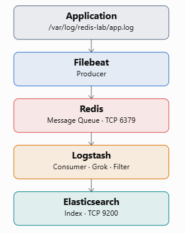

```sh
# install redis
vim docker-compose.yaml
-----
services:
  redis:
    image: hub.hamdocker.ir/redis:7.4-alpine
    container_name: redis
    ports:
      - "6379:6379"
    command: redis-server --requirepass MyRedis123
-----

docker compose up -d

docker ps
docker logs redis
ss -lntp | grep 6379

docker exec -it redis redis-cli --askpass
PING
keys *
TYPE mylogs
LLEN mylogs
LRANGE mylogs 0 4


#############################################################
# config filebeat
mkdir -p /var/log/redis-test

vim app.py
--------
import time
from datetime import datetime

counter = 1

while True:
    log = f"{datetime.now()} INFO Log number {counter}"

    with open("/var/log/redis-test/app.log", "a") as f:
        f.write(log + "\n")

    print(log)

    counter += 1
    time.sleep(1)

--------
python3 app.py


vim /etc/filebeat/filebeat.yml
-------
filebeat.inputs:
  - type: filestream
    id: redis-test
    enabled: true
    paths:
      - /var/log/redis-test/app.log

output.redis:
  hosts: ["172.16.30.79:6379"]
  password: "MyRedis123"
  key: "mylogs"
  datatype: list
------

systemctl enable --now filebeat
systemctl restart filebeat

journalctl -u filebeat -f


docker exec -it redis redis-cli --askpass
KEYS *
TYPE mylogs
LLEN mylogs
LRANGE mylogs 0 4


# on logstash server
/usr/share/logstash/bin/logstash-plugin list --verbose | grep logstash-input-redis

vim /etc/logstash/pipelines.d/redis.conf
----------
input {
  redis {
    host => "172.16.30.79"
    port => 6379
    password => "MyRedis123"
    key => "mylogs"
    data_type => "list"
    codec => json
  }
}

output {
  elasticsearch {
    hosts => ["https://172.16.30.240:9200"]
    user => "elastic"
    password => "cl-L2iyW1H4kdiI7HqxG"

    ssl_certificate_authorities => [
      "/etc/logstash/certs/http_ca.crt"
    ]

    index => "redis-test"
    ilm_enabled => false
    data_stream => false
  }

  stdout {
    codec => rubydebug
  }
}
----------

vim /etc/logstash/pipelines.yml
-------
- pipeline.id: redis-test
  path.config: "/etc/logstash/pipelines.d/redis.conf"
-------

sudo -u logstash /usr/share/logstash/bin/logstash \
  --path.settings /etc/logstash -t

systemctl restart logstash


```
GET redis-test/_count

GET redis-test/_search
{
  "size": 10,
  "sort": [
    {
      "@timestamp": "desc"
    }
  ]
}


## example sneding custom data to elastic directly using python
```sh


```


# 


# KQL

```sh
agent.type: "heartbeat"
agent.type: "heartbeat" AND monitor.status: "up" 

```


# n8n integration

```sh
docker volume create n8n_data
docker pull  hub.hamdocker.ir/n8nio/n8n:2.32.5
docker run -d \
 --name n8n \
 -p 5678:5678 \
 -e GENERIC_TIMEZONE="Asia/Tehran" \
 -e TZ="Asia/Tehran" \
 -e N8N_ENFORCE_SETTINGS_FILE_PERMISSIONS=true \
 -e N8N_SECURE_COOKIE=false \
 -v n8n_data:/home/node/.n8n \
 hub.hamdocker.ir/n8nio/n8n:2.32.5

```

# Examples
## Example - 1 - Read Bind9 log and sending logs to elastic without extracting date
```sh

sudo dnf install -y bind bind-utils
sudo systemctl enable --now named

vim /etc/named.conf
-----
        listen-on port 53 { 172.16.30.241; };
        allow-query     { 172.16.30.0/24; };
        recursion yes;
-----

sudo named-checkconf
echo $?
systemctl restart named

dig @172.16.30.241 yahoo.com

# enable dns query log
sudo mkdir -p /var/log/named
sudo chown named:named /var/log/named
sudo chmod 750 /var/log/named

```
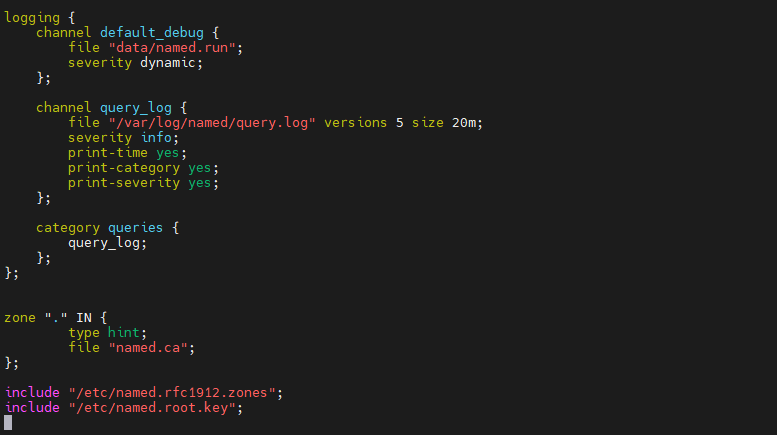

```sh
vim /etc/named.conf
----------
logging {
    channel default_debug {
        file "data/named.run";
        severity dynamic;
    };

    channel query_log {
        file "/var/log/named/query.log" versions 5 size 20m;
        severity info;
        print-time yes;
        print-category yes;
        print-severity yes;
    };

    category queries {
        query_log;
    };
};
----------

sudo named-checkconf
echo $?

sudo systemctl restart named
sudo rndc querylog on


dig @172.16.30.241 yahoo.com
dig @172.16.30.241 mx yahoo.com
dig @172.16.30.241 aaa yahoo.com
dig @172.16.30.241 aaaa yahoo.com
dig @172.16.30.241 txt yahoo.com


tail -f /var/log/named/query.log


vim /etc/filebeat/filebeat.yml
----
filebeat.inputs:
# Each - is an input. Most options can be set at the input level, so
# you can use different inputs for various configurations.
# Below are the input-specific configurations.

# filestream is an input for collecting log messages from files.
- type: filestream

  # Unique ID among all inputs, an ID is required.
  id: my-filestream-id

  # Change to true to enable this input configuration.
  enabled: false

  # Paths that should be crawled and fetched. Glob based paths.
  paths:
    - /var/log/*.log
    #- c:\programdata\elasticsearch\logs\*

# DNS Query Logs
- type: filestream
  id: bind-dns-logs
  enabled: true
  paths:
    - /var/log/named/query.log
  fields:
    log_type: dns
    server_role: dns
  fields_under_root: true

----

sudo filebeat test config -e

systemctl restart filebeat.service

# filter in kibana discover
log_type: dns

```
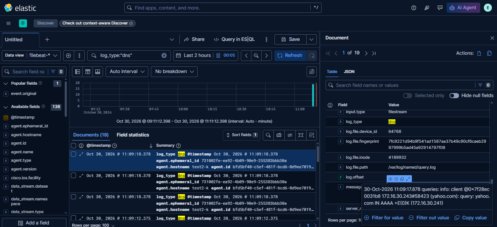


```sh

# create pipeline
PUT _ingest/pipeline/dns-query-parser
{
  "description": "Parse BIND DNS query logs",
  "processors": [
    {
      "grok": {
        "field": "message",
        "patterns": [
          "%{MONTHDAY:tmp.day}-%{MONTH:tmp.month}-%{YEAR:tmp.year} %{TIME:tmp.time} queries: %{LOGLEVEL:log.level}: client %{NOTSPACE:tmp.client_id} %{IP:client.ip}#%{NUMBER:client.port:long} \\(%{DATA:tmp.domain}\\): query: %{DATA:dns.question.name} IN %{WORD:dns.question.type} %{GREEDYDATA:dns.flags} \\(%{IP:dns.server.ip}\\)"
        ]
      }
    },
    {
      "set": {
        "field": "event.category",
        "value": ["network"]
      }
    },
    {
      "remove": {
        "field": "tmp",
        "ignore_missing": true
      }
    }
  ]
}


## simulate the pipeline

POST _ingest/pipeline/dns-query-parser/_simulate
{
  "docs": [
    {
      "_source": {
        "message": "30-Oct-2026 11:16:45.091 queries: info: client @0x7f28fc0036a8 172.16.30.242#33687 (digikala.com): query: digikala.com IN A +E(0)K (172.16.30.241)"
      }
    }
  ]
}


# now edit filebeat.yaml
vim /etc/filebeat/filebeat.yml
---------
- type: filestream
  id: bind-dns-logs
  enabled: true
  paths:
    - /var/log/named/query.log
  fields:
    log_type: dns
    server_role: dns
  fields_under_root: true
  # add this
  pipeline: dns-query-parser
----------
systemctl restart filebeat.service

for i in {1..100}; do dig @172.16.30.241 faradars.org +short > /dev/null; done


```

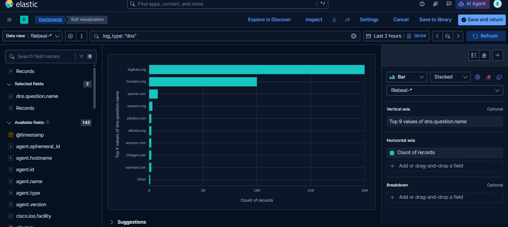

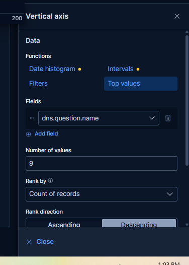

```sh

# script for sending dns query 
vim app.sh
------
#!/bin/bash

DNS_SERVER="172.16.30.241"

DOMAINS=(
  google.com
  youtube.com
  github.com
  microsoft.com
  cloudflare.com
  amazon.com
  openai.com
  wikipedia.org
  facebook.com
  example.com
)

TYPES=(A AAAA MX TXT NS CNAME)

for i in {1..500}; do
    DOMAIN=${DOMAINS[$RANDOM % ${#DOMAINS[@]}]}
    TYPE=${TYPES[$RANDOM % ${#TYPES[@]}]}

    dig @"$DNS_SERVER" "$DOMAIN" "$TYPE" \
        +time=1 +tries=1 > /dev/null

    sleep 0.1
done

echo "500 DNS queries generated!"
------

bash app.sh

```


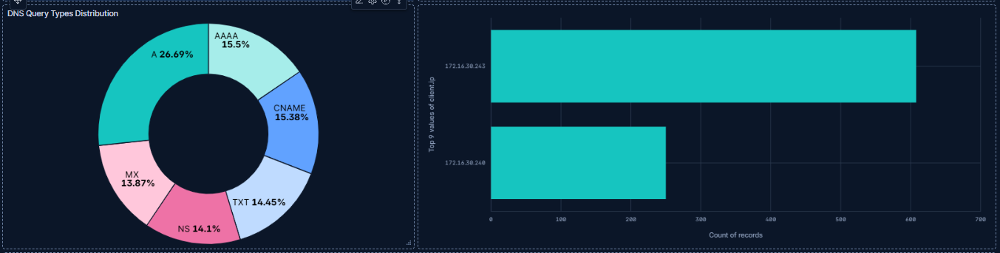


# Examples
## Example - 1.1 - Read Bind9 log and sending logs to elastic with extracting date
```sh

sudo dnf install -y bind bind-utils
sudo systemctl enable --now named

vim /etc/named.conf
-----
        listen-on port 53 { 172.16.30.241; };
        allow-query     { 172.16.30.0/24; };
        recursion yes;
-----

sudo named-checkconf
echo $?
systemctl restart named

dig @172.16.30.241 yahoo.com

# enable dns query log
sudo mkdir -p /var/log/named
sudo chown named:named /var/log/named
sudo chmod 750 /var/log/named

```


```sh
vim /etc/named.conf
----------
logging {
    channel default_debug {
        file "data/named.run";
        severity dynamic;
    };

    channel query_log {
        file "/var/log/named/query.log" versions 5 size 20m;
        severity info;
        print-time yes;
        print-category yes;
        print-severity yes;
    };

    category queries {
        query_log;
    };
};
----------

sudo named-checkconf
echo $?

sudo systemctl restart named
sudo rndc querylog on


dig @172.16.30.241 yahoo.com
dig @172.16.30.241 mx yahoo.com
dig @172.16.30.241 aaa yahoo.com
dig @172.16.30.241 aaaa yahoo.com
dig @172.16.30.241 txt yahoo.com


tail -f /var/log/named/query.log


vim /etc/filebeat/filebeat.yml
----
filebeat.inputs:
# Each - is an input. Most options can be set at the input level, so
# you can use different inputs for various configurations.
# Below are the input-specific configurations.

# filestream is an input for collecting log messages from files.
- type: filestream

  # Unique ID among all inputs, an ID is required.
  id: my-filestream-id

  # Change to true to enable this input configuration.
  enabled: false

  # Paths that should be crawled and fetched. Glob based paths.
  paths:
    - /var/log/*.log
    #- c:\programdata\elasticsearch\logs\*

# DNS Query Logs
- type: filestream
  id: bind-dns-logs
  enabled: true
  paths:
    - /var/log/named/query.log
  fields:
    log_type: dns
    server_role: dns
  fields_under_root: true

----

sudo filebeat test config -e

systemctl restart filebeat.service

# filter in kibana discover
log_type: dns

```


```sh
# create pipeline

PUT _ingest/pipeline/dns-query-parser-1-1
{
  "description": "Parse BIND DNS query logs",
  "processors": [
    {
      "grok": {
        "field": "message",
        "patterns": [
          "%{MONTHDAY:tmp.day}-%{MONTH:tmp.month}-%{YEAR:tmp.year} %{TIME:tmp.time} queries: %{LOGLEVEL:log.level}: client %{NOTSPACE:tmp.client_id} %{IP:client.ip}#%{NUMBER:client.port:long} \\(%{DATA:tmp.domain}\\): query: %{DATA:dns.question.name} IN %{WORD:dns.question.type} %{GREEDYDATA:dns.flags} \\(%{IP:dns.server.ip}\\)"
        ]
      }
    },
{
      "set": {
        "field": "tmp.timestamp",
        "value": "{{tmp.day}}-{{tmp.month}}-{{tmp.year}} {{tmp.time}}"
      }
    },
    {
      "date": {
        "field": "tmp.timestamp",
        "formats": ["dd-MMM-yyyy HH:mm:ss.SSS"],
        "target_field": "@timestamp",
        "timezone": "Asia/Tehran"
      }
    },
    {
      "set": {
        "field": "event.category",
        "value": ["network"]
      }
    },
    {
      "remove": {
        "field": "tmp",
        "ignore_missing": true
      }
    }
  ]
}


## simulate the pipeline

POST _ingest/pipeline/dns-query-parser-1-1/_simulate
{
  "docs": [
    {
      "_source": {
        "message": "30-Oct-2026 11:16:45.091 queries: info: client @0x7f28fc0036a8 172.16.30.242#33687 (digikala.com): query: digikala.com IN A +E(0)K (172.16.30.241)"
      }
    }
  ]
}


# now edit filebeat.yaml
vim /etc/filebeat/filebeat.yml
---------
- type: filestream
  id: bind-dns-logs
  enabled: true
  paths:
    - /var/log/named/query.log
  fields:
    log_type: dns
    server_role: dns
  fields_under_root: true
  # add this
  pipeline: dns-query-parser-1-1
----------
systemctl restart filebeat.service

for i in {1..100}; do dig @172.16.30.241 faradars.org +short > /dev/null; done


```


```sh

# script for sending dns query 
vim app.sh
------
#!/bin/bash

DNS_SERVER="172.16.30.241"

DOMAINS=(
  google.com
  youtube.com
  github.com
  microsoft.com
  cloudflare.com
  amazon.com
  openai.com
  wikipedia.org
  facebook.com
  example.com
)

TYPES=(A AAAA MX TXT NS CNAME)

for i in {1..500}; do
    DOMAIN=${DOMAINS[$RANDOM % ${#DOMAINS[@]}]}
    TYPE=${TYPES[$RANDOM % ${#TYPES[@]}]}

    dig @"$DNS_SERVER" "$DOMAIN" "$TYPE" \
        +time=1 +tries=1 > /dev/null

    sleep 0.1
done

echo "500 DNS queries generated!"
------

bash app.sh

```


## Example - 2 - Application Performance & API Monitoring
```sh

PUT api-monitoring
{
  "mappings": {
    "properties": {
      "@timestamp": {
        "type": "date"
      },
      "service": {
        "properties": {
          "name": {
            "type": "keyword"
          }
        }
      },
      "host": {
        "properties": {
          "name": {
            "type": "keyword"
          }
        }
      },
      "http": {
        "properties": {
          "request": {
            "properties": {
              "method": {
                "type": "keyword"
              }
            }
          },
          "response": {
            "properties": {
              "status_code": {
                "type": "integer"
              }
            }
          }
        }
      },
      "url": {
        "properties": {
          "path": {
            "type": "keyword"
          }
        }
      },
      "response_time_ms": {
        "type": "float"
      },
      "client": {
        "properties": {
          "ip": {
            "type": "ip"
          }
        }
      },
      "event": {
        "properties": {
          "outcome": {
            "type": "keyword"
          }
        }
      }
    }
  }
}


```

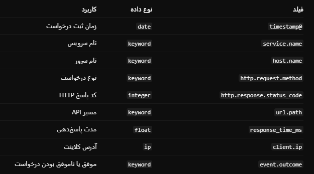
```sh
# python script
python3 -m venv venv
source venv/bin/activate
pip install elasticsearch==9.5.1

vim app.py

----

import os
import time
import random
from datetime import datetime, timezone
from getpass import getpass
from elasticsearch import Elasticsearch
from elasticsearch.helpers import bulk

HOSTS = [
    "https://172.16.30.240:9200",
    "https://172.16.30.242:9200",
    "https://172.16.30.243:9200",
]

CA_CERT = "/etc/elasticsearch/certs/http_ca.crt"

password = os.getenv("ES_PASSWORD") or getpass("ES password: ")

es = Elasticsearch(
    HOSTS,
    basic_auth=("elastic", password),
    ca_certs=CA_CERT,
    request_timeout=20,
    retry_on_timeout=True,
    max_retries=3
)

services = {
    "payment-service": ("/api/payment", "POST"),
    "auth-service": ("/api/login", "POST"),
    "order-service": ("/api/orders", "POST"),
    "product-service": ("/api/products", "GET"),
    "notification-service": ("/api/notify", "POST"),
}

names = list(services)
counter = 0

print("Generating API monitoring events... Ctrl+C to stop.")

try:
    while True:
        documents = []
        incident = (counter // 20) % 5 == 4

        for _ in range(20):
            service = random.choice(names)
            path, method = services[service]

            # Simulate payment-service incidents
            affected = incident and service == "payment-service"
            error_rate = 0.65 if affected else 0.03
            failed = random.random() < error_rate

            status = (
                random.choice([500, 503])
                if failed else 200
            )

            latency = (
                random.uniform(1500, 4500)
                if affected
                else random.uniform(30, 350)
            )

            event = {
                "@timestamp": datetime.now(timezone.utc).isoformat(),
                "service": {"name": service},
                "host": {
                    "name": f"app-server-{random.randint(1, 5):02d}"
                },
                "http": {
                    "request": {"method": method},
                    "response": {"status_code": status}
                },
                "url": {"path": path},
                "response_time_ms": round(latency, 2),
                "client": {
                    "ip": f"192.168.10.{random.randint(10, 200)}"
                },
                "event": {
                    "outcome": "failure" if failed else "success"
                }
            }

            documents.append({
                "_index": "api-monitoring",
                "_source": event
            })

        success, _ = bulk(es, documents)
        counter += 1

        print(
            f"Batch {counter} | Sent: {success} | "
            f"Payment incident: {incident}"
        )

        time.sleep(1)

except KeyboardInterrupt:
    print("\nStopped.")

----
python app.py

GET api-monitoring/_count

# create dashboard


```


## Example 3 - 


## Example - 4 - Global Security Event Monitoring & Alerting
```sh
# create index in elastic
PUT geo-security-events
{
  "mappings": {
    "properties": {
      "@timestamp": { "type": "date" },
      "geo": {
        "properties": {
          "location": { "type": "geo_point" }
        }
      },
      "country": { "type": "keyword" },
      "city": { "type": "keyword" },
      "attack_type": { "type": "keyword" },
      "severity": { "type": "keyword" }
    }
  }
}


vim geo-generator.py
----

import json
import random
import time
import ssl
import urllib.request
from getpass import getpass
from datetime import datetime, timezone
from base64 import b64encode

ES_URL = "https://172.16.30.240:9200"
CA_CERT = "/etc/elasticsearch/certs/http_ca.crt"
PASSWORD = getpass("Elasticsearch password: ")

places = [
    ("Iran", "Tehran", 35.69, 51.39),
    ("Germany", "Berlin", 52.52, 13.40),
    ("USA", "New York", 40.71, -74.00),
    ("Japan", "Tokyo", 35.67, 139.65),
    ("France", "Paris", 48.85, 2.35),
    ("UAE", "Dubai", 25.20, 55.27),
    ("UK", "London", 51.50, -0.12),
    ("India", "Mumbai", 19.07, 72.87)
]

attacks = ["Brute Force", "DDoS", "Port Scan", "Malware"]
severities = ["low", "medium", "high", "critical"]

auth = b64encode(f"elastic:{PASSWORD}".encode()).decode()
context = ssl.create_default_context(cafile=CA_CERT)

for i in range(500):
    country, city, lat, lon = random.choice(places)

    event = {
        "@timestamp": datetime.now(timezone.utc).isoformat(),
        "country": country,
        "city": city,
        "geo": {"location": {"lat": lat, "lon": lon}},
        "attack_type": random.choice(attacks),
        "severity": random.choice(severities)
    }

    request = urllib.request.Request(
        ES_URL + "/geo-security-events/_doc",
        data=json.dumps(event).encode(),
        headers={
            "Authorization": "Basic " + auth,
            "Content-Type": "application/json"
        },
        method="POST"
    )

    with urllib.request.urlopen(request, context=context) as response:
        response.read()

    print(i + 1, country, city, event["severity"])
    time.sleep(0.2)


----


```

# Clustering
## add node to cluster
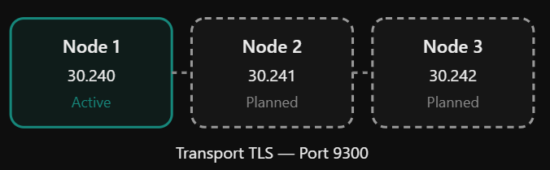
### node 1 - 30.240
```sh
setenforce 0

vim /etc/elasticsearch/elasticsearch.yml
-----
# comment below line
# discovery.type: single-node

cluster.name: my-elastic-cluster

# add below line
transport.host: 172.16.30.240
discovery.seed_hosts: ["172.16.30.240:9300", "172.16.30.242:9300", "172.16.30.243:9300"]

-----

sudo chown root:elasticsearch /etc/elasticsearch/service_tokens
sudo chmod 640 /etc/elasticsearch/service_tokens
sudo systemctl restart elasticsearch

curl --cacert /etc/elasticsearch/certs/http_ca.crt -u elastic https://172.16.30.240:9200/_cat/nodes?v
# you have to see only one node

# generate enrollment token 
sudo /usr/share/elasticsearch/bin/elasticsearch-create-enrollment-token -s node

# this is the outpub
eyJ2ZXIiOiI4LjE0LjAiLCJhZHIiOlsiMTcyLjE2LjMwLjI0MDo5MjAwIl0sImZnciI6IjZiOTc1ZTMyMjg0NWYzNzFhZmE0Zjk5ZWQ3ZDBjNTFhYjIxMGUzNmY0ZjE1YjIyMWMyYmE2NDk1ZGE5NjQ0M2EiLCJrZXkiOiJfYVlMaWFFQjZrd01zMjVheUNpZzo0NnpWQzlMX0IxLUY1bHcwUzhEa193In0=


```

### node 2 - 30.242

```sh

setenforce 0
# disable or config firewalld

sudo /usr/share/elasticsearch/bin/elasticsearch-reconfigure-node --enrollment-token "eyJ2ZXIiOiI4LjE0LjAiLCJhZHIiOlsiMTcyLjE2LjMwLjI0MDo5MjAwIl0sImZnciI6IjZiOTc1ZTMyMjg0NWYzNzFhZmE0Zjk5ZWQ3ZDBjNTFhYjIxMGUzNmY0ZjE1YjIyMWMyYmE2NDk1ZGE5NjQ0M2EiLCJrZXkiOiJfYVlMaWFFQjZrd01zMjVheUNpZzo0NnpWQzlMX0IxLUY1bHcwUzhEa193In0"

vim /etc/elasticsearch/elasticsearch.yml
----

cluster.name: my-elastic-cluster
node.name: el-30.242
network.host: 172.16.30.242
discovery.seed_hosts: ["172.16.30.240:9300", "172.16.30.242:9300", "172.16.30.243:9300"]
---

systemctl enable --now elasticsearch.service


# on node one run call below api to see how many node you have in your cluster
curl --cacert /etc/elasticsearch/certs/http_ca.crt -u elastic https://172.16.30.240:9200/_cat/nodes?v


```
### node 3 - 30.243

```sh

setenforce 0
# disable or config firewalld


sudo /usr/share/elasticsearch/bin/elasticsearch-reconfigure-node --enrollment-token "eyJ2ZXIiOiI4LjE0LjAiLCJhZHIiOlsiMTcyLjE2LjMwLjI0MDo5MjAwIl0sImZnciI6IjZiOTc1ZTMyMjg0NWYzNzFhZmE0Zjk5ZWQ3ZDBjNTFhYjIxMGUzNmY0ZjE1YjIyMWMyYmE2NDk1ZGE5NjQ0M2EiLCJrZXkiOiI5R2d1aWFFQmNUa1FkY0dFX2Y1Zjpwd01vZnZzVDI4UnM1OEZiSkM0Qll3In0="

vim /etc/elasticsearch/elasticsearch.yml
----

cluster.name: my-elastic-cluster
node.name: el-30.243
network.host: 172.16.30.243
discovery.seed_hosts: ["172.16.30.240:9300", "172.16.30.242:9300", "172.16.30.243:9300"]
---

systemctl enable --now elasticsearch.service


# on node one run call below api to see how many node you have in your cluster
curl --cacert /etc/elasticsearch/certs/http_ca.crt -u elastic https://172.16.30.240:9200/_cat/nodes?v


```

# Node Roles
```sh
vim /etc/elasticsearch/elasticsearch.yml
----
node.roles: [master]
node.roles: [data]
node.roles: [master, data, data_hot, data_warm]

----

```


## monitor nodes
#### node1
```sh

curl --cacert /etc/elasticsearch/certs/http_ca.crt -u elastic 'https://172.16.30.240:9200/_cluster/health?pretty'

# see master node
curl --cacert /etc/elasticsearch/certs/http_ca.crt -u elastic 'https://172.16.30.240:9200/_cat/master?v'


# see data nodes
curl --cacert /etc/elasticsearch/certs/http_ca.crt -u elastic 'https://172.16.30.240:9200/_cat/nodes?v&h=ip,name,node.role,master&s=name'


# only data nodes
curl --cacert /etc/elasticsearch/certs/http_ca.crt -u elastic 'https://172.16.30.240:9200/_nodes/data:true?filter_path=nodes.*.name,nodes.*.roles&pretty'

# only master eligibles
curl --cacert /etc/elasticsearch/certs/http_ca.crt -u elastic 'https://172.16.30.240:9200/_nodes/master:true?filter_path=nodes.*.name,nodes.*.roles&pretty'


sudo metricbeat modules list
metricbeat modules enable elasticsearch


## monitor elastic node with metricbeat using elastic module
vim /etc/metricbeat/modules.d/elasticsearch.yml
------
- module: elasticsearch
  xpack.enabled: true
  period: 10s
  scope: node
  hosts: ["https://172.16.30.240:9200"]
  username: "elastic"
  password: "cl-L2iyW1H4kdiI7HqxG"
  ssl.certificate_authorities:
    - "/etc/elasticsearch/certs/http_ca.crt"
  ssl.verification_mode: certificate

------

metricbeat test modules elasticsearch
systemctl restart metricbeat

```
#### node2

```sh
rpm -i metricbeat-9.5.5-x86_64.rpm
metricbeat modules enable elasticsearch

vim /etc/metricbeat/metricbeat.yml
------
setup.kibana:
  host: "http://172.16.30.241:5601"
  username: "elastic"
  password: "cl-L2iyW1H4kdiI7HqxG"


output.elasticsearch:

  hosts: ["172.16.30.240:9200","172.16.30.242:9200", "172.16.30.243:9200"]

  preset: balanced

  protocol: "https"

  username: "elastic"
  password: "cl-L2iyW1H4kdiI7HqxG"
  ssl.verification_mode: none
--------


## monitor elastic node with metricbeat using elastic module
vim /etc/metricbeat/modules.d/elasticsearch.yml
------
- module: elasticsearch
  xpack.enabled: true
  period: 10s
  scope: node
  hosts: ["https://172.16.30.242:9200"] # specify metric collect from which node
  username: "elastic"
  password: "cl-L2iyW1H4kdiI7HqxG"
  ssl.certificate_authorities:
    - "/etc/elasticsearch/certs/http_ca.crt"
  ssl.verification_mode: certificate

------
metricbeat test modules elasticsearch
systemctl restart metricbeat


```

#### node3

```sh
rpm -i metricbeat-9.5.5-x86_64.rpm
metricbeat modules enable elasticsearch


vim /etc/metricbeat/metricbeat.yml
------
setup.kibana:
  host: "http://172.16.30.241:5601"
  username: "elastic"
  password: "cl-L2iyW1H4kdiI7HqxG"


output.elasticsearch:

  hosts: ["172.16.30.240:9200","172.16.30.242:9200", "172.16.30.243:9200"]

  preset: balanced

  protocol: "https"

  username: "elastic"
  password: "cl-L2iyW1H4kdiI7HqxG"
  ssl.verification_mode: none
--------


## monitor elastic node with metricbeat using elastic module
vim /etc/metricbeat/modules.d/elasticsearch.yml
------
- module: elasticsearch
  xpack.enabled: true
  period: 10s
  scope: node
  hosts: ["https://172.16.30.243:9200"] # specify metric collect from which node
  username: "elastic"
  password: "cl-L2iyW1H4kdiI7HqxG"
  ssl.certificate_authorities:
    - "/etc/elasticsearch/certs/http_ca.crt"
  ssl.verification_mode: certificate

------
metricbeat test modules elasticsearch
systemctl restart metricbeat

```

## reconfigure kibana
```sh


vim /etc/kibana/kibana.yml
------
elasticsearch.hosts: ["https://172.16.30.240:9200", "https://172.16.30.242:9200", "https://172.16.30.243:9200"]
------


```


# Index Template and data stream


### example 0
**Goal:** All indexes whose names start with `students-` should have the same settings and mappings.

```sh


PUT _index_template/students-template
{
  "index_patterns": ["students-*"],
  "priority": 100,
  "template": {
    "settings": {
      "number_of_shards": 1,
      "number_of_replicas": 1
    },
    "mappings": {
      "properties": {
        "name": {
          "type": "keyword"
        },
        "age": {
          "type": "integer"
        },
        "course": {
          "type": "keyword"
        },
        "created_at": {
          "type": "date"
        }
      }
    }
  }
}


GET _index_template/students-template

# create index

PUT students-2026


GET students-2026/_settings

GET students-2026/_mapping


POST students-2026/_doc/1
{
  "name": "Ali",
  "age": 25,
  "course": "Linux",
  "created_at": "2026-11-12T10:00:00Z"
}

POST students-2026/_doc/2
{
  "name": "Sara",
  "age": 30,
  "course": "Elasticsearch",
  "created_at": "2026-11-12T11:00:00Z"
}


GET students-2026/_search
{
  "query": {
    "term": {
      "course": "Linux"
    }
  }
}


```

### example 1 - Priority in index template
```sh


PUT _index_template/app-default-template
{
  "index_patterns": ["app-*"],
  "priority": 100,
  "template": {
    "settings": {
      "number_of_shards": 1,
      "number_of_replicas": 0
    }
  }
}


PUT _index_template/app-production-template
{
  "index_patterns": ["app-prod-*"],
  "priority": 200,
  "template": {
    "settings": {
      "number_of_shards": 3,
      "number_of_replicas": 1
    }
  }
}


PUT app-test-001

PUT app-prod-001

GET app-test-001/_settings

GET app-prod-001/_settings


```


### example 2 
Changing an index template only affects newly created indexes. Existing indexes will remain unchanged.
```sh

PUT _index_template/test-template
{
  "index_patterns": ["test-app-*"],
  "template": {
    "settings": {
      "number_of_shards": 1,
      "number_of_replicas": 0
    }
  }
}


PUT test-app-001

GET test-app-001/_settings


PUT _index_template/test-template
{
  "index_patterns": ["test-app-*"],
  "template": {
    "settings": {
      "number_of_shards": 3,
      "number_of_replicas": 1
    }
  }
}

PUT test-app-002

GET test-app-001/_settings

GET test-app-002/_settings


```


# ILM, Rollover
### example - 1
```sh
mkdir -p /var/log/myapp
cat > /var/log/myapp/app.log << 'EOF'
2026-11-08T20:30:00 INFO module=auth user=ali ip=10.0.0.5 msg=login success
2026-11-08T20:30:05 DEBUG module=cache user=ali ip=10.0.0.5 msg=cache hit
2026-11-08T20:31:10 WARN module=payment user=sara ip=10.0.0.8 msg=payment slow
2026-11-08T20:32:00 ERROR module=db user=reza ip=10.0.0.9 msg=connection failed
java.sql.SQLException: Connection refused
    at com.myapp.db.Pool.connect(Pool.java:42)
    at com.myapp.Main.run(Main.java:10)
EOF

# create ILM (Configure ILM to create a new index daily or whenever the index size exceeds 10 GB.)
PUT _ilm/policy/myapp-policy
{
  "policy": {
    "phases": {
      "hot": {
        "actions": {
          "rollover": {
            "max_age": "1d",
            "max_primary_shard_size": "10gb"
          }
        }
      },
      "delete": {
        "min_age": "7d",
        "actions": { "delete": {} }
      }
    }
  }
}


# create ingest pipeline
PUT _ingest/pipeline/myapp-pipeline
{
  "description": "Parse myapp logs",
  "processors": [
    {
      "grok": {
        "field": "message",
        "patterns": [
          "%{TIMESTAMP_ISO8601:log_time} %{LOGLEVEL:log.level} module=%{WORD:app.module} user=%{USERNAME:user.name} ip=%{IP:source.ip} msg=%{GREEDYDATA:app.msg}"
        ]
      }
    },
    {
      "date": {
        "field": "log_time",
        "formats": ["ISO8601"],
        "timezone": "Asia/Tehran",
        "target_field": "@timestamp"
      }
    },
    {
      "remove": { "field": "log_time" }
    }
  ],
  "on_failure": [
    {
      "set": {
        "field": "error.message",
        "value": "{{ _ingest.on_failure_message }}"
      }
    }
  ]
}
# test the pipeline
POST _ingest/pipeline/myapp-pipeline/_simulate
{
  "docs": [
    {
      "_source": {
        "message": "2026-11-08T20:31:10 WARN module=payment user=sara ip=10.0.0.8 msg=payment slow"
      }
    }
  ]
}


## create index template
PUT _index_template/myapp-template
{
  "index_patterns": ["logs-myapp-*"],
  "data_stream": {},
  "priority": 200,
  "template": {
    "settings": {
      "number_of_shards": 1,
      "number_of_replicas": 1,
      "index.lifecycle.name": "myapp-policy"
    },
    "mappings": {
      "properties": {
        "@timestamp":          { "type": "date" },
        "message":             { "type": "text" },
        "log.level":           { "type": "keyword" },
        "app.module":          { "type": "keyword" },
        "app.msg":             { "type": "text" },
        "user.name":           { "type": "keyword" },
        "source.ip":           { "type": "ip" },
        "service.environment": { "type": "keyword" }
      }
    }
  }
}


vim /etc/filebeat/filebeat.yml
-----
- type: filestream
  id: myapp-logs
  paths:
    - /var/log/myapp/*.log

  # Only for this input
  index: "logs-myapp-default"
  pipeline: "myapp-pipeline"

  parsers:
    - multiline:
        type: pattern
        pattern: '^\d{4}-\d{2}-\d{2}T'
        negate: true
        match: after

  processors:
    - drop_event:
        when:
          regexp:
            message: '^\S+ DEBUG '
    - add_fields:
        target: service
        fields:
          environment: production


setup.kibana:

  # Kibana Host
  # Scheme and port can be left out and will be set to the default (http and 5601)
  # In case you specify and additional path, the scheme is required: http://localhost:5601/path
  # IPv6 addresses should always be defined as: https://[2001:db8::1]:5601
  #host: "localhost:5601"

  # Kibana Space ID
  # ID of the Kibana Space into which the dashboards should be loaded. By default,
  # the Default Space will be used.
  #space.id:
  host: "https://172.16.30.241:5601"
  username: "elastic"
  password: "cl-L2iyW1H4kdiI7HqxG"
  ssl.verification_mode: none


output.elasticsearch:
  # Array of hosts to connect to.
  hosts: ["https://172.16.30.240:9200"]

  # Performance preset - one of "balanced", "throughput", "scale",
  # "latency", or "custom".
  #preset: balanced

  # Protocol - either `http` (default) or `https`.

  protocol: "https"

  # Authentication credentials - either API key or username/password.
  #api_key: "id:api_key"
  username: "elastic"
  password: "cl-L2iyW1H4kdiI7HqxG"
  ssl.verification_mode: none


-----

# ^       start of line
# \S+     one or more non-space chars  -> 2026-11-08T20:30:05
# (space)
# DEBUG   the word DEBUG
# (space)


filebeat setup -e
systemctl restart filebeat


GET _data_stream/logs-myapp-default


cat >> /var/log/myapp/app.log << 'EOF'
2026-11-08T22:30:00 INFO module=auth user=ali ip=10.0.0.5 msg=login success
2026-11-08T22:30:10 DEBUG module=cache user=ali ip=10.0.0.5 msg=cache hit
2026-11-08T22:30:20 INFO module=config user=admin ip=10.0.0.1 msg=DEBUG mode enabled
2026-11-08T22:31:00 ERROR module=db user=reza ip=10.0.0.9 msg=connection failed
java.sql.SQLException: Connection refused
    at com.myapp.db.Pool.connect(Pool.java:42)
    at com.myapp.Main.run(Main.java:10)
2026-11-08T22:31:30 WARN module=payment user=sara.k ip=192.168.1.20 msg=payment took 5 seconds
2026-11-08T22:32:00 INFO module=auth user=ali msg=logout
2026-11-08T22:32:30 ERROR module=api user=hamid ip=999.1.1.1 msg=bad request
EOF

# aggregate on log.level
GET logs-myapp-default/_search
{
  "size": 0,
  "aggs": {
    "levels": { "terms": { "field": "log.level" } }
  }
}


GET logs-myapp-default/_search
{
  "query": { "match_phrase": { "app.msg": "DEBUG mode enabled" } }
}


# find error logs
GET logs-myapp-default/_search
{
  "query": { "exists": { "field": "error.message" } }
}
```

### example - 2

```sh
# create ILM
PUT _ilm/policy/shop-policy
{
  "policy": {
    "phases": {
      "hot": {
        "actions": {
          "rollover": { "max_age": "1d" }
        }
      },
      "delete": {
        "min_age": "30d",
        "actions": { "delete": {} }
      }
    }
  }
}


# create pipeline
PUT _ingest/pipeline/shop-pipeline
{
  "processors": [
    {
      "date": {
        "field": "time",
        "formats": ["ISO8601"],
        "timezone": "Asia/Tehran",
        "target_field": "@timestamp"
      }
    },
    {
      "remove": { "field": "time" }
    }
  ],
  "on_failure": [
    {
      "set": {
        "field": "error.message",
        "value": "{{ _ingest.on_failure_message }}"
      }
    }
  ]
}


# create index template
PUT _index_template/shop-template
{
  "index_patterns": ["logs-shop-*"],
  "data_stream": {},
  "priority": 200,
  "template": {
    "settings": {
      "index.lifecycle.name": "shop-policy",
      "index.default_pipeline": "shop-pipeline"
    },
    "mappings": {
      "properties": {
        "@timestamp": { "type": "date" },
        "level":      { "type": "keyword" },
        "user":       { "type": "keyword" },
        "order_id":   { "type": "keyword" },
        "amount":     { "type": "long" },
        "status":     { "type": "keyword" }
      }
    }
  }
}


vim /etc/filebeat/filebeat.yml
-----
- type: filestream
  id: shop-logs
  paths:
    - /var/log/shop/orders.log
  index: "logs-shop-production"

  parsers:
    - ndjson:
        target: ""
        add_error_key: true
-----


filebeat test config
systemctl restart filebeat


mkdir -p /var/log/shop
cat >> /var/log/shop/orders.log << 'EOF'
{"time":"2026-11-08T22:50:00","level":"INFO","user":"ali","order_id":"A1001","amount":250000,"status":"paid"}
{"time":"2026-11-08T22:51:00","level":"INFO","user":"sara","order_id":"A1002","amount":120000,"status":"paid"}
{"time":"2026-11-08T22:52:00","level":"WARN","user":"reza","order_id":"A1003","amount":500000,"status":"pending"}
{"time":"2026-11-08T22:53:00","level":"ERROR","user":"hamid","order_id":"A1004","amount":80000,"status":"failed"}
{"time":"2026-11-08T22:54:00","level":"INFO","user":"ali","order_id":"A1005","amount":300000,"status":"paid"}
{"time":"2026-11-08T22:55:00","level":"INFO","user":"mina","order_id":"A1006","amount":450000,"status":"paid"}
{"time":"2026-11-08T22:56:00","level":"ERROR","user":"sara","order_id":"A1007","amount":90000,"status":"failed"}
{"time":"2026-11-08T22:57:00","level":"INFO","user":"reza","order_id":"A1008","amount":150000,"status":"paid"}
{"time":"2026-11-08T22:58:00","level":"WARN","user":"mina","order_id":"A1009","amount":60000,"status":"pending"}
{"time":"2026-11-08T22:59:00","level":"INFO","user":"ali","order_id":"A1010","amount":200000,"status":"paid"}
{"time":"2026-11-08T23:00:00","level":"INFO","user":"broken"
EOF


GET _data_stream/logs-shop-production

GET logs-shop-production/_search
{
  "size": 0,
  "aggs": {
    "by_status": { "terms": { "field": "status" } }
  }
}


GET logs-shop-production/_search
{
  "size": 0,
  "query": { "term": { "status": "paid" } },
  "aggs": {
    "total_sales": { "sum": { "field": "amount" } }
  }
}


```


### example 3 
By default, Elasticsearch checks the ILM status every 10 minutes.
```sh
# change ILM check to 5 seconds
PUT _cluster/settings
{
  "transient": {
    "indices.lifecycle.poll_interval": "5s"
  }
}


PUT _ilm/policy/lab-ilm-policy
{
  "policy": {
    "phases": {
      "hot": {
        "actions": {
          "rollover": {
            "max_age": "1m"
          }
        }
      },
      "warm": {
        "min_age": "1m",
        "actions": {
          "migrate": {
            "enabled": false
          },
          "forcemerge": {
            "max_num_segments": 1
          }
        }
      },
      "cold": {
        "min_age": "2m",
        "actions": {
          "migrate": {
            "enabled": false
          },
          "set_priority": {
            "priority": 0
          }
        }
      },
      "delete": {
        "min_age": "3m",
        "actions": {
          "delete": {}
        }
      }
    }
  }
}


PUT _index_template/lab-ilm-template
{
  "index_patterns": ["lab-ilm-*"],
  "priority": 500,
  "data_stream": {},
  "template": {
    "settings": {
      "number_of_shards": 1,
      "number_of_replicas": 0,
      "index.lifecycle.name": "lab-ilm-policy"
    },
    "mappings": {
      "properties": {
        "@timestamp": {
          "type": "date"
        },
        "log.level": {
          "type": "keyword"
        },
        "service.name": {
          "type": "keyword"
        },
        "message": {
          "type": "text"
        }
      }
    }
  }
}

PUT _data_stream/lab-ilm-logs


# you can see backing index
GET _data_stream/lab-ilm-logs


POST lab-ilm-logs/_doc
{
  "@timestamp": "2026-11-13T10:00:00Z",
  "log.level": "INFO",
  "service.name": "nginx",
  "message": "Nginx started"
}

POST lab-ilm-logs/_doc
{
  "@timestamp": "2026-11-13T10:00:10Z",
  "log.level": "ERROR",
  "service.name": "nginx",
  "message": "Connection failed"
}

POST lab-ilm-logs/_doc
{
  "@timestamp": "2026-11-13T10:00:20Z",
  "log.level": "WARN",
  "service.name": "nginx",
  "message": "High response time"
}


GET lab-ilm-logs/_count


GET _data_stream/lab-ilm-logs


# reset to default
DELETE _data_stream/lab-ilm-logs

DELETE _index_template/lab-ilm-template

DELETE _ilm/policy/lab-ilm-policy


PUT _cluster/settings
{
  "transient": {
    "indices.lifecycle.poll_interval": null
  }
}


```

### s3 storage for backup
```sh
mkdir s3
cd s3
vim docker-compose.yaml
----
services:
  silo:
    image: hub.hamdocker.ir/pgsty/silo:RELEASE.2026-11-09T00-00-00Z
    container_name: silo
    restart: unless-stopped
    ports:
      - "9000:9000"  # api
      - "9001:9001"  # web-ui 
    environment:
      MINIO_ROOT_USER: minioadmin
      MINIO_ROOT_PASSWORD: change-me-long-password
    volumes:
      - ./data:/data
    command: server /data --console-address ":9001"
    networks:
      - silo-network

networks:
  silo-network:
    driver: bridge
    ipam:
      config:
        - subnet: 10.12.13.0/24
----------
# api works on 9000
# web-ui works on 9001


# create access and secret key
access key: GjwWKumFUSvef94QJGZK
secret key: cbb98NW3tZTI6ELodyw2r2ae8kv6o59dUd7pLy0J


# create buket
name: elastic-backups


# add below config in  /etc/elasticsearch/elasticsearch.yml in all nodes

vim /etc/elasticsearch/elasticsearch.yml
--------
s3.client.default.endpoint: "172.16.30.241:9000"
s3.client.default.protocol: http
s3.client.default.path_style_access: true
--------

systemctl restart elasticsearch.service


/usr/share/elasticsearch/bin/elasticsearch-keystore add s3.client.default.access_key
/usr/share/elasticsearch/bin/elasticsearch-keystore add s3.client.default.secret_key
/usr/share/elasticsearch/bin/elasticsearch-keystore list


# load keystore without restart 
POST _nodes/reload_secure_settings

# create repository
PUT _snapshot/silo-repo
{
  "type": "s3",
  "settings": {
    "bucket": "elastic-backups",
    "client": "default",
    "base_path": "cluster-2",
    "max_snapshot_bytes_per_sec": "40mb"
  }
}


# test repository
POST _snapshot/silo-repo/_verify


# test repository connectivity 
POST _snapshot/silo-repo/_analyze?blob_count=50&max_blob_size=50mb&timeout=300s 


# create index
PUT school-students
{
  "settings": {
    "number_of_shards": 1,
    "number_of_replicas": 1
  },
  "mappings": {
    "properties": {
      "seq":        { "type": "long" },
      "name":       { "type": "keyword" },
      "city":       { "type": "keyword" },
      "grade":      { "type": "integer" },
      "created_at": { "type": "date" }
    }
  }
}


dnf install python3-pip
export PIP_INDEX_URL=https://package-mirror.liara.ir/repository/pypi/simple
pip install requests
vim gen.py
----------
import os
import time
import random
from datetime import datetime, timezone

import requests

ES_URL = os.getenv("ES_URL", "https://192.168.85.190:9200")
ES_USER = os.getenv("ES_USER", "elastic")
ES_PASS = os.getenv("ES_PASS", "B2_LLhiy7y9jpWYipjao")
CA_CERT = os.getenv("ES_CA_CERT", "")
INDEX = "school-students"

session = requests.Session()
session.auth = (ES_USER, ES_PASS)
session.verify = CA_CERT if CA_CERT else False
session.headers["Content-Type"] = "application/json"

NAMES = ["Ali", "Sara", "Reza", "Maryam", "Hossein", "Zahra", "Amir", "Neda"]
CITIES = ["Tehran", "Shiraz", "Isfahan", "Tabriz", "Mashhad"]


def get_last_seq():
    r = session.post(f"{ES_URL}/{INDEX}/_refresh")
    if r.status_code == 404:
        return 0
    r = session.post(
        f"{ES_URL}/{INDEX}/_search",
        json={"size": 0, "aggs": {"max_seq": {"max": {"field": "seq"}}}},
    )
    r.raise_for_status()
    value = r.json()["aggregations"]["max_seq"]["value"]
    return int(value) if value is not None else 0


def main():
    seq = get_last_seq()
    print(f"Last seq in index: {seq}. Continuing from {seq + 1}")
    try:
        while True:
            seq += 1
            doc = {
                "seq": seq,
                "name": random.choice(NAMES),
                "city": random.choice(CITIES),
                "grade": random.randint(1, 12),
                "created_at": datetime.now(timezone.utc).isoformat(),
            }
            r = session.put(f"{ES_URL}/{INDEX}/_doc/{seq}", json=doc)
            r.raise_for_status()
            print(f"Indexed seq={seq}")
            time.sleep(0.2)
    except KeyboardInterrupt:
        print(f"\nStopped. Last indexed seq={seq - 1}")


if __name__ == "__main__":
    import urllib3
    urllib3.disable_warnings()
    main()

----------

python3 generator.py

GET school-students/_count

POST school-students/_search
{
  "size": 0,
  "aggs": { "max_seq": { "max": { "field": "seq" } } }
}


# stop python app
# ctrl + c


PUT _snapshot/silo-repo/snap-students-1
{
  "indices": "school-students",
  "include_global_state": false
}


DELETE school-students
GET _cat/indices/school-students?v


POST _snapshot/silo-repo/snap-students-1/_restore
{
  "indices": "school-students",
  "include_global_state": false
}


# run the python application again


# example 2 - create another snapshot
PUT _snapshot/silo-repo/snap-students-2
{
  "indices": "school-students",
  "include_global_state": false
}


# we can resotre with another name
POST _snapshot/silo-repo/snap-students-2/_restore
{
  "indices": "school-students",
  "include_global_state": false,
  "rename_pattern": "(.+)",
  "rename_replacement": "restored-$1"
}


###################################### example 2 ###########################################
# SLM (Snapshot lifecycle management)
PUT _slm/policy/students-test-policy
{
  "schedule": "0 */15 * * * ?",
  "name": "<students-snap-{now/d}>",
  "repository": "silo-repo",
  "config": {
    "indices": ["school-students"],
    "include_global_state": false
  },
  "retention": {
    "expire_after": "1d",
    "min_count": 2,
    "max_count": 4
  }
}

POST _slm/policy/students-test-policy/_execute

POST _slm/_execute_retention

GET _slm/status


```

### ILM and SLM
```sh

PUT _cluster/settings
{
  "transient": {
    "slm.minimum_interval": "1m"
  }
}

PUT _slm/policy/lab-backup-slm
{
  "schedule": "0 * * * * ?",
  "name": "<lab-backup-{now/d}>",
  "repository": "silo-repo",
  "config": {
    "indices": ["lab-backup-logs"],
    "include_global_state": false
  },
  "retention": {
    "expire_after": "1d",
    "min_count": 1,
    "max_count": 100
  }
}


PUT _ilm/policy/lab-backup-ilm
{
  "policy": {
    "phases": {
      "hot": {
        "actions": {
          "rollover": {
            "max_age": "1m"
          }
        }
      },
      "warm": {
        "min_age": "2m",
        "actions": {
          "migrate": {
            "enabled": false
          },
          "forcemerge": {
            "max_num_segments": 1
          }
        }
      },
      "cold": {
        "min_age": "3m",
        "actions": {
          "migrate": {
            "enabled": false
          },
          "set_priority": {
            "priority": 0
          }
        }
      },
      "delete": {
        "min_age": "4m",
        "actions": {
          "wait_for_snapshot": {
            "policy": "lab-backup-slm"
          },
          "delete": {}
        }
      }
    }
  }
}


PUT _cluster/settings
{
  "transient": {
    "slm.minimum_interval": null
  }
}
```

# Security and RBAC
```sh

PUT shop-orders
{
  "mappings": {
    "properties": {
      "order_id": { "type": "keyword" },
      "customer": { "type": "keyword" },
      "product": { "type": "keyword" },
      "amount": { "type": "long" },
      "status": { "type": "keyword" },
      "created_at": { "type": "date" }
    }
  }
}


PUT shop-orders/_doc/1001
{
  "order_id": "1001",
  "customer": "Ali",
  "product": "Laptop",
  "amount": 85000000,
  "status": "paid",
  "created_at": "2026-11-13T10:00:00Z"
}

PUT shop-orders/_doc/1002
{
  "order_id": "1002",
  "customer": "Sara",
  "product": "Monitor",
  "amount": 15000000,
  "status": "pending",
  "created_at": "2026-11-13T10:05:00Z"
}


# 
PUT _security/role/sales-read-role
{
  "cluster": [],
  "indices": [
    {
      "names": ["shop-orders"],
      "privileges": [
        "read",
        "view_index_metadata"
      ]
    }
  ]
}

PUT _security/role/order-create-role
{
  "cluster": [],
  "indices": [
    {
      "names": ["shop-orders"],
      "privileges": ["create_doc"]
    }
  ]
}


PUT _security/role/sales-manager-role
{
  "cluster": [],
  "indices": [
    {
      "names": ["shop-orders"],
      "privileges": [
        "read",
        "write",
        "view_index_metadata"
      ]
    }
  ]
}


PUT _security/user/sales_reader
{
  "password": "SalesReader-2026!",
  "roles": ["sales-read-role"]
}

PUT _security/user/order_writer
{
  "password": "OrderWriter-2026!",
  "roles": ["order-create-role"]
}

PUT _security/user/sales_manager
{
  "password": "SalesManager-2026!",
  "roles": ["sales-manager-role"]
}


curl --cacert /etc/elasticsearch/certs/http_ca.crt \
  -u sales_reader \
  "https://localhost:9200/shop-orders/_search?pretty"


curl --cacert /etc/elasticsearch/certs/http_ca.crt \
  -u sales_reader \
  -X DELETE \
  "https://localhost:9200/shop-orders/_doc/1001"


curl --cacert /etc/elasticsearch/certs/http_ca.crt \
  -u order_writer \
  -X PUT \
  "https://localhost:9200/shop-orders/_create/1003" \
  -H "Content-Type: application/json" \
  -d '{
    "order_id": "1003",
    "customer": "Reza",
    "product": "Keyboard",
    "amount": 2500000,
    "status": "paid",
    "created_at": "2026-11-13T11:00:00Z"
  }'


# apikey
Stack Management → Security → API Keys → Create API key


curl --cacert /etc/elasticsearch/certs/http_ca.crt \
  -H "Authorization: ApiKey T1hxRzRLRUJzUkJNTlFWS2dZbkI6eWxmOGNUSENBUC1pSG5VLXpzUV9SUQ==" \
  "https://172.16.30.240:9200/training-api-monitoring/_search?pretty"


# copy encoded
POST _security/api_key
{
  "name": "api-monitoring-writer",
  "expiration": "90d",
  "role_descriptors": {
    "log-writer": {
      "cluster": [],
      "indices": [
        {
          "names": ["training-api-monitoring"],
          "privileges": ["create_doc"]
        }
      ]
    }
  }
}


PUT _security/api_key/IHql4KEBsRBMNQVKSdIY
{
  "expiration": "360d"
}

POST _security/api_key/_bulk_update
{
  "ids": [
    "API_KEY_ID_1",
    "API_KEY_ID_2"
  ],
  "expiration": "180d"
}


vim app.py
-----------
import os
from elasticsearch import Elasticsearch

es = Elasticsearch(
    [
        "https://172.16.30.240:9200",
        "https://172.16.30.242:9200",
        "https://172.16.30.243:9200"
    ],
    api_key=os.environ["ES_API_KEY"],
    ca_certs="/etc/elasticsearch/certs/http_ca.crt"
)

result = es.search(
    index="training-api-monitoring",
    size=5
)

print(result)
-------------


DELETE _security/api_key
{
  "ids": ["API_KEY_ID"]
}


```

# index Alias
```sh

PUT products-v1
{
  "mappings": {
    "properties": {
      "name": { "type": "text" },
      "price": { "type": "long" },
      "category": { "type": "keyword" }
    }
  }
}


POST products-v1/_doc/1
{
  "name": "Laptop",
  "price": 75000000,
  "category": "computer"
}

POST products-v1/_doc/2
{
  "name": "Mouse",
  "price": 1200000,
  "category": "accessories"
}


POST _aliases
{
  "actions": [
    {
      "add": {
        "index": "products-v1",
        "alias": "products"
      }
    }
  ]
}


GET products/_search


GET _alias/products

GET _cat/aliases/products?v


```


# Reindex
```sh

# example 1 - change mapping type from string to long
PUT orders-v1
{
  "mappings": {
    "properties": {
      "customer": { "type": "keyword" },
      "amount": { "type": "keyword" },
      "status": { "type": "keyword" }
    }
  }
}

PUT orders-v1/_doc/1
{
  "customer": "Ali",
  "amount": "1500000",
  "status": "paid"
}

PUT orders-v1/_doc/2
{
  "customer": "Sara",
  "amount": "2500000",
  "status": "paid"
}

PUT orders-v1/_doc/3
{
  "customer": "Reza",
  "amount": "500000",
  "status": "pending"
}


POST _aliases
{
  "actions": [
    {
      "add": {
        "index": "orders-v1",
        "alias": "orders"
      }
    }
  ]
}


GET orders/_search


# create index with correct mapping
PUT orders-v2
{
  "mappings": {
    "properties": {
      "customer": { "type": "keyword" },
      "amount": { "type": "long" },
      "status": { "type": "keyword" }
    }
  }
}

GET orders-v2/_search

POST _reindex
{
  "source": {
    "index": "orders-v1"
  },
  "dest": {
    "index": "orders-v2"
  },
  "script": {
    "source": "ctx._source.amount = Long.parseLong(ctx._source.amount)"
  }
}

GET orders-v2/_mapping

GET orders-v2/_count

GET orders-v2/_search


GET orders-v2/_search
{
  "size": 0,
  "query": {
    "term": {
      "status": "paid"
    }
  },
  "aggs": {
    "total_amount": {
      "sum": {
        "field": "amount"
      }
    }
  }
}


POST _aliases
{
  "actions": [
    {
      "remove": {
        "index": "orders-v1",
        "alias": "orders"
      }
    },
    {
      "add": {
        "index": "orders-v2",
        "alias": "orders"
      }
    }
  ]
}

GET _alias/orders

GET orders/_search


###############################################################
## example copy only paid docs
PUT paid-orders
{
  "mappings": {
    "properties": {
      "customer": { "type": "keyword" },
      "amount": { "type": "long" },
      "status": { "type": "keyword" }
    }
  }
}


POST _reindex
{
  "source": {
    "index": "orders-v2",
    "query": {
      "term": {
        "status": "paid"
      }
    }
  },
  "dest": {
    "index": "paid-orders"
  }
}


GET paid-orders/_count


```


# Cluster MGMT in devtools
```sh

# reset elastic password
/usr/share/elasticsearch/bin/elasticsearch-reset-password -u elastic -i      # give password intractively
/usr/share/elasticsearch/bin/elasticsearch-reset-password -u elastic -a      # auto generate


# list all users / roles
GET _security/user
GET _security/role


# create user


# cluster health
GET _cluster/health?pretty
GET _cat/health?v

# see all nodes with ip and uuid and node name
GET _cat/nodes?v&h=id,name,ip,node.role,uptime&full_id=true

GET _cat/nodes?v&h=id,name,ip,node.role,master,heap.percent,ram.percent,cpu,load_1m,disk.used_percent,uptime&full_id=true


# get master node
GET _cat/master?v

# node info / stats
GET _nodes?pretty
GET _nodes/stats?pretty
GET _nodes/NODE_NAME/stats/jvm,os,fs


```

# import data into elastic search
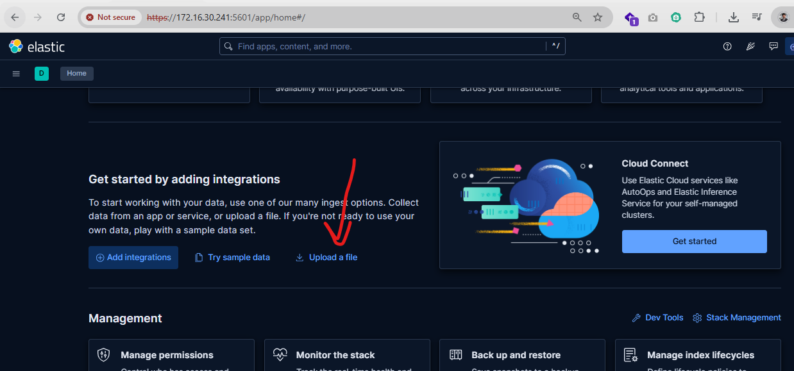
```sh

# you can import csv file by (in new index)

GET training-shop-orders-csv/_count

GET training-shop-orders-csv/_mapping

GET training-shop-orders-csv/_search


# or import in existing index
PUT shop-orders-manual
{
  "mappings": {
    "properties": {
      "@timestamp": { "type": "date" },
      "order_id": { "type": "keyword" },
      "customer_id": { "type": "keyword" },
      "city": { "type": "keyword" },
      "product": { "type": "keyword" },
      "category": { "type": "keyword" },
      "quantity": { "type": "long" },
      "amount": { "type": "long" },
      "status": { "type": "keyword" },
      "payment_method": { "type": "keyword" },
      "channel": { "type": "keyword" },
      "response_time_ms": { "type": "long" }
    }
  }
}


```

# Elastic Agent and Fleet

```sh

# Generate encyption key for kibana
/usr/share/kibana/bin/kibana-encryption-keys generate

vim /etc/kibana/kibana.yml
--------
xpack.encryptedSavedObjects.encryptionKey: 1acf4d30286e8dd176a278fa0f7ab96af9c0a3c20d29ea400fae6cc004cbf3b5
xpack.reporting.encryptionKey: b2a8946c8d12380e8d2e03a63ddc8c023980959d609454e984cb043a52c538ab
xpack.security.encryptionKey: 7c4e36f9b0968473aab3b3074e874eb704dc04af370b258501b229ca2055f5c7
--------
systemctl restart kibana

```
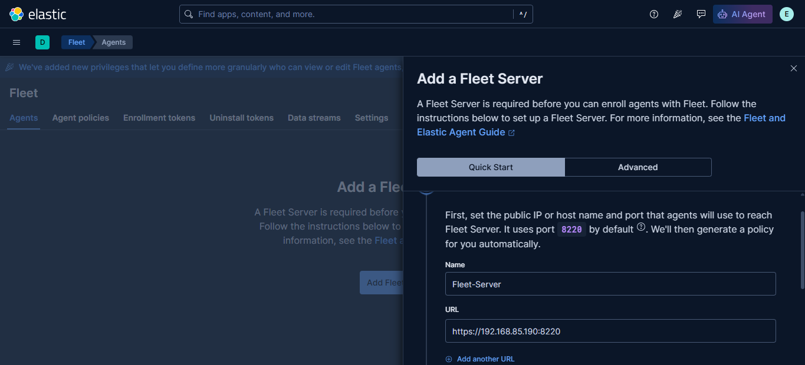

```sh
# add fleet server
sudo ELASTIC_AGENT_FLAVOR=servers rpm -ivh elastic-agent-9.5.5-x86_64.rpm

# after installation go to kibana and add fleet server

elastic-agent enroll \
  --fleet-server-es=https://172.16.30.242:9200 \
  --fleet-server-service-token=AAEAAWVsYXN0aWMvZmxlZXQtc2VydmVyL3Rva2VuLTE3OTQ2NjM3NDQ1NDM6M2wxNzdiRDRSOU9xQVVfcjhmQ0pHZw \
  --fleet-server-policy=fleet-server-policy \
  --fleet-server-port=8220 \
  --fleet-server-es-insecure


# go to Fleet → Settings → Outputs → Edit default
# change elastic search ouput to https
# add all elastic nodes
https://172.16.30.240:9200
https://172.16.30.242:9200
https://172.16.30.243:9200

# and add in advance yaml setting
ssl.verification_mode: none


firewall-cmd --permanent --add-port=8220/tcp


systemctl restart elastic-agent
elastic-agent status


# add integration offline
vim /etc/kibana/kibana.yml
--------
xpack.fleet.isAirGapped: true
--------

systemctl restart kibana

# add system integrations
curl -k -X POST \
  -u elastic \
  -H 'Content-Type: application/zip' \
  -H 'kbn-xsrf: true' \
  http://192.168.85.190:5601/api/fleet/epm/packages \
  --data-binary @cisco_ios-1.37.0.zip


# Integrations → Installed integrations (you can see system integration )


# now create new policy named Linux-Servers
# click on this policy and add integration and select system
# Fleet → Agents → Add agent

# on server install elastic-agent
rpm -ivh elastic-agent-9.5.5-x86_64.rpm


elastic-agent enroll \
  --url=https://172.16.30.241:8220   \
  --enrollment-token=NDR4MjJxRUJIQ2dlY0Vhc0NOUWY6MlVNanROdzVpQjBQcVdNcVNCM2l5dw== \
  --insecure


systemctl enable --now elastic-agent
elastic-agent status

# Observability → Infrastructure → Hosts
# Analytics → Dashboards  (search Metrics System)

```
## integrations
### filestream 
```sh
# create new policy and join your host to this policy


mkdir -p /opt/myapp
mkdir -p /var/log/myapp
vim  /opt/myapp/app.py
---------
import logging
import random
import time

logging.basicConfig(
    filename="/var/log/myapp/application.log",
    level=logging.INFO,
    format="%(asctime)s | %(levelname)s | %(message)s"
)

while True:
    event = random.choice([
        "success", "warning", "error"
    ])

    if event == "success":
        logging.info("Request completed successfully")

    elif event == "warning":
        logging.warning("Request processing is slow")

    else:
        logging.error("Database connection failed")

    time.sleep(2)

---------

python3 /opt/myapp/app.py

# now assgin filestream integration to this policy

```
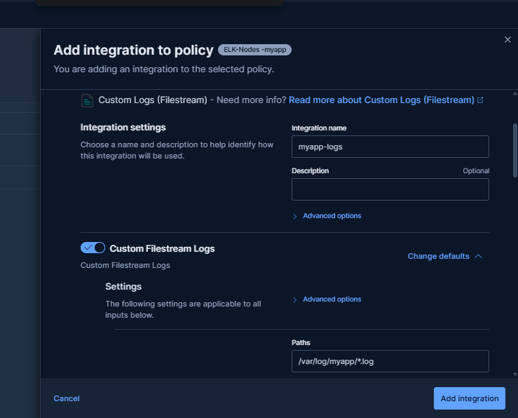

```sh

# search in discover 
# data_stream.dataset: "myapp"
# data_stream.dataset: "myapp" and message: "ERROR"
```
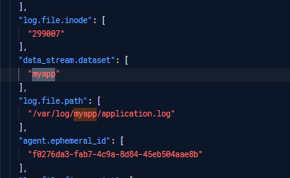

```sh
# now create ingest pipeline
PUT _ingest/pipeline/myapp-pipeline
{
  "description": "Parse MyApp application logs",
  "processors": [
    {
      "grok": {
        "field": "message",
        "patterns": [
          "%{TIMESTAMP_ISO8601:log_time} \\| %{LOGLEVEL:log.level} \\| %{GREEDYDATA:message}"
        ]
      }
    },
    {
      "date": {
        "field": "log_time",
        "formats": ["yyyy-MM-dd HH:mm:ss,SSS"],
        "timezone": "Asia/Tehran"
      }
    },
    {
      "remove": {
        "field": "log_time"
      }
    }
  ]
}


# then in policy and filestream integration add your ingest pipeline
```


```sh
# you can search 
# data_stream.dataset: "myapp" and log.level: "ERROR"
# data_stream.dataset: "myapp"


```
#### alerting
```sh
# create index for storing alerts
PUT custom-alerts
{
  "mappings": {
    "properties": {
      "rule_id": {
        "type": "keyword"
      },
      "rule_name": {
        "type": "keyword"
      },
      "alert_id": {
        "type": "keyword"
      },
      "alert_uuid": {
        "type": "keyword"
      },
      "alert_status": {
        "type": "keyword"
      },
      "notification_status": {
        "type": "keyword"
      },
      "message": {
        "type": "text"
      },
      "created_at": {
        "type": "date"
      },
      "sent_at": {
        "type": "date"
      },
      "retry_count": {
        "type": "integer"
      }
    }
  }
}

# now create index connector
Stack Management → Connectors → Create connector

# choose index type
```
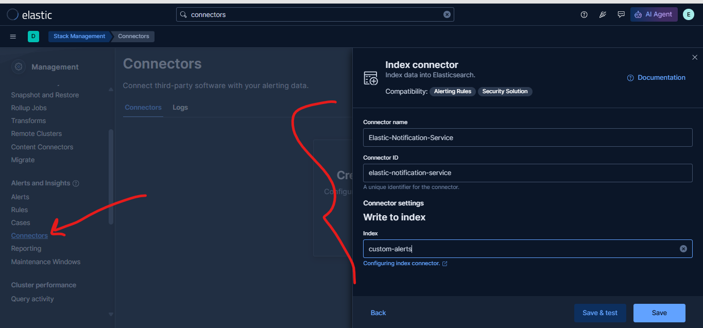
```sh
# now create rule
Stack Management → Rules → Create rule

# type: -> Index threshold

```

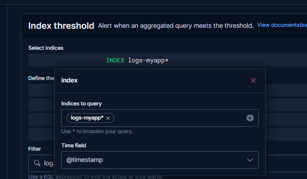

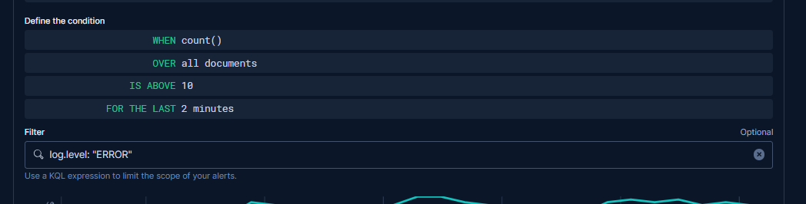


```sh
# define Active Action
{
  "rule_id": "{{rule.id}}",
  "rule_name": "{{rule.name}}",
  "alert_id": "{{alert.id}}",
  "alert_uuid": "{{alert.uuid}}",
  "alert_status": "active",
  "notification_status": "pending",
  "message": "{{context.message}}",
  "created_at": "{{date}}",
  "retry_count": 0
}

```
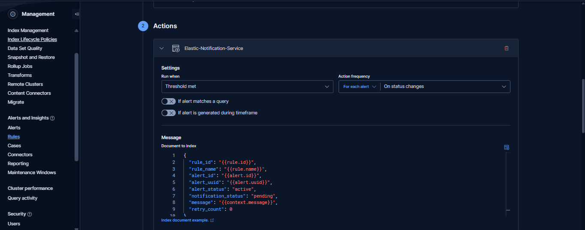


```sh
# define Recovery Action
{
  "rule_id": "{{rule.id}}",
  "rule_name": "{{rule.name}}",
  "alert_id": "{{alert.id}}",
  "alert_uuid": "{{alert.uuid}}",
  "alert_status": "resolved",
  "notification_status": "pending",
  "message": "Alert recovered: {{rule.name}}",
  "created_at": "{{date}}",
  "retry_count": 0
}
```
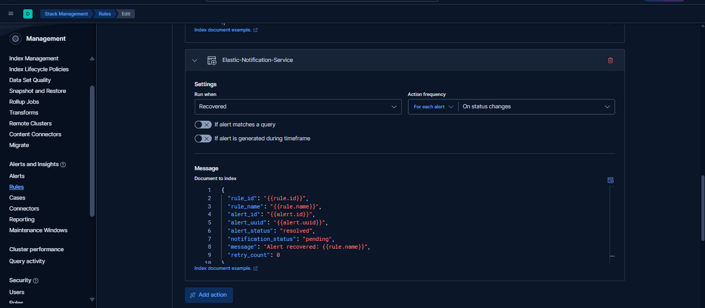

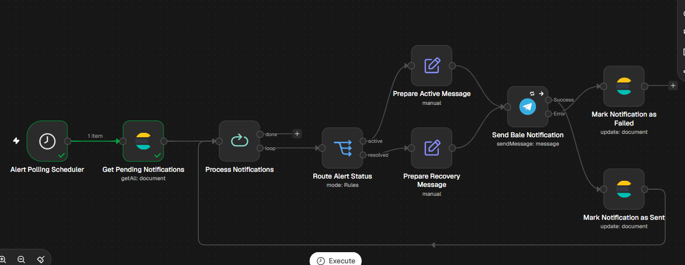


### Docker integrations in elastic agent
```sh
add docker integration to policy 

```
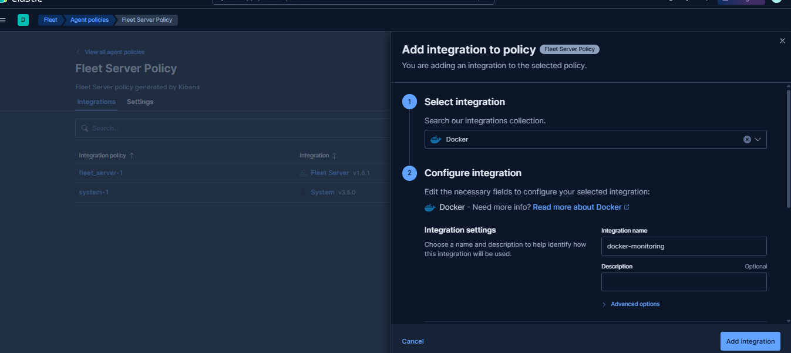


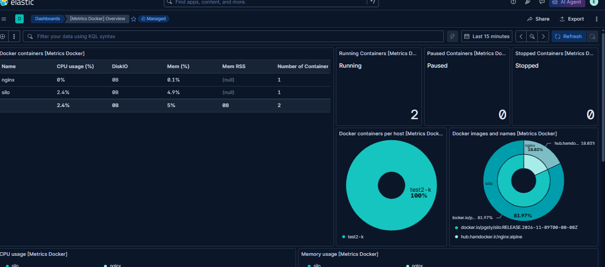


#### Nginx
```sh

vim /etc/nginx/conf.d/monitoring.conf
-------
server {
    listen 127.0.0.1:8081;

    location /nginx_status {
        stub_status;
        access_log off;

        allow 127.0.0.1;
        deny all;
    }
}

-------

nginx -t
systemctl reload nginx

curl http://127.0.0.1:8081/nginx_status

# Fleet → Agent policies → Nginx-Servers → Add integration → Nginx

```

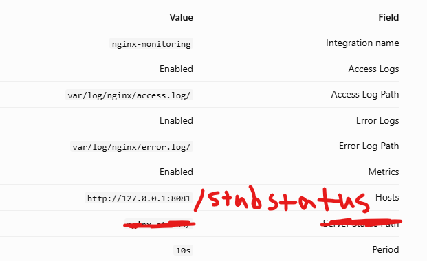

```sh
# generate fake traffik
for i in {1..100}; do
    curl -s http://localhost/ > /dev/null
    curl -s http://localhost/notfound > /dev/null
done

```

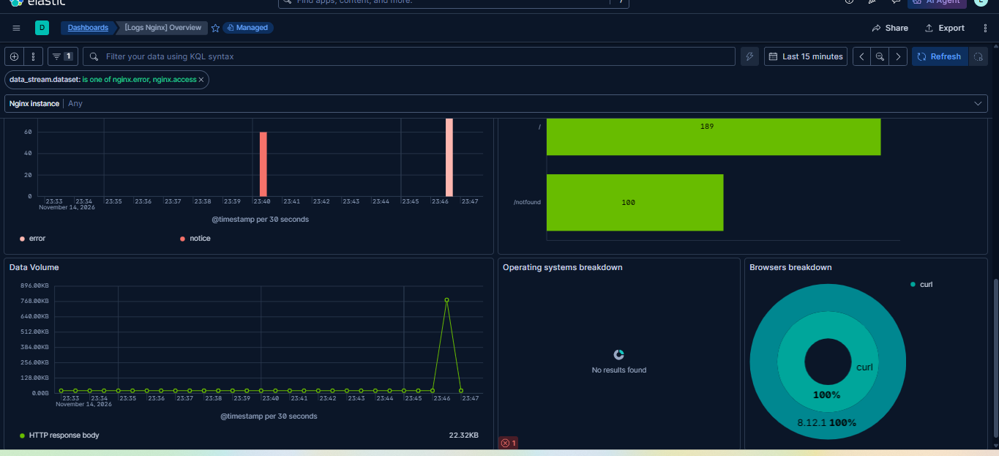

#### Elastic Defend
```sh


elastic-agent status --output full
whoami
id
uname -a
ls -la /tmp

```


## fleet HA
```sh
# this time we use ubuntu server
# install fleet server in new server
sudo ELASTIC_AGENT_FLAVOR=servers dpkg -i elastic-agent-9.5.5-amd64.deb


elastic-agent enroll \
  --fleet-server-es=https://172.16.30.242:9200 \
  --fleet-server-service-token=AAEAAWVsYXN0aWMvZmxlZXQtc2VydmVyL3Rva2VuLTE3OTQ4MTgzNTE5ODM6MHh2OEpxN09TUjJaSHR5a0xwMmdJZw \
  --fleet-server-policy=fleet-server-policy \
  --fleet-server-port=8220 \
  --fleet-server-es-insecure

sudo systemctl enable --now elastic-agent


```
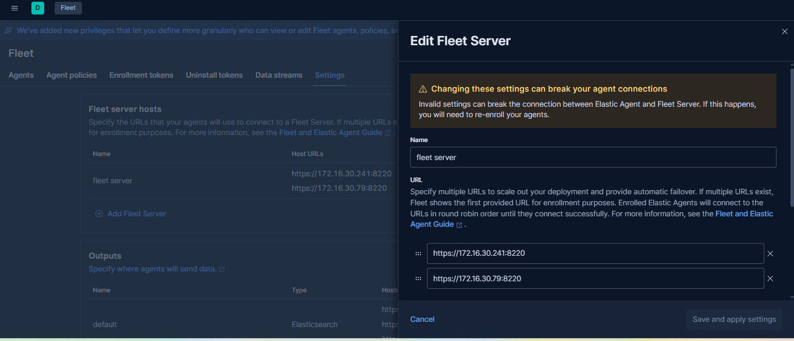


# send you data or log into elasticsearch directly using python
```sh
vim app.py
-----

import requests
import random
import time
import urllib3
from datetime import datetime, timezone

# Disable SSL warnings (Self-Signed)
urllib3.disable_warnings(urllib3.exceptions.InsecureRequestWarning)

ELASTIC_URL = "https://192.168.1.100:9200"
USERNAME = "elastic"
PASSWORD = "YourPassword"

INDEX_NAME = "linux-login-logs"

users = ["admin", "root", "iman", "test", "developer"]

servers = [
    "linux-web-01",
    "linux-db-01",
    "linux-app-01"
]

ips = [
    "192.168.1.10",
    "192.168.1.20",
    "10.10.10.15",
    "172.16.1.50"
]

while True:

    log = {
        "@timestamp": datetime.now(timezone.utc).isoformat(),
        "username": random.choice(users),
        "source_ip": random.choice(ips),
        "server": random.choice(servers),
        "event_type": "user_login",
        "status": random.choice(["success", "success", "failed"])
    }

    try:
        response = requests.post(
            f"{ELASTIC_URL}/{INDEX_NAME}/_doc",
            json=log,
            auth=(USERNAME, PASSWORD),
            verify=False,
            timeout=10
        )

        response.raise_for_status()

        print("Sent successfully:", log)

    except requests.exceptions.RequestException as e:
        print("Elasticsearch Error:", e)

    time.sleep(3)

-----


# see 10 last docs
GET linux-login-logs/_search
{
  "size": 10,
  "sort": [
    {
      "@timestamp": "desc"
    }
  ]
}

```


# Query DSL, KQL,  ES|QL
```sh

PUT training-api-monitoring
{
  "settings": {
    "number_of_shards": 1,
    "number_of_replicas": 1
  },
  "mappings": {
    "properties": {
      "@timestamp": { "type": "date" },
      "service.name": { "type": "keyword" },
      "host.name": { "type": "keyword" },
      "log.level": { "type": "keyword" },
      "message": { "type": "text" },
      "http.request.method": { "type": "keyword" },
      "http.response.status_code": { "type": "integer" },
      "url.path": { "type": "keyword" },
      "client.ip": { "type": "ip" },
      "user.name": { "type": "keyword" },
      "duration_ms": { "type": "long" },
      "event.outcome": { "type": "keyword" },
      "service.environment": { "type": "keyword" }
    }
  }
}


mkdir python
cd python
python3 -m venv venv

source venv/bin/activate

pip install elasticsearch

vim generate-api-logs.py
----
import random
from datetime import datetime, timedelta, timezone
from getpass import getpass
from elasticsearch import Elasticsearch
from elasticsearch.helpers import bulk

ES_HOSTS = [
    "https://172.16.30.240:9200",
    "https://172.16.30.242:9200",
    "https://172.16.30.243:9200"
]

INDEX = "training-api-monitoring"
TOTAL_DOCUMENTS = 10000

password = getpass("Elasticsearch Password: ")

es = Elasticsearch(
    ES_HOSTS,
    basic_auth=("elastic", password),
    ca_certs="/etc/elasticsearch/certs/http_ca.crt"
)

SERVICES = {
    "payment-service": ("/api/payment", "POST"),
    "auth-service": ("/api/login", "POST"),
    "order-service": ("/api/orders", "POST"),
    "product-service": ("/api/products", "GET"),
    "user-service": ("/api/users", "GET")
}

HOSTS = [
    "app-server-01",
    "app-server-02",
    "app-server-03"
]

USERS = [
    "ali", "reza", "sara", "mina",
    "hamid", "maryam", "admin"
]

STATUS_CODES = [200, 201, 400, 401, 403, 404, 500, 503]
WEIGHTS = [55, 15, 5, 5, 3, 5, 8, 4]

MESSAGES = {
    200: "Request completed successfully",
    201: "Resource created successfully",
    400: "Invalid request parameters",
    401: "Authentication failed",
    403: "Access denied",
    404: "Resource not found",
    500: "Database connection failed",
    503: "Service temporarily unavailable"
}

def generate_documents():

    now = datetime.now(timezone.utc)

    for i in range(TOTAL_DOCUMENTS):

        service = random.choice(list(SERVICES))
        path, method = SERVICES[service]

        status = random.choices(
            STATUS_CODES,
            weights=WEIGHTS,
            k=1
        )[0]

        if status >= 500:
            level = "ERROR"
            duration = random.randint(1000, 5000)

        elif status >= 400:
            level = "WARN"
            duration = random.randint(100, 1500)

        else:
            level = "INFO"
            duration = random.randint(20, 800)

        timestamp = now - timedelta(
            seconds=random.randint(0, 7 * 24 * 60 * 60)
        )

        yield {
            "_index": INDEX,
            "_source": {
                "@timestamp": timestamp.isoformat(),
                "service": {
                    "name": service,
                    "environment": random.choice(
                        ["production", "production", "test"]
                    )
                },
                "host": {
                    "name": random.choice(HOSTS)
                },
                "log": {
                    "level": level
                },
                "message": MESSAGES[status],
                "http": {
                    "request": {
                        "method": method
                    },
                    "response": {
                        "status_code": status
                    }
                },
                "url": {
                    "path": path
                },
                "client": {
                    "ip": f"192.168.10.{random.randint(10, 30)}"
                },
                "user": {
                    "name": random.choice(USERS)
                },
                "duration_ms": duration,
                "event": {
                    "outcome": (
                        "failure" if status >= 400
                        else "success"
                    )
                }
            }
        }

success, errors = bulk(
    es,
    generate_documents(),
    chunk_size=500,
    refresh=True
)

print(f"Inserted documents: {success}")

----


GET training-api-monitoring/_count
GET training-api-monitoring/_mapping

# create dataview called  API Monitoring Lab


```

## Query DSL
```sh
# go to dev-tools and run 


# list all docs
GET training-api-monitoring/_search
{
  "query": {
    "match_all": {}
  }
}

# limit only 10 document
GET training-api-monitoring/_search
{
  "size": 10,
  "query": {
    "match_all": {}
  }
}


# exact search
# term (find exect value fo a specific feild)
GET training-api-monitoring/_search
{
  "query": {
    "term": {
      "log.level": "ERROR"
    }
  }
}


# you can limit
# 
GET training-api-monitoring/_search
{  
  "size": 2,
  "query": {
    "term": {
      "log.level": "ERROR"
    }
  }
}

# log.level: ERROR or WARN
GET training-api-monitoring/_search
{
  "query": {
    "terms": {
      "log.level": ["ERROR", "WARN"]
    }
  }
}


# find a pattern in a feild using match
# match 
GET training-api-monitoring/_search
{
  "query": {
    "match": {
      "message": "database connection"
    }
  }
}


GET training-api-monitoring/_search
{
  "query": {
    "range": {
      "duration_ms": {
        "gt": 1000
      }
    }
  }
}


GET training-api-monitoring/_search
{
  "query": {
    "range": {
      "duration_ms": {
        "gte": 500,
        "lte": 2000
      }
    }
  }
}


GET training-api-monitoring/_search
{
  "query": {
    "bool": {
      "must": [
        {
          "term": {
            "service.name": "payment-service"
          }
        },
        {
          "term": {
            "log.level": "ERROR"
          }
        }
      ]
    }
  }
}


GET training-api-monitoring/_search
{
  "query": {
    "bool": {
      "filter": [
        {
          "term": {
            "service.environment": "production"
          }
        },
        {
          "range": {
            "duration_ms": {
              "gt": 1000
            }
          }
        }
      ]
    }
  }
}


# at least one rule must pass
GET training-api-monitoring/_search
{
  "query": {
    "bool": {
      "should": [
        {
          "term": {
            "service.name": "payment-service"
          }
        },
        {
          "term": {
            "service.name": "auth-service"
          }
        }
      ],
      "minimum_should_match": 1
    }
  }
}


GET training-api-monitoring/_search
{
  "query": {
    "bool": {
      "must_not": [
        {
          "term": {
            "log.level": "INFO"
          }
        }
      ]
    }
  }
}
################

GET training-api-monitoring/_search
{
  "query": {
    "bool": {
      "filter": [
        {
          "term": {
            "service.environment": "production"
          }
        },
        {
          "range": {
            "duration_ms": {
              "gt": 1000
            }
          }
        }
      ],
      "should": [
        {
          "term": {
            "service.name": "payment-service"
          }
        },
        {
          "term": {
            "service.name": "order-service"
          }
        }
      ],
      "minimum_should_match": 1,
      "must_not": [
        {
          "term": {
            "log.level": "INFO"
          }
        }
      ]
    }
  }
}


# select only some feild

GET training-api-monitoring/_search
{
  "_source": [
    "service.name",
    "log.level",
    "duration_ms"
  ],
  "size": 10
}


# find error in last 24 hours
GET training-api-monitoring/_search
{
  "query": {
    "bool": {
      "filter": [
        {
          "term": {
            "log.level": "ERROR"
          }
        },
        {
          "range": {
            "@timestamp": {
              "gte": "now-24h",
              "lte": "now"
            }
          }
        }
      ]
    }
  }
}


```

## KQL (Kibana Query Language)
```sh

# go to discover and in search field 

field_name: value
# example
log.level: "ERROR"
service.name: "payment-service"
http.response.status_code: 500
http.response.status_code: 401
http.response.status_code: 403

client.ip: "192.168.10.15"

# AND OR
service.name: "payment-service" AND log.level: "ERROR"
log.level: "ERROR" OR log.level: "WARN"
log.level: (ERROR OR WARN)
# show all log.level except INFO
NOT log.level: "INFO"


service.environment: "production" AND (log.level: "ERROR" OR log.level: "WARN")
duration_ms > 1000
http.response.status_code >= 500


message: database
message: "Database connection"

database

host.name: app-server*
url.path: /api/*
service.name: payment*


# show docs which have client.ip feild
# نمایش داکیومنت هایی که فیلد زیر را دارند
client.ip: *

NOT client.ip: *


# نمایش لاگهایی که در 30ساعت گذشته است
@timestamp >= now-30h

# نمایش خطاهایی که در ۲۴ ساعت گذشته است
log.level: "ERROR" AND @timestamp >= now-24h


service.name: "payment-service" AND
service.environment: "production" AND
http.response.status_code >= 500 AND
duration_ms > 1000

```

## ES|QL (Elasticsearch Query Language)
```sh
# in kibana discover change query type to ESQL
FROM training-api-monitoring | LIMIT 10


FROM training-api-monitoring | WHERE http.response.status_code >= 500 | LIMIT 100


FROM training-api-monitoring | WHERE service.name == "payment-service" AND log.level == "ERROR" | LIMIT 100

FROM training-api-monitoring | WHERE log.level IN ("ERROR", "WARN") | LIMIT 100


FROM training-api-monitoring | KEEP @timestamp, service.name, log.level, message | LIMIT 100

FROM training-api-monitoring | SORT duration_ms DESC | KEEP service.name, url.path, duration_ms | LIMIT 10

FROM training-api-monitoring | SORT duration_ms ASC | KEEP service.name, url.path, duration_ms | LIMIT 10


FROM training-api-monitoring | STATS total_requests = COUNT(*)

FROM training-api-monitoring | STATS avg_duration = AVG(duration_ms)

FROM training-api-monitoring |  WHERE http.response.status_code <= 300 | STATS avg_duration = AVG(duration_ms)

FROM training-api-monitoring | STATS total_requests = COUNT(*) BY service.name | SORT total_requests DESC


FROM training-api-monitoring
| STATS
    total_requests = COUNT(*),
    avg_duration = AVG(duration_ms),
    max_duration = MAX(duration_ms),
    min_duration = MIN(duration_ms)
  BY service.name
| SORT avg_duration DESC


FROM training-api-monitoring
| EVAL duration_seconds = duration_ms / 1000.0
| KEEP service.name, duration_ms, duration_seconds
| LIMIT 10


FROM training-api-monitoring
| STATS
    total = COUNT(*),
    errors = COUNT(*) WHERE http.response.status_code >= 500
  BY service.name
| EVAL error_rate = ROUND(errors * 100.0 / total, 2)
| SORT error_rate DESC
| KEEP service.name, error_rate, errors, total


```

# kibana spaces

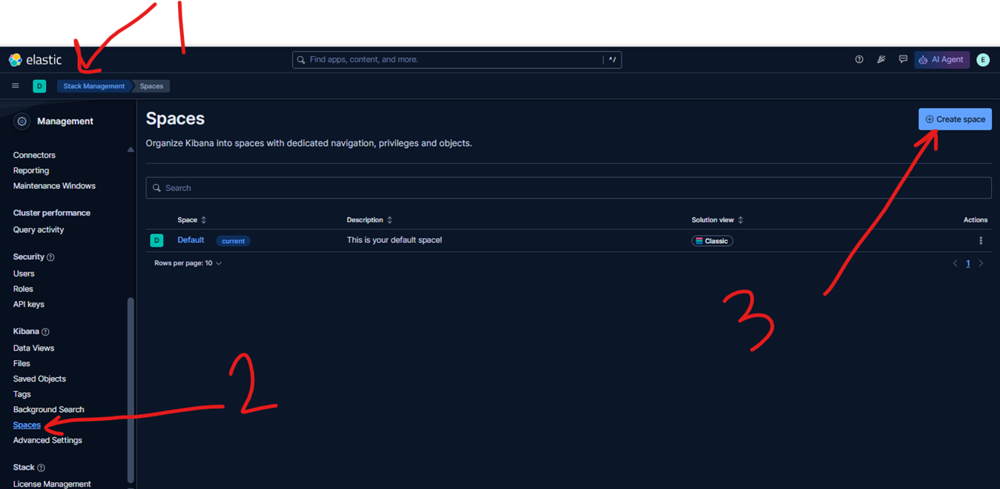
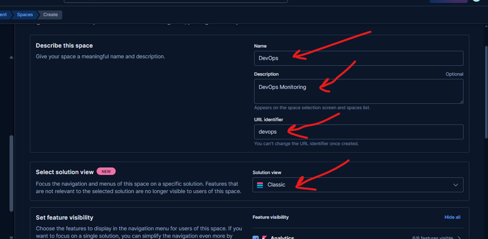
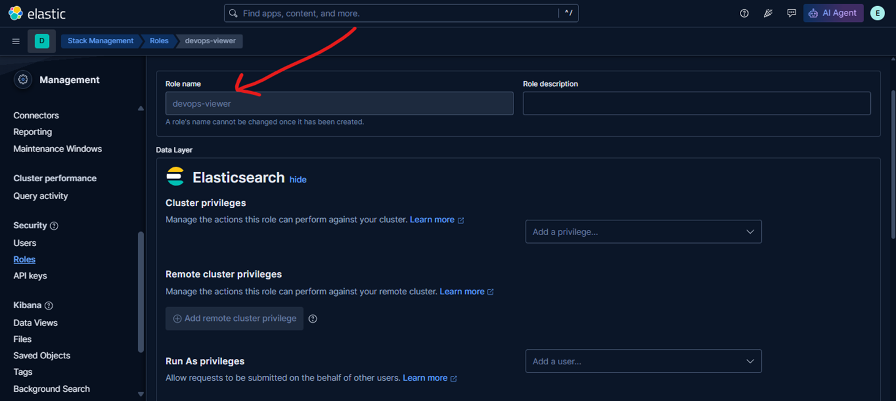
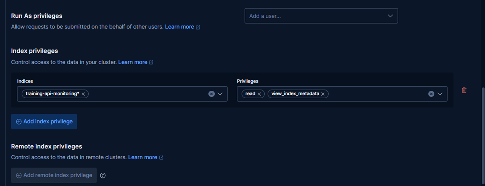
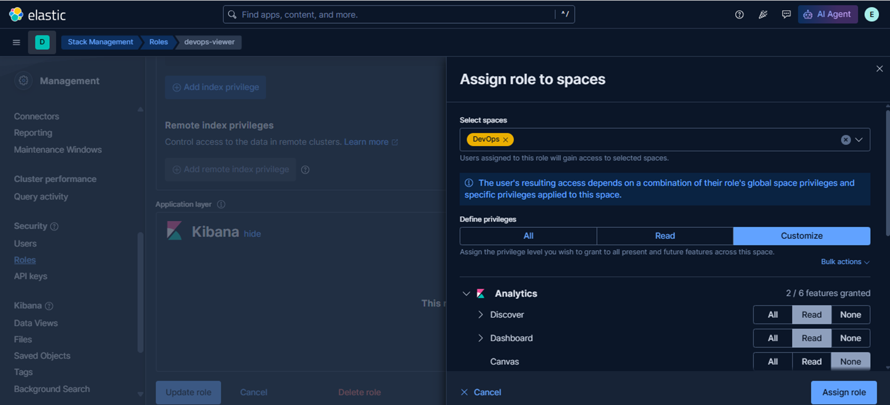
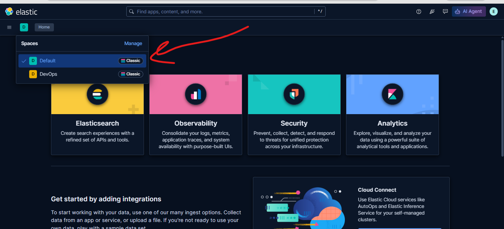


```sh


PUT _security/user/devops_user
{
  "password": "asdfadsf",
  "roles": ["devops-viewer"],
  "full_name": "DevOps User",
  "enabled": true
}

```

## chnage between spaces


#  kibana dashboarding

```sh
# import visitor-interests
```
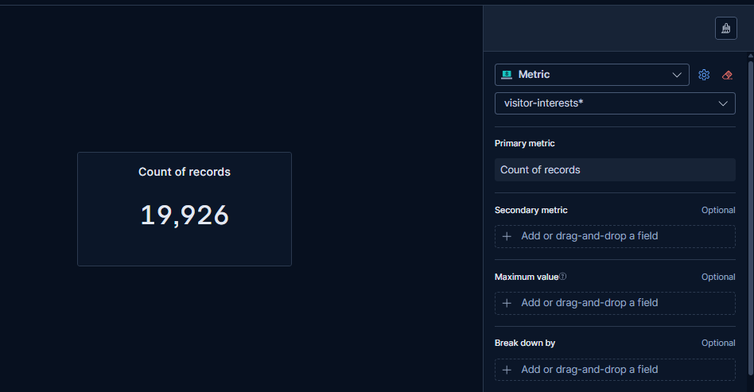
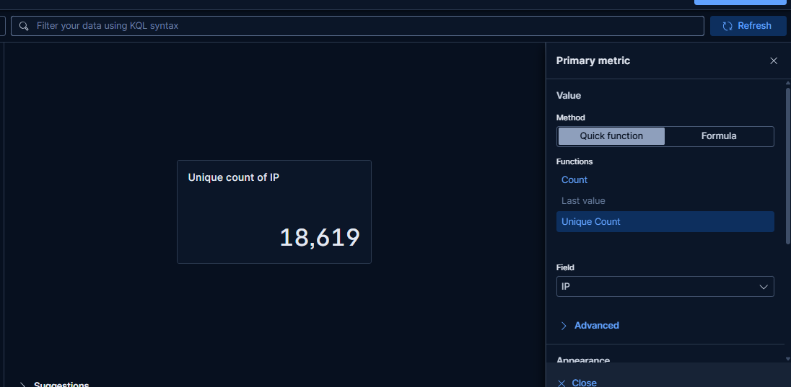


