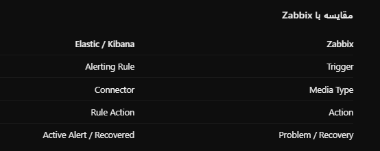
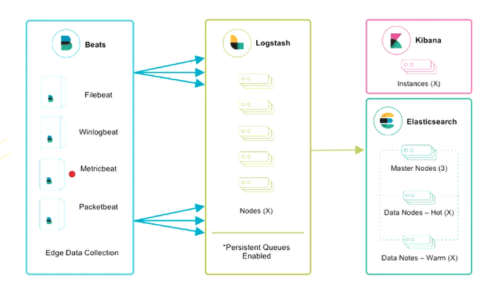
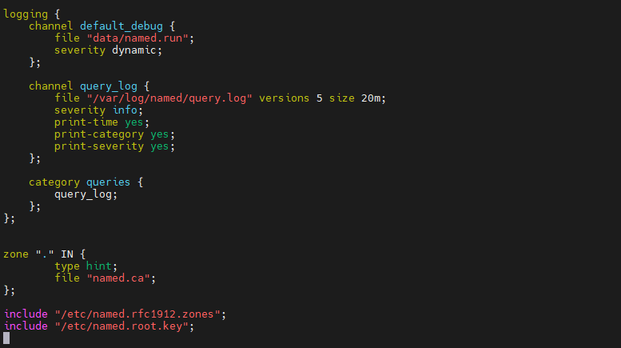
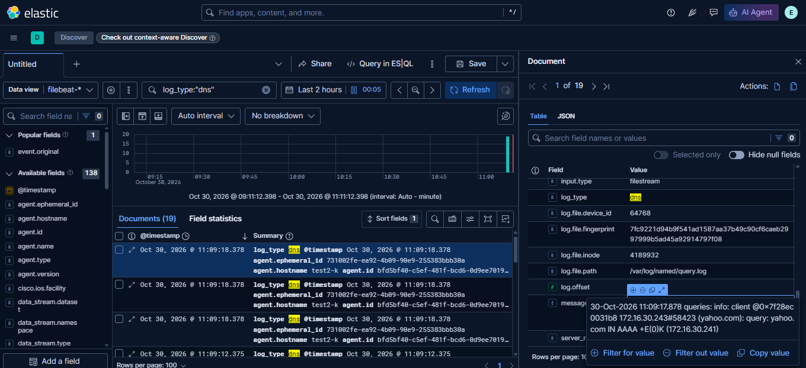
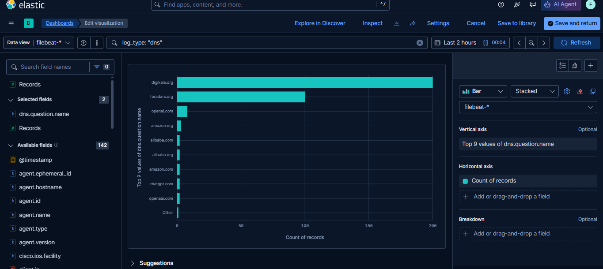
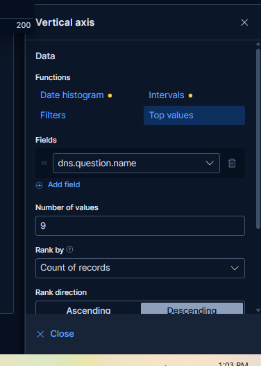
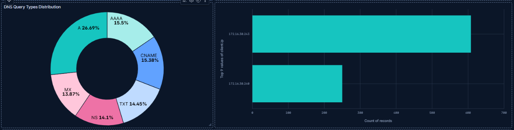
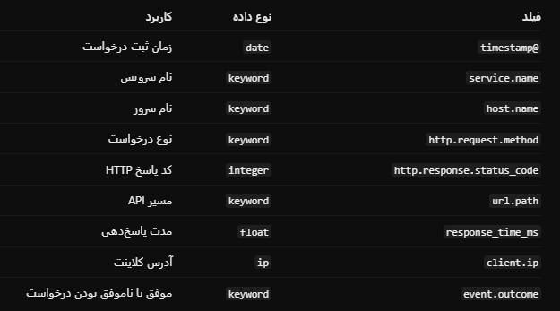
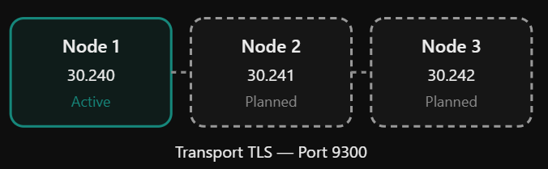

# ElasticSearch
```sh

# setup repository in rocky linux
# use below repository
---
https://repo.iut.ac.ir/
https://repo.iut.ac.ir/repo/repofiles/iutepel9.repo
https://repo.iut.ac.ir/repo/repofiles/iutrocky9.repo
---

# go to this website and download the elastic package
https://www.elastic.co/downloads/


dnf install lsof bash-completion vim nano tar zip unzip wget curl git net-tools traceroute htop tcpdump rsync jq tree tmux iperf3
 

# you can use official repository 
vim /etc/yum.repos.d/elasticsearch.repo
----
[elasticsearch]
name=Elasticsearch repository for 9.x packages
baseurl=https://artifacts.elastic.co/packages/9.x/yum
gpgcheck=1
gpgkey=https://artifacts.elastic.co/GPG-KEY-elasticsearch
enabled=0
type=rpm-md

----

dnf repolist
dnf makecache
sudo dnf install --enablerepo=elasticsearch elasticsearch
sudo dnf install elasticsearch-<SPECIFIC.VERSION.NUMBER>


# or you can download the rpm or deb file directly
this is the sha file
wget https://artifacts.elastic.co/downloads/elasticsearch/elasticsearch-9.5.5-x86_64.rpm
wget https://artifacts.elastic.co/downloads/elasticsearch/elasticsearch-9.5.5-x86_64.rpm.sha512
shasum -a 512 -c elasticsearch-9.5.5-x86_64.rpm.sha512
sudo rpm --install elasticsearch-9.5.5-x86_64.rpm


# Configure Elasticsearch as a Single Node
vim /etc/elasticsearch/elasticsearch.yml
-----
#  Add the following configuration:
discovery.type: single-node
#  Comment the following setting if it exists:
# cluster.initial_master_nodes: ["localhost"]

network.host: 192.168.85.140
http.port: 9200
# Verify the data and log paths:
path.data: /var/lib/elasticsearch
path.logs: /var/log/elasticsearch


-----
systemctl enable --now elasticsearch.service 
systemctl restart elasticsearch.service


# Check Elasticsearch cluster health
curl -k -u elastic https://localhost:9200/_cluster/health?pretty

curl  --cacert /etc/elasticsearch/certs/http_ca.crt -u elastic https://localhost:9200/_cluster/health?pretty

# ?v --> verbose
# List all nodes in the cluster
curl -k -u elastic https://localhost:9200/_cat/nodes?v

# List all Elasticsearch indices
curl -k -u elastic https://localhost:9200/_cat/indices?v

# List all indices, including hidden and system indices
curl -k -u elastic "https://localhost:9200/_cat/indices?v&expand_wildcards=all"


# Count all indices in Elasticsearch
curl -k -u elastic "https://localhost:9200/_cat/indices?format=json&expand_wildcards=all" | jq 'length'


# work with index
# Create a new index named students
curl -k -u elastic -X PUT "https://localhost:9200/students"


# Display the students index information
curl -k -u elastic "https://localhost:9200/_cat/indices/students?v"


# Insert a student document with ID 1
curl -k -u elastic -X PUT "https://localhost:9200/students/_doc/1?refresh=wait_for" \
-H "Content-Type: application/json" \
-d '{
  "name": "Ali",
  "age": 25,
  "course": "Elasticsearch"
}'


# Retrieve the student document by ID
curl -k -u elastic "https://localhost:9200/students/_doc/1?pretty"


# Count documents in the students index
curl -k -u elastic "https://localhost:9200/students/_count?pretty"


# Create a new student document with ID 2
curl -k -u elastic -X PUT "https://localhost:9200/students/_create/2" \
-H "Content-Type: application/json" \
-d '{
  "name": "Sara",
  "age": 23,
  "course": "Linux"
}'


curl -k -u elastic -X PUT "https://localhost:9200/students/_create/10" \
-H "Content-Type: application/json" \
-d '{
  "name": "ali",
  "age": 30,
  "course": "devops",
  "city": "shiraz"
}'

curl -k -u elastic -X PUT "https://localhost:9200/students/_create/11" \
-H "Content-Type: application/json" \
-d '{
  "name": "mohammad",
  "age": 18,
  "course": "ccna",
  "city": "darab"
}'


# Retrieve student document with ID 2
curl -k -u elastic "https://localhost:9200/students/_doc/2?pretty"


# Update the age of student with ID 2
curl -k -u elastic -X POST "https://localhost:9200/students/_update/2" \
-H "Content-Type: application/json" \
-d '{
  "doc": {
    "age": 24
  }
}'


# Delete student document with ID 2
curl -k -u elastic -X DELETE "https://localhost:9200/students/_doc/2"


# Count all documents in the students index
curl -k -u elastic "https://localhost:9200/students/_count?pretty"


# Retrieve all documents from the students index
curl -k -u elastic -X GET "https://localhost:9200/students/_search?pretty" \
-H "Content-Type: application/json" \
-d '{
  "query": {
    "match_all": {}
  }
}'


# Search for students named Ali
curl -k -u elastic -X GET "https://localhost:9200/students/_search?pretty" \
-H "Content-Type: application/json" \
-d '{
  "query": {
    "match": {
      "name": "Ali"
    }
  }
}'


# Find students between 20 and 30 years old
curl -k -u elastic -X GET "https://localhost:9200/students/_search?pretty" \
-H "Content-Type: application/json" \
-d '{
  "query": {
    "range": {
      "age": {
        "gte": 10,
        "lte": 20
      }
    }
  }
}'


# now go tho kibana and search from dev tools
# create index with mapping
PUT /students_v2
{
  "mappings": {
    "properties": {
      "name": { "type": "text" },
      "age": { "type": "integer" },
      "email": { "type": "keyword" },
      "created_at": { "type": "date" }
    }
  }
}


```


# Setup kibana
```sh
rpm -i kibana-9.5.5-x86_64.rpm


# on elastic server create service token for kibana
curl -k -u elastic -X POST "https://172.16.30.240:9200/_security/service/elastic/kibana/credential/token/kibana-new"
# output is 
# {"created":true,"token":{"name":"kibana-new","value":"AAEAAWVsYXN0aWMva2liYW5hL2tpYmFuYS1uZXc6ZldZM3ExZnZSc09qUTBKbDVRT3dQUQ"}}[root@el-3


vim /etc/kibana/kibana.yml
----
server.port: 5601
server.host: "172.16.30.241"

# =================== System: Kibana Server (Optional) ===================
# Enables SSL and paths to the PEM-format SSL certificate and SSL key files, respectively.
# These settings enable SSL for outgoing requests from the Kibana server to the browser.
#server.ssl.enabled: false
#server.ssl.certificate: /path/to/your/server.crt
#server.ssl.key: /path/to/your/server.key

# =================== System: Elasticsearch ===================
# The URLs of the Elasticsearch instances to use for all your queries.
elasticsearch.hosts: ["https://172.16.30.240:9200"]
elasticsearch.serviceAccountToken: "AAEAAWVsYXN0aWMva2liYW5hL2tpYmFuYS1wcm9kOmktUkxSVkRCVFA2ZTdxcWJjeEhKbHc"
elasticsearch.ssl.verificationMode: none

# on elastic server copy ca certificate 
# ls -lah /etc/elasticsearch/certs/
# elasticsearch.ssl.certificateAuthorities: [ "/etc/kibana/certs/http_ca.crt" ]
# elasticsearch.ssl.verificationMode: full


map.includeElasticMapsService: false

map.tilemap.url: "https://tile.openstreetmap.org/{z}/{x}/{y}.png"

map.tilemap.options.attribution: "© OpenStreetMap contributors"
map.tilemap.options.maxZoom: 19


----

systemctl enable --now kibana.service
ss -nlpt


# login with elastic user, 
```

# Beats
## filebeats

```sh
rpm -i filebeat-9.5.5-x86_64.rpm

vim /etc/filebeat/filebeat.yml
----

output.elasticsearch:
  hosts: ["https://172.16.30.240:9200"]
  protocol: "https"

  username: "elastic"
  password: "YOUR_ELASTIC_PASSWORD"
  ssl.verification_mode: none

setup.kibana:
  host: "http://172.16.30.241:5601"
  username: "elastic"
  password: "QJMqrf9u56nPHR=H6mRn"

----

# Validate Filebeat configuration
filebeat test config -e

# Test the connection to Elasticsearch
filebeat test output


filebeat setup -e
systemctl enable filebeat.service --now


```

### enable nginx module
```sh
filebeat modules list
filebeat modules enable nginx
vim /etc/filebeat/modules.d/nginx.yml
------
- module: nginx
  # Access logs
  access:
    enabled: true
# error logs
  error:
    enabled: true
-------

systemctl restart filebeat.service
```


```sh

vim /etc/nginx/conf.d/app.conf
----
server {
    listen 8080;
    server_name web.test.local;

    location / {
        return 500;
    }
}
----
curl web.test.local:8080

```

### enable system module
```sh
filebeat modules enable system
vim /etc/filebeat/modules.d/system.yml
----
  # Syslog
  syslog:
    enabled: true

  # Authorization logs
  auth:
    enabled: true
----

filebeat test config -e


# Test the connection to Elasticsearch
filebeat test output

systemctl restart filebeat.service

```

### enable postgresql module
```sh


```

### enable iptables module
```sh


```


### enable netflow module
```sh
filebeat modules enable netflow

vim /etc/filebeat/modules.d/netflow.yml
----
- module: netflow
  log:
    enabled: true
    var:
      netflow_host: 0.0.0.0
      netflow_port: 2055
      # internal_networks specifies which networks are considered internal or private
      # you can specify either a CIDR block or any of the special named ranges listed
      # at: https://www.elastic.co/guide/en/beats/filebeat/current/defining-processors.html#condition-network
      internal_networks:
        - private


----

firewall-cmd --add-port=2055/udp --permanent
firewall-cmd --reload

systemctl restart filebeat.service

ss -lunp | grep 2055


conf t

flow record NETFLOW-RECORD
 match ipv4 source address
 match ipv4 destination address
 match ipv4 protocol
 match transport source-port
 match transport destination-port
 match interface input
 collect counter bytes long
 collect counter packets long
 collect timestamp sys-uptime first
 collect timestamp sys-uptime last
 exit

flow exporter NETFLOW-EXPORTER
 destination 192.168.1.100
 source GigabitEthernet0/0
 transport udp 2055
 export-protocol netflow-v9
 exit

flow monitor NETFLOW-MONITOR
 record NETFLOW-RECORD
 exporter NETFLOW-EXPORTER
 cache timeout active 60
 cache timeout inactive 15
 exit

interface GigabitEthernet0/0
 ip flow monitor NETFLOW-MONITOR input
 exit

end

```


### enable cisco module for reading syslog from cisco devices
```sh
filebeat modules enable cisco

vim /etc/filebeat/modules.d/cisco.yml
---------
- module: cisco
  ios:
    enabled: true
    var.syslog_host: 172.16.30.241
    var.syslog_port: 9002
--------

firewall-cmd --add-port=9002/udp --permanent
firewall-cmd --reload
firewall-cmd --list-all


systemctl restart filebeat.service


# config syslog cisco IOS/IOS-XE
conf t
service timestamps log datetime msec show-timezone
logging host 172.16.30.241 transport udp port 9002
logging trap informational
logging origin-id hostname
exit

# create user and enable ssh
username iman privilege 15 secret iman
hostname router.iman.test
crypto key generate rsa modulus 2048
ip ssh version 2
line vty 0 2
transport input ssh
login local
do wr

# generate test log in cisco
send log 3 TEST_ERROR
send log 4 TEST_WARNING
send log 5 TEST_NOTICE
send log 6 TEST_INFORMATIONAL
send log 7 TEST_DEBUG


# filetr in kibana
event.module: "cisco" 
```


## metricbeat
```sh
rpm -i metricbeat-9.5.5-x86_64.rpm


vim /etc/metricbeat/metricbeat.yml
----

output.elasticsearch:
  hosts: ["https://172.16.30.240:9200"]
  protocol: "https"

  username: "elastic"
  password: "YOUR_ELASTIC_PASSWORD"
  ssl.verification_mode: none

setup.kibana:
  host: "http://172.16.30.241:5601"
  username: "elastic"
  password: "QJMqrf9u56nPHR=H6mRn"

----

metricbeat modules list
metricbeat modules enable system
vim /etc/metricbeat/modules.d/system.yml
------

-------

# Validate Filebeat configuration
metricbeat test config -e

# Test the connection to Elasticsearch
metricbeat test output

metricbeat setup -e

systemctl enable --now  metricbeat.service
```

### enable nginx module
```sh
metricbeat modules list | grep nginx

metricbeat modules enable nginx


vim /etc/nginx/nginx.conf
---
    server {
        listen       80;
        listen       [::]:80;
        server_name  _;
        root         /usr/share/nginx/html;

        # Load configuration files for the default server block.
        include /etc/nginx/default.d/*.conf;

        location /nginx_status {
                stub_status;
                allow 127.0.0.1;
                deny all;
        }
    }

---

curl http://127.0.0.1/nginx_status

vim /etc/metricbeat/modules.d/nginx.yml
---
- module: nginx
  metricsets:
    - stubstatus
  period: 10s

  # Nginx hosts
  hosts: ["http://127.0.0.1"]

  # Path to server status. Default nginx_status
  server_status_path: "nginx_status"

  #username: "user"
  #password: "secret"
---

metricbeat test modules nginx
systemctl restart metricbeat

# test 
vim app.sh
-----

#!/bin/bash

while true
do
    curl -s -o /dev/null http://127.0.0.1/
    sleep 0.01
done
----

bash app.sh

```

### enable postgresql module
[install postgresql](https://www.postgresql.org/download/linux/redhat/)
```sh
# Install the repository RPM:
sudo dnf install -y https://download.postgresql.org/pub/repos/yum/reporpms/EL-10-x86_64/pgdg-redhat-repo-latest.noarch.rpm

dnf makecache -y
# Install PostgreSQL:
sudo dnf install -y postgresql18-server

# Optionally initialize the database and enable automatic start:
sudo /usr/pgsql-18/bin/postgresql-18-setup initdb
sudo systemctl enable postgresql-18
sudo systemctl start postgresql-18

su - postgres
psql
CREATE USER metricbeat WITH PASSWORD 'YOUR_PASSWORD';
GRANT pg_monitor TO metricbeat;

create database zbx;
\l
exit
exit


metricbeat modules enable postgresql

vim /etc/metricbeat/modules.d/postgresql.yml
-----
- module: postgresql
  metricsets:
    - database
    - bgwriter
    - activity
  period: 10s
  hosts: ["postgres://127.0.0.1:5432/postgres?sslmode=disable"]
  username: metricbeat
  password: YOUR_PASSWORD
----

metricbeat test modules postgresql
systemctl restart metricbeat


# create test db
sudo -u postgres createdb shopdb
sudo -u postgres psql -d shopdb

CREATE TABLE orders (
    id SERIAL PRIMARY KEY,
    customer_id INT,
    amount NUMERIC(10,2),
    status VARCHAR(20),
    created_at TIMESTAMP DEFAULT NOW()
);


INSERT INTO orders (customer_id, amount, status)
SELECT
    (random() * 10000)::INT,
    (random() * 1000)::NUMERIC(10,2),
    CASE WHEN random() > 0.5 THEN 'paid' ELSE 'pending' END
FROM generate_series(1, 100000);

\dt

select * from orders limit 10;
exit


vim query.sh
----
#!/bin/bash

while true
do
    sudo -u postgres psql -d shopdb -c \
    "SELECT COUNT(*), AVG(amount) FROM orders;" > /dev/null

    sudo -u postgres psql -d shopdb -c \
    "UPDATE orders SET amount = amount + 1 WHERE id = (random() * 100000)::INT;" > /dev/null

    sudo -u postgres psql -d shopdb -c \
    "INSERT INTO orders (customer_id, amount, status)
     VALUES (100, random()*1000, 'paid');" > /dev/null

    sleep 0.2
done
----


sudo dnf install postgresql18-contrib
vim /var/lib/pgsql/18/data/postgresql.conf
-----
shared_preload_libraries = 'pg_stat_statements'
pg_stat_statements.track = all
----

sudo systemctl restart postgresql

sudo -u postgres psql -d postgres -c "CREATE EXTENSION IF NOT EXISTS pg_stat_statements;"

# enable statement in metricbeat
vim /etc/metricbeat/modules.d/postgresql.yml
-----
- module: postgresql
  metricsets:
    - database
    - bgwriter
    - activity
    - statement
  period: 10s
  hosts: ["postgres://127.0.0.1:5432/postgres?sslmode=disable"]
  username: metricbeat
  password: YOUR_PASSWORD
----

systemctl restart metricbeat

```
### enable docker module
```sh
sudo dnf -y install dnf-plugins-core
sudo dnf config-manager --add-repo https://download.docker.com/linux/rhel/docker-ce.repo

sudo dnf install docker-ce docker-ce-cli containerd.io docker-buildx-plugin docker-compose-plugin

sudo systemctl enable --now docker


metricbeat modules enable docker
vim /etc/metricbeat/modules.d/docker.yml
---
- module: docker
  enabled: true
  metricsets:
    - container
    - cpu
    - memory
    - network
    - diskio
    - info
    - healthcheck
  hosts: ["unix:///var/run/docker.sock"]
  period: 10s
---
docker run -d \
  --name nginx-test \
  -p 8080:80 \
  --restart no \
  nginx:alpine

metricbeat test modules docker
systemctl restart metricbeat


```

### enable mongodb module
```sh


```


## packetbeat

```sh
rpm -i packetbeat-9.5.5-x86_64.rpm

vim /etc/packetbeat/packetbeat.yml
---
packetbeat.interfaces.device: any

output.elasticsearch:
  hosts: ["https://172.16.30.240:9200"]
  protocol: "https"

  username: "elastic"
  password: "YOUR_ELASTIC_PASSWORD"
  ssl.verification_mode: none

setup.kibana:
  host: "http://172.16.30.241:5601"
  username: "elastic"
  password: "QJMqrf9u56nPHR=H6mRn"

---
packetbeat test config
packetbeat test output
packetbeat setup -e

systemctl enable --now packetbeat


```


## Heartbeat
```sh
rpm -i heartbeat-9.5.5-x86_64.rpm

vim /etc/heartbeat/heartbeat.yml
-----

output.elasticsearch:
  hosts: ["https://172.16.30.240:9200"]
  protocol: "https"

  username: "elastic"
  password: "QJMqrf9u56nPHR=H6mRn"
  ssl.verification_mode: none

setup.kibana:
  host: "http://172.16.30.241:5601"
  username: "elastic"
  password: "QJMqrf9u56nPHR=H6mRn"


heartbeat.monitors:
- type: icmp
  id: router
  name: "router"
  hosts: ["172.16.30.1"]
  schedule: '@every 5s'

- type: icmp
  id: elastic
  name: "elastic"
  hosts: ["172.16.30.240"]
  schedule: '@every 5s'

# SSH TCP Port
- type: tcp
  id: ssh-check
  name: SSH Port 22
  hosts: ["192.168.1.10:22"]
  schedule: '@every 10s'

# PostgreSQL TCP
- type: tcp
  id: postgres-check
  name: PostgreSQL 5432
  hosts: ["192.168.1.20:5432"]
  schedule: '@every 10s'

# HTTP
- type: http
  id: nginx-http
  name: Nginx HTTP
  hosts: ["http://192.168.1.10:80"]
  check.response.status: [200]
  schedule: '@every 10s'

-----

heartbeat test config
heartbeat test output
heartbeat setup -e

systemctl enable --now heartbeat-elastic.service


```


# Elastic Agent

## Managed by fleet server
```sh


```


# create dashboard in kibana
```sh


```


# Sending notification 

Kibana Alerting + Index Connector + n8n 



```sh
# on kibana server create encryption key
/usr/share/kibana/bin/kibana-encryption-keys generate
vim /etc/kibana/kibana.yml
----
xpack.encryptedSavedObjects.encryptionKey: "YOUR_GENERATED_KEY"
----
systemctl restart kibana


```


# logstash

```sh


```


## connect to redis
```sh


```

## connect beats to logstash
```sh


```


## example sneding custom data to elastic using python
```sh


```


# KQL

```sh
agent.type: "heartbeat"
agent.type: "heartbeat" AND monitor.status: "up" 

```


# n8n integration

```sh
docker volume create n8n_data

docker run -d \
 --name n8n \
 -p 5678:5678 \
 -e GENERIC_TIMEZONE="Asia/Tehran" \
 -e TZ="Asia/Tehran" \
 -e N8N_ENFORCE_SETTINGS_FILE_PERMISSIONS=true \
 -e N8N_SECURE_COOKIE=false \
 -v n8n_data:/home/node/.n8n \
 hub.hamdocker.ir/n8nio/n8n:2.32.5

```

# Examples
## Example - 1 - Read Bind9 log and sending logs to elastic
```sh

sudo dnf install -y bind bind-utils
sudo systemctl enable --now named

vim /etc/named.conf
-----
        listen-on port 53 { 172.16.30.241; };
        allow-query     { 172.16.30.0/24; };
        recursion yes;
-----

sudo named-checkconf
echo $?
systemctl restart named

dig @172.16.30.241 yahoo.com

# enable dns query log
sudo mkdir -p /var/log/named
sudo chown named:named /var/log/named
sudo chmod 750 /var/log/named

```


```sh
vim /etc/named.conf
----------
logging {
    channel default_debug {
        file "data/named.run";
        severity dynamic;
    };

    channel query_log {
        file "/var/log/named/query.log" versions 5 size 20m;
        severity info;
        print-time yes;
        print-category yes;
        print-severity yes;
    };

    category queries {
        query_log;
    };
};
----------

sudo named-checkconf
echo $?

sudo systemctl restart named
sudo rndc querylog on


dig @172.16.30.241 yahoo.com
dig @172.16.30.241 mx yahoo.com
dig @172.16.30.241 aaa yahoo.com
dig @172.16.30.241 aaaa yahoo.com
dig @172.16.30.241 txt yahoo.com


tail -f /var/log/named/query.log


vim /etc/filebeat/filebeat.yml
----
filebeat.inputs:
# Each - is an input. Most options can be set at the input level, so
# you can use different inputs for various configurations.
# Below are the input-specific configurations.

# filestream is an input for collecting log messages from files.
- type: filestream

  # Unique ID among all inputs, an ID is required.
  id: my-filestream-id

  # Change to true to enable this input configuration.
  enabled: false

  # Paths that should be crawled and fetched. Glob based paths.
  paths:
    - /var/log/*.log
    #- c:\programdata\elasticsearch\logs\*

# DNS Query Logs
- type: filestream
  id: bind-dns-logs
  enabled: true
  paths:
    - /var/log/named/query.log
  fields:
    log_type: dns
    server_role: dns
  fields_under_root: true

----

sudo filebeat test config -e

systemctl restart filebeat.service

# filter in kibana discover
log_type: dns

```



```sh
# create pipeline
PUT _ingest/pipeline/dns-query-parser
{
  "description": "Parse BIND DNS query logs",
  "processors": [
    {
      "grok": {
        "field": "message",
        "patterns": [
          "%{MONTHDAY:tmp.day}-%{MONTH:tmp.month}-%{YEAR:tmp.year} %{TIME:tmp.time} queries: %{LOGLEVEL:log.level}: client %{NOTSPACE:tmp.client_id} %{IP:client.ip}#%{NUMBER:client.port:long} \\(%{DATA:tmp.domain}\\): query: %{DATA:dns.question.name} IN %{WORD:dns.question.type} %{GREEDYDATA:dns.flags} \\(%{IP:dns.server.ip}\\)"
        ]
      }
    },
    {
      "set": {
        "field": "event.category",
        "value": ["network"]
      }
    },
    {
      "remove": {
        "field": "tmp",
        "ignore_missing": true
      }
    }
  ]
}


## simulate the pipeline

POST _ingest/pipeline/dns-query-parser/_simulate
{
  "docs": [
    {
      "_source": {
        "message": "30-Oct-2026 11:16:45.091 queries: info: client @0x7f28fc0036a8 172.16.30.242#33687 (digikala.com): query: digikala.com IN A +E(0)K (172.16.30.241)"
      }
    }
  ]
}


# now edit filebeat.yaml
vim /etc/filebeat/filebeat.yml
---------
- type: filestream
  id: bind-dns-logs
  enabled: true
  paths:
    - /var/log/named/query.log
  fields:
    log_type: dns
    server_role: dns
  fields_under_root: true
  # add this
  pipeline: dns-query-parser
----------
systemctl restart filebeat.service

for i in {1..100}; do dig @172.16.30.241 faradars.org +short > /dev/null; done


```





```sh

# script for sending dns query 
vim app.sh
------
#!/bin/bash

DNS_SERVER="172.16.30.241"

DOMAINS=(
  google.com
  youtube.com
  github.com
  microsoft.com
  cloudflare.com
  amazon.com
  openai.com
  wikipedia.org
  facebook.com
  example.com
)

TYPES=(A AAAA MX TXT NS CNAME)

for i in {1..500}; do
    DOMAIN=${DOMAINS[$RANDOM % ${#DOMAINS[@]}]}
    TYPE=${TYPES[$RANDOM % ${#TYPES[@]}]}

    dig @"$DNS_SERVER" "$DOMAIN" "$TYPE" \
        +time=1 +tries=1 > /dev/null

    sleep 0.1
done

echo "500 DNS queries generated!"
------

bash app.sh

```





## Example - 2 - Application Performance & API Monitoring
```sh

PUT api-monitoring
{
  "mappings": {
    "properties": {
      "@timestamp": {
        "type": "date"
      },
      "service": {
        "properties": {
          "name": {
            "type": "keyword"
          }
        }
      },
      "host": {
        "properties": {
          "name": {
            "type": "keyword"
          }
        }
      },
      "http": {
        "properties": {
          "request": {
            "properties": {
              "method": {
                "type": "keyword"
              }
            }
          },
          "response": {
            "properties": {
              "status_code": {
                "type": "integer"
              }
            }
          }
        }
      },
      "url": {
        "properties": {
          "path": {
            "type": "keyword"
          }
        }
      },
      "response_time_ms": {
        "type": "float"
      },
      "client": {
        "properties": {
          "ip": {
            "type": "ip"
          }
        }
      },
      "event": {
        "properties": {
          "outcome": {
            "type": "keyword"
          }
        }
      }
    }
  }
}


```


```sh
# python script
python3 -m venv venv
source venv/bin/activate
pip install elasticsearch==9.5.1

vim app.py

----

import os
import time
import random
from datetime import datetime, timezone
from getpass import getpass
from elasticsearch import Elasticsearch
from elasticsearch.helpers import bulk

HOSTS = [
    "https://172.16.30.240:9200",
    "https://172.16.30.242:9200",
    "https://172.16.30.243:9200",
]

CA_CERT = "/etc/elasticsearch/certs/http_ca.crt"

password = os.getenv("ES_PASSWORD") or getpass("ES password: ")

es = Elasticsearch(
    HOSTS,
    basic_auth=("elastic", password),
    ca_certs=CA_CERT,
    request_timeout=20,
    retry_on_timeout=True,
    max_retries=3
)

services = {
    "payment-service": ("/api/payment", "POST"),
    "auth-service": ("/api/login", "POST"),
    "order-service": ("/api/orders", "POST"),
    "product-service": ("/api/products", "GET"),
    "notification-service": ("/api/notify", "POST"),
}

names = list(services)
counter = 0

print("Generating API monitoring events... Ctrl+C to stop.")

try:
    while True:
        documents = []
        incident = (counter // 20) % 5 == 4

        for _ in range(20):
            service = random.choice(names)
            path, method = services[service]

            # Simulate payment-service incidents
            affected = incident and service == "payment-service"
            error_rate = 0.65 if affected else 0.03
            failed = random.random() < error_rate

            status = (
                random.choice([500, 503])
                if failed else 200
            )

            latency = (
                random.uniform(1500, 4500)
                if affected
                else random.uniform(30, 350)
            )

            event = {
                "@timestamp": datetime.now(timezone.utc).isoformat(),
                "service": {"name": service},
                "host": {
                    "name": f"app-server-{random.randint(1, 5):02d}"
                },
                "http": {
                    "request": {"method": method},
                    "response": {"status_code": status}
                },
                "url": {"path": path},
                "response_time_ms": round(latency, 2),
                "client": {
                    "ip": f"192.168.10.{random.randint(10, 200)}"
                },
                "event": {
                    "outcome": "failure" if failed else "success"
                }
            }

            documents.append({
                "_index": "api-monitoring",
                "_source": event
            })

        success, _ = bulk(es, documents)
        counter += 1

        print(
            f"Batch {counter} | Sent: {success} | "
            f"Payment incident: {incident}"
        )

        time.sleep(1)

except KeyboardInterrupt:
    print("\nStopped.")

----
python app.py

GET api-monitoring/_count

# create dashboard


```


## Example 3 - 


## Example - 4 - Global Security Event Monitoring & Alerting
```sh
# create index in elastic
PUT geo-security-events
{
  "mappings": {
    "properties": {
      "@timestamp": { "type": "date" },
      "geo": {
        "properties": {
          "location": { "type": "geo_point" }
        }
      },
      "country": { "type": "keyword" },
      "city": { "type": "keyword" },
      "attack_type": { "type": "keyword" },
      "severity": { "type": "keyword" }
    }
  }
}


vim geo-generator.py
----

import json
import random
import time
import ssl
import urllib.request
from getpass import getpass
from datetime import datetime, timezone
from base64 import b64encode

ES_URL = "https://172.16.30.240:9200"
CA_CERT = "/etc/elasticsearch/certs/http_ca.crt"
PASSWORD = getpass("Elasticsearch password: ")

places = [
    ("Iran", "Tehran", 35.69, 51.39),
    ("Germany", "Berlin", 52.52, 13.40),
    ("USA", "New York", 40.71, -74.00),
    ("Japan", "Tokyo", 35.67, 139.65),
    ("France", "Paris", 48.85, 2.35),
    ("UAE", "Dubai", 25.20, 55.27),
    ("UK", "London", 51.50, -0.12),
    ("India", "Mumbai", 19.07, 72.87)
]

attacks = ["Brute Force", "DDoS", "Port Scan", "Malware"]
severities = ["low", "medium", "high", "critical"]

auth = b64encode(f"elastic:{PASSWORD}".encode()).decode()
context = ssl.create_default_context(cafile=CA_CERT)

for i in range(500):
    country, city, lat, lon = random.choice(places)

    event = {
        "@timestamp": datetime.now(timezone.utc).isoformat(),
        "country": country,
        "city": city,
        "geo": {"location": {"lat": lat, "lon": lon}},
        "attack_type": random.choice(attacks),
        "severity": random.choice(severities)
    }

    request = urllib.request.Request(
        ES_URL + "/geo-security-events/_doc",
        data=json.dumps(event).encode(),
        headers={
            "Authorization": "Basic " + auth,
            "Content-Type": "application/json"
        },
        method="POST"
    )

    with urllib.request.urlopen(request, context=context) as response:
        response.read()

    print(i + 1, country, city, event["severity"])
    time.sleep(0.2)


----


```

# Clustering
## add node to cluster

### node 1 - 30.240
```sh
setenforce 0

vim /etc/elasticsearch/elasticsearch.yml
-----
# comment below line
# discovery.type: single-node

cluster.name: my-elastic-cluster

# add below line
transport.host: 172.16.30.240
discovery.seed_hosts: ["172.16.30.240:9300", "172.16.30.242:9300", "172.16.30.243:9300"]

-----

sudo chown root:elasticsearch /etc/elasticsearch/service_tokens
sudo chmod 640 /etc/elasticsearch/service_tokens
sudo systemctl restart elasticsearch

curl --cacert /etc/elasticsearch/certs/http_ca.crt -u elastic https://172.16.30.240:9200/_cat/nodes?v
# you have to see only one node

# generate enrollment token 
sudo /usr/share/elasticsearch/bin/elasticsearch-create-enrollment-token -s node

# this is the outpub
eyJ2ZXIiOiI4LjE0LjAiLCJhZHIiOlsiMTcyLjE2LjMwLjI0MDo5MjAwIl0sImZnciI6IjZiOTc1ZTMyMjg0NWYzNzFhZmE0Zjk5ZWQ3ZDBjNTFhYjIxMGUzNmY0ZjE1YjIyMWMyYmE2NDk1ZGE5NjQ0M2EiLCJrZXkiOiJfYVlMaWFFQjZrd01zMjVheUNpZzo0NnpWQzlMX0IxLUY1bHcwUzhEa193In0=


```

### node 2 - 30.242

```sh

setenforce 0
# disable or config firewalld

sudo /usr/share/elasticsearch/bin/elasticsearch-reconfigure-node --enrollment-token "eyJ2ZXIiOiI4LjE0LjAiLCJhZHIiOlsiMTcyLjE2LjMwLjI0MDo5MjAwIl0sImZnciI6IjZiOTc1ZTMyMjg0NWYzNzFhZmE0Zjk5ZWQ3ZDBjNTFhYjIxMGUzNmY0ZjE1YjIyMWMyYmE2NDk1ZGE5NjQ0M2EiLCJrZXkiOiJfYVlMaWFFQjZrd01zMjVheUNpZzo0NnpWQzlMX0IxLUY1bHcwUzhEa193In0"

vim /etc/elasticsearch/elasticsearch.yml
----

cluster.name: my-elastic-cluster
node.name: el-30.242
network.host: 172.16.30.242
discovery.seed_hosts: ["172.16.30.240:9300", "172.16.30.242:9300", "172.16.30.243:9300"]
---

systemctl enable --now elasticsearch.service


# on node one run call below api to see how many node you have in your cluster
curl --cacert /etc/elasticsearch/certs/http_ca.crt -u elastic https://172.16.30.240:9200/_cat/nodes?v


```
### node 3 - 30.243

```sh

setenforce 0
# disable or config firewalld


sudo /usr/share/elasticsearch/bin/elasticsearch-reconfigure-node --enrollment-token "eyJ2ZXIiOiI4LjE0LjAiLCJhZHIiOlsiMTcyLjE2LjMwLjI0MDo5MjAwIl0sImZnciI6IjZiOTc1ZTMyMjg0NWYzNzFhZmE0Zjk5ZWQ3ZDBjNTFhYjIxMGUzNmY0ZjE1YjIyMWMyYmE2NDk1ZGE5NjQ0M2EiLCJrZXkiOiI5R2d1aWFFQmNUa1FkY0dFX2Y1Zjpwd01vZnZzVDI4UnM1OEZiSkM0Qll3In0="

vim /etc/elasticsearch/elasticsearch.yml
----

cluster.name: my-elastic-cluster
node.name: el-30.243
network.host: 172.16.30.243
discovery.seed_hosts: ["172.16.30.240:9300", "172.16.30.242:9300", "172.16.30.243:9300"]
---

systemctl enable --now elasticsearch.service


# on node one run call below api to see how many node you have in your cluster
curl --cacert /etc/elasticsearch/certs/http_ca.crt -u elastic https://172.16.30.240:9200/_cat/nodes?v


```


## monitor nodes
#### node1
```sh

curl --cacert /etc/elasticsearch/certs/http_ca.crt -u elastic 'https://172.16.30.240:9200/_cluster/health?pretty'

# see master node
curl --cacert /etc/elasticsearch/certs/http_ca.crt -u elastic 'https://172.16.30.240:9200/_cat/master?v'


# see data nodes
curl --cacert /etc/elasticsearch/certs/http_ca.crt -u elastic 'https://172.16.30.240:9200/_cat/nodes?v&h=ip,name,node.role,master&s=name'


# only data nodes
curl --cacert /etc/elasticsearch/certs/http_ca.crt -u elastic 'https://172.16.30.240:9200/_nodes/data:true?filter_path=nodes.*.name,nodes.*.roles&pretty'

# only master eligibles
curl --cacert /etc/elasticsearch/certs/http_ca.crt -u elastic 'https://172.16.30.240:9200/_nodes/master:true?filter_path=nodes.*.name,nodes.*.roles&pretty'


sudo metricbeat modules list
metricbeat modules enable elasticsearch


## monitor elastic node with metricbeat using elastic module
vim /etc/metricbeat/modules.d/elasticsearch.yml
------
- module: elasticsearch
  xpack.enabled: true
  period: 10s
  scope: node
  hosts: ["https://172.16.30.240:9200"]
  username: "elastic"
  password: "QJMqrf9u56nPHR=H6mRn"
  ssl.certificate_authorities:
    - "/etc/elasticsearch/certs/http_ca.crt"
  ssl.verification_mode: certificate

------

metricbeat test modules elasticsearch
systemctl restart metricbeat

```
#### node2

```sh
rpm -i metricbeat-9.5.5-x86_64.rpm
metricbeat modules enable elasticsearch

vim /etc/metricbeat/metricbeat.yml
------
setup.kibana:
  host: "http://172.16.30.241:5601"
  username: "elastic"
  password: "QJMqrf9u56nPHR=H6mRn"


output.elasticsearch:

  hosts: ["172.16.30.240:9200","172.16.30.242:9200", "172.16.30.243:9200"]

  preset: balanced

  protocol: "https"

  username: "elastic"
  password: "QJMqrf9u56nPHR=H6mRn"
  ssl.verification_mode: none
--------


## monitor elastic node with metricbeat using elastic module
vim /etc/metricbeat/modules.d/elasticsearch.yml
------
- module: elasticsearch
  xpack.enabled: true
  period: 10s
  scope: node
  hosts: ["https://172.16.30.242:9200"] # specify metric collect from which node
  username: "elastic"
  password: "QJMqrf9u56nPHR=H6mRn"
  ssl.certificate_authorities:
    - "/etc/elasticsearch/certs/http_ca.crt"
  ssl.verification_mode: certificate

------
metricbeat test modules elasticsearch
systemctl restart metricbeat


```

#### node3

```sh
rpm -i metricbeat-9.5.5-x86_64.rpm
metricbeat modules enable elasticsearch


vim /etc/metricbeat/metricbeat.yml
------
setup.kibana:
  host: "http://172.16.30.241:5601"
  username: "elastic"
  password: "QJMqrf9u56nPHR=H6mRn"


output.elasticsearch:

  hosts: ["172.16.30.240:9200","172.16.30.242:9200", "172.16.30.243:9200"]

  preset: balanced

  protocol: "https"

  username: "elastic"
  password: "QJMqrf9u56nPHR=H6mRn"
  ssl.verification_mode: none
--------


## monitor elastic node with metricbeat using elastic module
vim /etc/metricbeat/modules.d/elasticsearch.yml
------
- module: elasticsearch
  xpack.enabled: true
  period: 10s
  scope: node
  hosts: ["https://172.16.30.243:9200"] # specify metric collect from which node
  username: "elastic"
  password: "QJMqrf9u56nPHR=H6mRn"
  ssl.certificate_authorities:
    - "/etc/elasticsearch/certs/http_ca.crt"
  ssl.verification_mode: certificate

------
metricbeat test modules elasticsearch
systemctl restart metricbeat

```

## reconfigure kibana
```sh


vim /etc/kibana/kibana.yml
------
elasticsearch.hosts: ["https://172.16.30.240:9200", "https://172.16.30.242:9200", "https://172.16.30.243:9200"]
------


```
